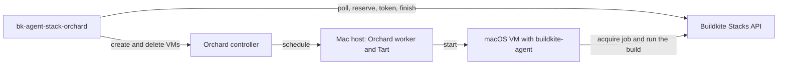

# bk-agent-stack-orchard

A Buildkite custom stack controller that runs each macOS job in its own ephemeral Tart virtual
machine on self-hosted Apple silicon, and deletes the machine when the job ends. It is the macOS
equivalent of [`agent-stack-k8s`](https://github.com/buildkite/agent-stack-k8s).

**Status: documents accepted on 2026-09-20, no code yet.** This repository holds the document set
that the implementation follows. Every requirement, decision, and plan below is accepted, so a
change to one of them needs the workflow in [CONTRIBUTING.md](CONTRIBUTING.md), and a change of
decision needs a new ADR that supersedes the old one.

## The problem

Buildkite does not start agents for a self-hosted queue, so the fleet must supply them. Each iOS
build needs a clean macOS environment, and Apple permits only two macOS virtual machines on one
host at a time. A permanent agent on each host gives neither isolation nor elasticity.

The controller watches the pending jobs of one macOS queue, starts a virtual machine for each job
that fits the free capacity, and gives that machine a credential for its own job only.



## How it works

1. The controller polls the Buildkite Stacks API for the scheduled jobs of one dedicated queue.
2. It matches the agent tags of each job to exactly one VM profile. A job that matches no profile
   fails immediately with a message.
3. It checks the free capacity of the fleet **before** it reserves a job, so a job that cannot
   start stays visible in the queue.
4. It reserves the job, issues a job acquisition token for that job alone, and asks Orchard for a
   new virtual machine.
5. The machine starts `buildkite-agent` with `--acquire-job`. The agent runs the build.
6. When the job reaches a terminal state, the controller deletes the machine. A decision table
   handles every other outcome: timeouts, cancellation, lost hosts, and a controller restart.

The controller keeps no durable state. After a restart it rebuilds its view from Orchard and from
Buildkite.

## Documents

| Document | Contents |
|---|---|
| [Product requirements](docs/product/requirements.md) | The problem, the actors, the journeys, and requirements PR-001 to PR-033 |
| [System design baseline](docs/architecture/system-design-baseline.md) | Quality scenarios, the assumed demand model, the quality targets, the cost comparison, and the driver register |
| [Target design](docs/architecture/target-design.md) | Components, job lifecycle, failure handling, configuration, security, observability, deployment, and conventions |
| [C4 model](docs/architecture/c4.md) | Levels 1 to 3, generated from [`workspace.dsl`](docs/architecture/workspace.dsl) |
| [Decision records](docs/adrs/README.md) | ADR-0001 to ADR-0011 |
| [Test strategy](docs/quality/test-strategy.md) | The risk map, the invariants, and the test obligations with their gates |
| [Implementation plan](docs/delivery/implementation-plan.md) | Work units W-01 to W-27, their order, and the evidence that ends each one |
| [Development guide](docs/development.md) | The gates, the integration tests, and their self-hosted runner |
| [Runbook: replace the agent token](docs/runbooks/token-replacement.md) | The token replacement of the target design, section 9.2, with its checks and its rollback |

## Decisions

| ADR | Decision |
|---|---|
| [0001](docs/adrs/0001-provision-macos-job-vms-with-a-custom-stack-controller.md) | Provision macOS job VMs with a custom Buildkite stack controller |
| [0002](docs/adrs/0002-check-capacity-before-reserving-jobs.md) | Check free capacity before the controller reserves a job |
| [0003](docs/adrs/0003-start-job-vms-on-demand.md) | Start job VMs on demand, without a pool of idle VMs |
| [0004](docs/adrs/0004-treat-all-builds-as-untrusted.md) | Treat all builds as untrusted and isolate each job VM |
| [0005](docs/adrs/0005-run-and-schedule-vms-with-tart-and-orchard.md) | Run and schedule the job VMs with Tart and Orchard |
| [0006](docs/adrs/0006-route-jobs-to-vm-profiles-by-agent-tags.md) | Route jobs to VM profiles by their agent tags |
| [0007](docs/adrs/0007-use-a-dedicated-queue-for-the-macos-fleet.md) | Use a dedicated queue for the macOS fleet |
| [0008](docs/adrs/0008-use-a-dedicated-cluster-agent-token.md) | Use a dedicated cluster agent token with an expiry and an IP allowlist |
| [0009](docs/adrs/0009-run-startup-scripts-over-the-tart-guest-agent.md) | Run VM startup scripts over the Tart guest agent |

## Delivery

The implementation follows four increments. Each one ends with evidence, not with code that
compiles.

1. **Walking skeleton** — one job from `scheduled` to a deleted VM, against a synthetic Orchard
   and Buildkite's fake Stacks server.
2. **Full lifecycle** — the complete decision table, admission rules, and restart recovery.
3. **Operability** — readiness, telemetry, outage behaviour, and token replacement.
4. **Fleet readiness** — real Tart virtual machines on Mac hardware, and the pilot.

## Stack

| Item | Version | Note |
|---|---|---|
| Go | 1.27 | Module `github.com/joshwrightcodes/bk-agent-stack-orchard` |
| [Orchard](https://github.com/openai/orchard) | 0.57.0 or later | VM scheduling across the Mac hosts |
| [Tart](https://github.com/openai/tart) | 2.37.0 | macOS VMs on Apple Virtualization |
| `buildkite-agent` | v4 | In the VM image |
| Pilot image | macOS 27, Xcode 27 | Built from `macos-golden-gate-base` |
| Telemetry | OpenTelemetry (OTLP only) | No Prometheus endpoint |
| Licence | AGPL-3.0-or-later | The controller holds no third-party code with a use restriction |
| Tools and tasks | `mise` | Pins Go, golangci-lint, GoReleaser, Packer, and Ansible |

## Development

```sh
mise install           # install the pinned tool versions, Orchard included
mise run check         # the gates: documents, commits, dependencies, lint, tests, and an image
mise run integration   # the integration tests against Orchard in synthetic mode
```

A development machine needs Docker for the Structurizr validation. The integration tests need macOS
on arm64, because Orchard places a macOS VM only on a worker with the runtime Tart.

In CI the integration tests run on a self-hosted runner in a Tart macOS VM while the repository is
private, and [`scripts/journey-runner.sh`](scripts/journey-runner.sh) starts, stops, and removes
it. The [development guide](docs/development.md) gives every step, and the step that is necessary
before the repository is public.

## Scope

This project does not build the VM images, scale the host pool, keep warm pools of started VMs,
run more than one queue in one process, or give high availability. The
[target design](docs/architecture/target-design.md) records these non-goals and the roadmap.

## Contributing and security

This is a personal project of Josh Wright, with one maintainer.

* [CONTRIBUTING.md](CONTRIBUTING.md) — the document-first workflow, the writing conventions, and
  the rules for code and commits.
* [SECURITY.md](SECURITY.md) — how to report a vulnerability, the properties that the project
  protects, and the risks that it accepts. Every build is untrusted by decision.
* [CODE_OF_CONDUCT.md](CODE_OF_CONDUCT.md) — the Contributor Covenant.

## Licence

[GNU Affero General Public License v3.0 or later](LICENSE).

Use it, run it, and change it. If you distribute it, or if you offer a modified version to other
people over a network, you must publish your source under the same licence. Internal use inside
your own company needs no disclosure.

The binary contains no code with a field-of-use restriction. The controller calls the Orchard
REST API with its own client, rather than importing the Orchard Go package, because Orchard
carries the FSL-1.1-ALv2 licence and the AGPL forbids a further restriction on a distributed work
([ADR-0010](docs/adrs/0010-call-the-orchard-api-with-a-client-of-this-project.md)). The fleet
still runs Orchard and Tart as separate programs under their own licence.
[NOTICE](NOTICE) records the third-party licences.
