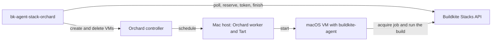

# bk-agent-stack-orchard

[](https://github.com/joshwrightcodes/bk-agent-stack-orchard/actions/workflows/ci.yml)
[](https://github.com/joshwrightcodes/bk-agent-stack-orchard/actions/workflows/github-code-scanning/codeql)
[](https://scorecard.dev/viewer/?uri=github.com/joshwrightcodes/bk-agent-stack-orchard)
[](https://github.com/joshwrightcodes/bk-agent-stack-orchard/releases)
[](go.mod)
[](LICENSE)

A Buildkite custom stack controller for macOS. The controller runs each job in its own temporary
Tart virtual machine on self-hosted Apple silicon, and deletes the machine when the job ends. It
is the macOS equivalent of [`agent-stack-k8s`](https://github.com/buildkite/agent-stack-k8s).

The project is a program that an operator deploys. It is not a Go library. All Go packages are in
`internal/`, and their API can change at any time.

## Status

**Pre-release.** The 0.x releases are marked as pre-releases on GitHub until version 1.0.0, and the
[version rules](#versioning) apply to them. The first release, version 0.1.0, waits for the release
gate in the [test strategy](docs/quality/test-strategy.md). The
[GitHub Releases page](https://github.com/joshwrightcodes/bk-agent-stack-orchard/releases) lists
each release that exists. [`CHANGELOG.md`](https://github.com/joshwrightcodes/bk-agent-stack-orchard/blob/main/CHANGELOG.md)
lists the changes of each release. The file appears with the first release, so the link works only
after that.

The implementation follows four increments. Each increment ends with evidence in CI, not with code
that compiles.

| Increment | Contents | State |
|---|---|---|
| 1. Walking skeleton | One job from `scheduled` to a deleted VM, against Orchard in synthetic mode and the fake Stacks API server of Buildkite | Done |
| 2. Full lifecycle | The complete decision table, the admission rules, and recovery after a restart | Done |
| 3. Operability | Readiness, telemetry, behaviour during an outage, and token replacement | Done, except the token replacement on a live cluster (W-18) |
| 4. Fleet readiness | Real Tart virtual machines on Mac hardware, and the pilot | In progress |

Do not use the controller for production work before increment 4 is complete.

## Known limitations

Each release pull request links to this section. As of 2026-11-01, from the
[test strategy](docs/quality/test-strategy.md) and the status above:

* The release gate is open. Tests T-100 to T-105 MUST pass on real hardware before version 0.1.0.
  They cover a real job on a Tart VM, the network limits, a failed image, a restart, the
  replacement of the token, and the storage of artifacts.
* Increment 4 is in progress, and the pilot has not run. The token replacement has not run on a
  live cluster (W-18).
* Every 0.x release is a pre-release. A minor version can contain a breaking change
  ([Versioning](#versioning)).

## The problem

Buildkite does not start agents for a self-hosted queue, so the fleet must supply them. Each iOS
build needs a clean macOS environment. Apple permits a maximum of two macOS virtual machines on
one host at a time. A permanent agent on each host gives no isolation and no elasticity.

The controller monitors the jobs that wait in one macOS queue. It starts a virtual machine for each
job that fits the free capacity, and it gives that machine a credential for its own job only.



## How it works

1. The controller polls the Buildkite Stacks API for the scheduled jobs of one dedicated queue.
2. It matches the agent tags of each job to exactly one VM profile. If a job matches no profile,
   the job fails immediately with a message.
3. It checks the free capacity of the fleet **before** it reserves a job. A job that cannot start
   stays visible in the queue.
4. It reserves the job, issues a job acquisition token for that job only, and asks Orchard for a
   new virtual machine.
5. The machine starts `buildkite-agent` with `--acquire-job`. The agent runs the build.
6. When the job gets to a terminal state, the controller deletes the machine. A decision table
   controls all other results: timeouts, cancellation, lost hosts, and a controller restart.

The controller keeps no durable state. After a restart, it gets its view again from Orchard and
from Buildkite.

## What you need

To operate the controller, you need these items:

* A Buildkite cluster with a dedicated self-hosted queue for the macOS fleet, and a cluster agent
  token for that queue (ADR-0007, ADR-0008).
* Apple silicon Mac hosts that run Orchard workers and Tart. `deploy/hosts` sets up a host with
  Ansible.
* An Orchard controller, version 0.58.0 or later. `deploy/orchard` gives a reference deployment.
* A Tart image for each VM profile, with `buildkite-agent` v4 and the Tart guest agent. `images/`
  builds the images.
* A Kubernetes cluster for the reference deployment of the controller. `deploy/helm` holds the
  chart. The controller is one binary, so other platforms are also possible.
* An OpenTelemetry collector that receives OTLP. The controller has no Prometheus endpoint.

The [target design](docs/architecture/target-design.md) gives the configuration (section 8), the
security model (section 9), and the deployment (section 11).

## Install

### Quick start with a published release

This section applies only after the project has published a release. The
[Releases page](https://github.com/joshwrightcodes/bk-agent-stack-orchard/releases) shows whether a
release exists. Each release has a signed Helm chart in an OCI registry.

1. [Verify the release](#verify-a-release) with `scripts/verify-release.sh`.
2. Make a namespace and a Secret. The keys of the Secret are environment variables of the
   controller. The chart creates no Secret, so that no secret goes through the values of a release.
   Read each value from your secret manager. Do not write it to a file in a repository.

   ```sh
   kubectl create namespace bk-agent-stack-orchard
   kubectl --namespace bk-agent-stack-orchard create secret generic bk-agent-stack-orchard \
     --from-literal=BK_AGENT_STACK_ORCHARD_BUILDKITE_AGENT_TOKEN="$BUILDKITE_AGENT_TOKEN" \
     --from-literal=BK_AGENT_STACK_ORCHARD_ORCHARD_TOKEN="$ORCHARD_TOKEN"
   ```

   Add `BK_AGENT_STACK_ORCHARD_ORCHARD_CA_CERT` if Orchard uses a private certificate authority.
   The [target design](docs/architecture/target-design.md) (section 8) lists all keys.
3. Write a values file. `config.controllerID`, `config.buildkite.queue`, `config.orchard.url`, and
   `secret.name` are required. Add at least one entry to `config.profiles`. The chart documents
   all values in `values.yaml`, and `values.schema.json` rejects a wrong value.
4. Install the chart. Use an exact version, and replace `<version>` with it:

   ```sh
   helm install bk-agent-stack-orchard \
     oci://ghcr.io/joshwrightcodes/charts/bk-agent-stack-orchard --version <version> \
     --namespace bk-agent-stack-orchard --values values.yaml
   ```

[`deploy/orchard`](deploy/orchard/README.md) is a kustomize base for the Orchard controller. An
overlay of the operator sets the namespace, the image, and the endpoint of the collector.
[`deploy/hosts`](deploy/hosts) sets up the Mac hosts, and [`images/`](images/README.md) builds the
VM images.

### Build from source

To build the binary and the container image from source:

```sh
mise install       # install the pinned tool versions
mise run build     # build the binary
mise run snapshot  # build the release archives and the image, without publishing them
```

The image is `goreleaser.ko.local` in the local Docker daemon. Push it to your registry, and set
`image.repository` and `image.digest` in the values of the chart.

## Verify a release

The release workflow publishes each release. Each release has a keyless
[cosign](https://docs.sigstore.dev/cosign/) signature from the release
workflow of this repository
([ADR-0013](docs/adrs/0013-sign-releases-with-keyless-cosign-signatures.md)):

| Artifact | Where | Signature | SBOM |
|---|---|---|---|
| Archives | The GitHub release | `checksums.txt.sigstore.json` signs `checksums.txt`, which names each archive | `<archive>.sbom.json` (SPDX), in `checksums.txt` |
| Image | `ghcr.io/joshwrightcodes/bk-agent-stack-orchard`, tags `v<version>` and `<version>` | On the index and on each platform image | An attestation of type `spdxjson` on each platform image |
| Chart | `oci://ghcr.io/joshwrightcodes/charts/bk-agent-stack-orchard`, and the GitHub release | On the chart in the registry, and `<chart>.tgz.sigstore.json` on the release | None. The chart refers to the image by its digest |

To verify all artifacts of a release, put the downloaded files in one directory, and run this
command:

```sh
scripts/verify-release.sh v0.1.0 ./downloads
```

The script needs cosign, docker with buildx, and jq. To verify one artifact, require the identity
of the release workflow at the tag:

```sh
cosign verify \
  --certificate-identity "https://github.com/joshwrightcodes/bk-agent-stack-orchard/.github/workflows/release.yml@refs/tags/v0.1.0" \
  --certificate-oidc-issuer "https://token.actions.githubusercontent.com" \
  ghcr.io/joshwrightcodes/bk-agent-stack-orchard:v0.1.0
```

## Versioning

The project uses [Semantic Versioning 2.0.0](https://semver.org/spec/v2.0.0.html). A release tag
has the form `vMAJOR.MINOR.PATCH`, for example `v0.3.1`.

The major version is 0, and it stays 0 until the maintainer decides that the project is stable.
While the major version is 0:

* A minor version can contain a breaking change. The release notes identify each breaking change.
* A patch version contains only fixes, and it contains no breaking change.
* Pin an exact version or an image digest. Do not use a version range.

The binary, the container image, and the Helm chart have the same version.
[CONTRIBUTING.md](CONTRIBUTING.md#versioning-and-releases) gives the rules that select the next
version.

## Documents

| Document | Contents |
|---|---|
| [Documents guide](docs/README.md) | The reading order for the first day, the document map, and the access checklist |
| [Glossary](docs/glossary.md) | The terms and the identifier families of the documents |
| [Product requirements](docs/product/requirements.md) | The problem, the actors, the journeys, and 23 requirements: PR-001 to PR-012, PR-020 to PR-026, and PR-030 to PR-033 |
| [System design baseline](docs/architecture/system-design-baseline.md) | Quality scenarios, the assumed demand model, the quality targets, the cost comparison, and the driver register |
| [Target design](docs/architecture/target-design.md) | Components, job lifecycle, failure handling, configuration, security, observability, deployment, and conventions |
| [C4 model](docs/architecture/c4.md) | Levels 1 to 3, generated from [`workspace.dsl`](docs/architecture/workspace.dsl) |
| [Decision records](docs/adrs/README.md) | ADR-0001 to ADR-0015 |
| [Test strategy](docs/quality/test-strategy.md) | The risk map, the invariants, and the test obligations with their gates |
| [Implementation plan](docs/delivery/implementation-plan.md) | Work units W-01 to W-27, their order, and the evidence that ends each work unit |
| [Development guide](docs/development.md) | The gates, the integration tests, and the real-VM tests |
| [Runbook: replace the agent token](docs/runbooks/token-replacement.md) | The token replacement of the target design, section 9.2, with its checks and its rollback |

## Decisions

| ADR | Decision |
|---|---|
| [0001](docs/adrs/0001-provision-macos-job-vms-with-a-custom-stack-controller.md) | Provision macOS job VMs with a custom Buildkite stack controller |
| [0002](docs/adrs/0002-check-capacity-before-reserving-jobs.md) | Check free capacity before the controller reserves a job |
| [0003](docs/adrs/0003-start-job-vms-on-demand.md) | Start job VMs on demand, without a pool of idle VMs |
| [0004](docs/adrs/0004-treat-all-builds-as-untrusted.md) | Treat all builds as untrusted and isolate each job VM |
| [0005](docs/adrs/0005-run-and-schedule-vms-with-tart-and-orchard.md) | Run and schedule the job VMs with Tart and Orchard |
| [0006](docs/adrs/0006-route-jobs-to-vm-profiles-by-agent-tags.md) | Route jobs to VM profiles by their agent tags |
| [0007](docs/adrs/0007-use-a-dedicated-queue-for-the-macos-fleet.md) | Use a dedicated queue for the macOS fleet |
| [0008](docs/adrs/0008-use-a-dedicated-cluster-agent-token.md) | Use a dedicated cluster agent token with an expiry and an IP allowlist |
| [0009](docs/adrs/0009-run-startup-scripts-over-the-tart-guest-agent.md) | Run VM startup scripts over the Tart guest agent |
| [0010](docs/adrs/0010-call-the-orchard-api-with-a-client-of-this-project.md) | Call the Orchard API with a client of this project |
| [0011](docs/adrs/0011-generate-the-orchard-wire-types.md) | Generate the Orchard wire types (superseded by ADR-0015) |
| [0012](docs/adrs/0012-build-the-job-vm-images-from-a-vanilla-macos-image.md) | Build the job VM images from a vanilla macOS image |
| [0013](docs/adrs/0013-sign-releases-with-keyless-cosign-signatures.md) | Sign releases with keyless cosign signatures (proposed) |
| [0014](docs/adrs/0014-calculate-releases-with-release-please.md) | Calculate releases with release-please (proposed) |
| [0015](docs/adrs/0015-generate-only-the-orchard-fields-the-controller-uses.md) | Generate only the Orchard fields that the controller uses (proposed) |

## Stack

| Item | Version | Note |
|---|---|---|
| Go | 1.27 | Module `github.com/joshwrightcodes/bk-agent-stack-orchard` |
| [Orchard](https://github.com/openai/orchard) | 0.58.0 or later | Schedules the VMs on the Mac hosts |
| [Tart](https://github.com/openai/tart) | 2.41.1 | Runs macOS VMs on Apple Virtualization |
| `buildkite-agent` | v4 | In the VM image |
| Pilot image | macOS 27.2, Xcode 27 | Built from `macos-golden-gate-vanilla` (ADR-0012) |
| Telemetry | OpenTelemetry (OTLP only) | No Prometheus endpoint |
| Licence | AGPL-3.0-or-later | The controller imports no code with a use restriction (ADR-0015) |
| Tools and tasks | `mise` | Pins Go, golangci-lint, GoReleaser, and Ansible |

## Development

```sh
mise install           # install the pinned tool versions, Orchard included
mise run check         # the gates: documents, commits, dependencies, lint, tests, and an image
mise run integration   # the integration tests against Orchard in synthetic mode
```

A development machine needs Docker for the Structurizr validation. The integration tests need macOS
on arm64, because Orchard puts a macOS VM only on a worker that uses Tart. In CI, the integration
tests run on a hosted macOS runner. The [development guide](docs/development.md) gives each step.

## Scope

The controller does not scale the host pool. It does not keep warm pools of started VMs, run more
than one queue in one process, or give high availability. The
[target design](docs/architecture/target-design.md) records these non-goals (section 2) and the
roadmap (section 14).

## Contributing and security

This is a personal project with one maintainer, Josh Wright.

* Report a bug or request a change through an
  [issue form](https://github.com/joshwrightcodes/bk-agent-stack-orchard/issues/new/choose). The
  maintainer answers when time permits.
* [CONTRIBUTING.md](CONTRIBUTING.md) gives the document-first workflow, the conventions for
  documents, the rules for code and commits, and the rules for versions and releases.
* [SECURITY.md](SECURITY.md) tells you how to report a vulnerability. It also gives the properties
  that the project protects and the risks that it accepts. Every build is untrusted, by decision.
* [CODE_OF_CONDUCT.md](CODE_OF_CONDUCT.md) gives the Contributor Covenant.

## Licence

[GNU Affero General Public License v3.0 or later](LICENSE).

You can use, run, and change the controller. If you give a copy to other people, you must offer
them the source under the same licence. If you change the controller and other people use it
through a network, you must offer the source of your changed version to those users. The AGPL
requires an offer to those people. It does not require you to publish the source to everyone. Use
inside your own organisation, without access for other people, needs no offer.

This summary is not legal advice. The text of the licence controls.

The binary imports no code with a field-of-use restriction. Orchard has the FSL-1.1-ALv2 licence,
and the AGPL forbids a further restriction on a distributed work. Because of this, the controller
calls the Orchard REST API with its own client, and it does not import the Orchard Go package
([ADR-0010](docs/adrs/0010-call-the-orchard-api-with-a-client-of-this-project.md)).

The project does generate one file from Orchard source. `internal/orchard/types_gen.go` holds the
field names, the JSON tags, and the types of the Orchard fields that the controller uses, taken
from a pinned Orchard version so that the controller works with the Orchard API. The generator
writes only the fields on an allow list, and the file has a header that names the source, the
version, the commit, the licence, and the copyright notice of OpenAI
([ADR-0015](docs/adrs/0015-generate-only-the-orchard-fields-the-controller-uses.md)). The project
copies no other code that is under the FSL. This is the view of the project about copying for
interoperability. It is not legal advice, and a lawyer has not yet confirmed it.

The fleet runs Orchard and Tart as separate programs under their own licences.
[NOTICE](NOTICE) records the third-party licences.

## Notices for operators

These notices are not legal advice. Ask a lawyer about your own case.

### Australian Consumer Law

Nothing in this project excludes, restricts, or modifies a right that cannot be excluded under
the Australian Consumer Law.

### Trademarks

This project is not affiliated with, and not endorsed by, Buildkite, OpenAI, Cirrus Labs, or
Apple. The names and marks in this project belong to their owners.

### Apple licensing

The operator is responsible for compliance with the licences of Apple. This section paraphrases
two agreements. It is not a full statement of them.

**The macOS licence agreement** (section 2B(iii), section 2I, and section 3):

* Section 2B(iii) lets the licensee run up to two additional instances of macOS in virtual
  environments on each Apple-branded computer that the licensee owns or controls and that already
  runs macOS. The permitted purposes are software development, testing during software
  development, use of macOS Server, and personal non-commercial use.
* The operator MUST NOT run more than two virtual macOS instances on one Mac host at a time.
* The text after section 2B(iii) and section 2I forbid the use of virtualised macOS in connection
  with service bureau, time-sharing, terminal sharing, relay, or similar services. This bar applies
  inside the organisation of the operator, and it applies to third parties. An operator MUST
  assess whether a shared pool of build machines for other teams is such a service.
* Section 3 is the only exception. It lets a lessor lease macOS to a lessee, if all of these
  conditions are met: the lease is for continuous integration services (Permitted Developer
  Services), each lease period is at least 24 consecutive hours, the lessee has sole and exclusive
  use and control of the software and the hardware during the lease, and the lessee agrees to the
  licence. The lessor MUST give Apple advance notice. A job VM that lives for one build is much
  shorter than 24 hours.

**The Xcode and Apple SDKs Agreement** (section 2.2 and section 2.7): the licence is for internal
use by the licensee and its authorised developers. The agreement does not let the licensee upload
the software to, or host it on, a website or a server, or redistribute it. Because of this, images
that contain Xcode MUST stay in a private registry that only the organisation of the operator can
use. The operator carries the risk of this reading. The operator SHOULD ask a lawyer.

When it runs, `images/build.sh` accepts the Xcode and SDK licences on behalf of the operator.

Sources, read on 2026-11-01:

* macOS licence agreement: <https://www.apple.com/legal/sla/docs/macOSGoldenGate.pdf>
* Xcode and Apple SDKs Agreement: <https://www.apple.com/legal/sla/docs/xcode.pdf> (edition
  EA2002, dated 06/08/2026 in the document)

### Privacy

Job logs and build metadata can carry personal information, such as the names of committers. They
go to Buildkite. Buildkite stores job logs in Amazon Web Services, and its documentation states no
region (2026-09-14, owner answer Q-A7 in the
[requirements](docs/product/requirements.md) and the
[system design baseline](docs/architecture/system-design-baseline.md)). The operator therefore
cannot assume that the data stays in Australia. An operator that is an APP entity under the Privacy
Act 1988 SHOULD consider Australian Privacy Principle 8 (APP 8) before it sends such data.

### Licences of Tart and Orchard

Tart and Orchard use the FSL-1.1-ALv2 licence. The licence text is in the LICENSE file of the
Tart repository, read on 2026-11-01 through the GitHub API (`openai/tart`). Its Permitted Purpose
is any purpose other than a Competing Use. Internal use and access is a Permitted Purpose. A
Competing Use is to make the software available to others in a commercial product or service
that substitutes for the software, substitutes for another product or service of the licensor that
uses the software, or offers the same or substantially similar functionality. An operator that
offers a commercial macOS build service to others MUST check this definition first. The licence
text controls. The Orchard licence was not checked separately on 2026-11-01.
