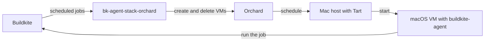

# bk-agent-stack-orchard

[](https://github.com/joshwrightcodes/bk-agent-stack-orchard/actions/workflows/ci.yml)
[](https://scorecard.dev/viewer/?uri=github.com/joshwrightcodes/bk-agent-stack-orchard)
[](https://www.bestpractices.dev/projects/16316)
[](https://github.com/joshwrightcodes/bk-agent-stack-orchard/releases)
[](LICENSE)

Run each Buildkite job in its own clean macOS virtual machine, on your own Apple silicon Macs.

bk-agent-stack-orchard is a Buildkite stack controller. It watches a macOS queue, starts a
[Tart](https://tart.run) virtual machine (VM) through [Orchard](https://github.com/openai/orchard)
for each job, and deletes the VM when the job ends. It does for macOS what
[agent-stack-k8s](https://github.com/buildkite/agent-stack-k8s) does for Kubernetes.

## Why use it

* **A clean machine for each job.** No state goes from one build to the next.
* **No idle agents.** A VM exists only while a job needs it.
* **Capacity first.** The controller reserves a job only when a Mac can start its VM. A job that
  cannot start stays in the queue, where another runner can take it.
* **Short-lived credentials.** Each VM gets a token for its own job. The cluster agent token
  stays with the controller.
* **Profiles by agent tags.** Send `xcode=27` jobs to one image and `xcode=26` jobs to another.

## Quick start

See a real job run in a new Tart VM on your Mac. You need an Apple silicon Mac with
[Tart](https://tart.run) and [mise](https://mise.jdx.dev), and a Buildkite cluster with a
self-hosted queue and a cluster agent token.

```sh
git clone https://github.com/joshwrightcodes/bk-agent-stack-orchard
cd bk-agent-stack-orchard
mise install
export BUILDKITE_AGENT_TOKEN=...   # your cluster agent token
mise run quickstart -- --queue macos-quickstart
```

The command downloads and verifies the newest release of the controller, starts it with a local
Orchard, and prints a pipeline step. Run the step in
Buildkite: the job runs in a new VM, and the VM is deleted when the job ends. Press Ctrl-C to stop.
The first run downloads a macOS image of about 40 GB. That upstream image is for evaluation only:
it does not meet the production image rules of the design. The
[quick start](docs/user/quickstart.md) gives each step, the Buildkite setup included.

## How it works



1. The controller polls Buildkite for the scheduled jobs of one queue.
2. It matches the agent tags of each job to a profile. A profile sets the image and the size of
   the VM.
3. It checks the free capacity of your Macs, then reserves the job and gets a token for that job
   only.
4. Orchard starts the VM on a Mac. `buildkite-agent` in the VM takes the job and runs it.
5. When the job ends, the controller deletes the VM.

The controller keeps no state of its own. After a restart, it reads the current state from
Orchard and Buildkite.

[How it works](docs/user/how-it-works.md) explains the life of a job, profiles, capacity, and what
happens when a VM does not start.

## Install

You bring your own Buildkite cluster, Orchard, Mac hosts with Tart, and VM images. The controller
is one binary. You can run it on Kubernetes with the signed Helm chart, on a Mac, or on another
platform.

[Install the controller](docs/user/install.md) lists what you need, and gives the steps to
install, verify, and upgrade a release.

The repository also has examples that you can adapt:

* [`deploy/orchard`](deploy/orchard/README.md): an Orchard controller on Kubernetes.
* [`deploy/hosts`](deploy/hosts/README.md): an Ansible playbook for the Mac hosts.
* [`images/`](images/README.md): a reference build of the job VM images.

## Limitations

* One controller serves one queue, and runs as one replica. For more queues, run more
  controllers. Controllers that share one Orchard need separate pools of workers: the
  `workerLabels` of one controller must select no worker of another, or both count the same free
  slots.
* The controller does not add or remove Mac hosts. You size the host pool.
* There is no pool of warm VMs. Each job waits for its VM to boot, typically 30 to 60 seconds.
* The hosts must be Apple silicon Macs. Apple permits at most two macOS VMs on one Mac at a time.
* The project publishes no job VM image. Build your own image for production. An image for the
  default `tart-guest-agent` transport must run the Tart guest agent. An image for
  `startupTransport: ssh` must accept an SSH login with the `vmCredentials` of the profile
  instead. Each VM downloads `buildkite-agent` when it starts, unless you choose the agent of the
  image.
* If the tags of a job match no profile, the controller leaves the job for another runner, and
  adds a note to the job page.
* Telemetry is OpenTelemetry (OTLP) only. There is no Prometheus endpoint.
* Until version 1.0, a minor release can contain a breaking change. Pin an exact version.

## Documentation

| Run it | Work on it |
|---|---|
| [Quick start](docs/user/quickstart.md) | [Contributing](CONTRIBUTING.md) |
| [How it works](docs/user/how-it-works.md) | [Development guide](docs/development.md) |
| [Install the controller](docs/user/install.md) | [Testing on real VMs](docs/testing-on-real-vms.md) |
| [Configuration reference](docs/user/configuration.md) | [Releasing](docs/releasing.md) |
| [Telemetry](docs/user/telemetry.md) | [Writing guide](docs/writing-guide.md) |
| [Troubleshooting](docs/user/troubleshooting.md) | [Target design](docs/architecture/target-design.md) |
| [Replace the agent token](docs/user/runbooks/token-replacement.md) | [Decision records](docs/adrs/README.md) |
| [Third-party terms](docs/user/third-party-terms.md) | [All design documents](docs/README.md) |

## Community

* Ask a question or report a bug with an
  [issue form](https://github.com/joshwrightcodes/bk-agent-stack-orchard/issues/new/choose).
  [SUPPORT.md](SUPPORT.md) tells you where to ask for help.
* Report a vulnerability privately, as [SECURITY.md](SECURITY.md) says.
* Read [CONTRIBUTING.md](CONTRIBUTING.md) before you open a pull request. The project follows the
  [Contributor Covenant](CODE_OF_CONDUCT.md).

The maintainers work on the project in their own time. There is no promise of a response time.

## Licence

[GNU Affero General Public License v3.0 or later](LICENSE). [NOTICE](NOTICE) lists the licences
of the third-party code in the controller.

macOS, Xcode, Tart, and Orchard have licence terms of their own. Read
[third-party terms](docs/user/third-party-terms.md) before you run a fleet.

This project is not affiliated with, or endorsed by, Buildkite, OpenAI, Cirrus Labs, or Apple.
Their names and marks belong to their owners.
