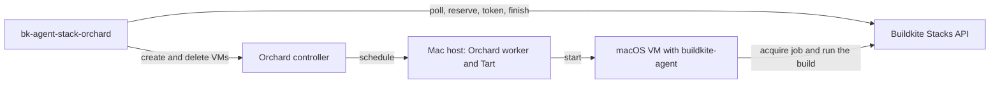

# bk-agent-stack-orchard

[](https://github.com/joshwrightcodes/bk-agent-stack-orchard/actions/workflows/ci.yml)
[](LICENSE)

A Buildkite custom stack controller for macOS. The controller runs each job in its own temporary
Tart virtual machine on self-hosted Apple silicon, and deletes the machine when the job ends. It
is the macOS equivalent of [`agent-stack-k8s`](https://github.com/buildkite/agent-stack-k8s).

The project is a program that an operator deploys. It is not a Go library. All Go packages are in
`internal/`, and their API can change at any time.

## Status

**Pre-release.** The project has no release yet. The first release will be version 0.1.0, and
the [version rules](#versioning) apply to it.

The implementation follows four increments. Each increment ends with evidence in CI, not with code
that compiles.

| Increment | Contents | State |
|---|---|---|
| 1. Walking skeleton | One job from `scheduled` to a deleted VM, against Orchard in synthetic mode and the fake Stacks API server of Buildkite | Done |
| 2. Full lifecycle | The complete decision table, the admission rules, and recovery after a restart | Done |
| 3. Operability | Readiness, telemetry, behaviour during an outage, and token replacement | Done, except the token replacement on a live cluster (W-18) |
| 4. Fleet readiness | Real Tart virtual machines on Mac hardware, and the pilot | In progress |

Do not use the controller for production work before increment 4 is complete.

## The problem

Buildkite does not start agents for a self-hosted queue, so the fleet must supply them. Each iOS
build needs a clean macOS environment. Apple permits a maximum of two macOS virtual machines on
one host at a time. A permanent agent on each host gives no isolation and no elasticity.

The controller monitors the jobs that wait in one macOS queue. It starts a virtual machine for each
job that fits the free capacity, and it gives that machine a credential for its own job only.



## How it works

1. The controller polls the Buildkite Stacks API for the scheduled jobs of one dedicated queue.
2. It matches the agent tags of each job to exactly one VM profile. If a job matches no profile,
   the job fails immediately with a message.
3. It checks the free capacity of the fleet **before** it reserves a job. A job that cannot start
   stays visible in the queue.
4. It reserves the job, issues a job acquisition token for that job only, and asks Orchard for a
   new virtual machine.
5. The machine starts `buildkite-agent` with `--acquire-job`. The agent runs the build.
6. When the job gets to a terminal state, the controller deletes the machine. A decision table
   controls all other results: timeouts, cancellation, lost hosts, and a controller restart.

The controller keeps no durable state. After a restart, it gets its view again from Orchard and
from Buildkite.

## What you need

To operate the controller, you need these items:

* A Buildkite cluster with a dedicated self-hosted queue for the macOS fleet, and a cluster agent
  token for that queue (ADR-0007, ADR-0008).
* Apple silicon Mac hosts that run Orchard workers and Tart. `deploy/hosts` sets up a host with
  Ansible.
* An Orchard controller, version 0.57.0 or later. `deploy/orchard` gives a reference deployment.
* A Tart image for each VM profile, with `buildkite-agent` v4 and the Tart guest agent. `images/`
  builds the images.
* A Kubernetes cluster for the reference deployment of the controller. `deploy/helm` holds the
  chart. The controller is one binary, so other platforms are also possible.
* An OpenTelemetry collector that receives OTLP. The controller has no Prometheus endpoint.

The [target design](docs/architecture/target-design.md) gives the configuration (section 8), the
security model (section 9), and the deployment (section 11).

## Install

The project publishes no release yet. To build the binary and the container image from source:

```sh
mise install       # install the pinned tool versions
mise run build     # build the binary
mise run snapshot  # build the release archives and the image, without publishing them
```

The image is `goreleaser.ko.local` in the local Docker daemon. Push it to your registry, and set
`image.repository` and `image.digest` in the values of the chart.

After the first release, use the published artifacts, and [verify](#verify-a-release) them before
you deploy them.

## Verify a release

Each release has a keyless [cosign](https://docs.sigstore.dev/cosign/) signature from the release
workflow of this repository
([ADR-0013](docs/adrs/0013-sign-releases-with-keyless-cosign-signatures.md)):

| Artifact | Where | Signature | SBOM |
|---|---|---|---|
| Archives | The GitHub release | `checksums.txt.sigstore.json` signs `checksums.txt`, which names each archive | `<archive>.sbom.json` (SPDX), in `checksums.txt` |
| Image | `ghcr.io/joshwrightcodes/bk-agent-stack-orchard` | On the index and on each platform image | An attestation of type `spdxjson` on each platform image |
| Chart | `oci://ghcr.io/joshwrightcodes/charts/bk-agent-stack-orchard` | On the chart | None |

To verify all artifacts of a release, put the downloaded files in one directory, and run this
command:

```sh
scripts/verify-release.sh v0.1.0 ./downloads
```

The script needs cosign, docker with buildx, and jq. To verify one artifact, require the identity
of the release workflow at the tag:

```sh
cosign verify \
  --certificate-identity "https://github.com/joshwrightcodes/bk-agent-stack-orchard/.github/workflows/release.yml@refs/tags/v0.1.0" \
  --certificate-oidc-issuer "https://token.actions.githubusercontent.com" \
  ghcr.io/joshwrightcodes/bk-agent-stack-orchard:v0.1.0
```

## Versioning

The project uses [Semantic Versioning 2.0.0](https://semver.org/spec/v2.0.0.html). A release tag
has the form `vMAJOR.MINOR.PATCH`, for example `v0.3.1`.

The major version is 0, and it stays 0 until the maintainer decides that the project is stable.
While the major version is 0:

* A minor version can contain a breaking change. The release notes identify each breaking change.
* A patch version contains only fixes, and it contains no breaking change.
* Pin an exact version or an image digest. Do not use a version range.

The binary, the container image, and the Helm chart have the same version.
[CONTRIBUTING.md](CONTRIBUTING.md#versioning-and-releases) gives the rules that select the next
version.

## Documents

| Document | Contents |
|---|---|
| [Product requirements](docs/product/requirements.md) | The problem, the actors, the journeys, and requirements PR-001 to PR-033 |
| [System design baseline](docs/architecture/system-design-baseline.md) | Quality scenarios, the assumed demand model, the quality targets, the cost comparison, and the driver register |
| [Target design](docs/architecture/target-design.md) | Components, job lifecycle, failure handling, configuration, security, observability, deployment, and conventions |
| [C4 model](docs/architecture/c4.md) | Levels 1 to 3, generated from [`workspace.dsl`](docs/architecture/workspace.dsl) |
| [Decision records](docs/adrs/README.md) | ADR-0001 to ADR-0014 |
| [Test strategy](docs/quality/test-strategy.md) | The risk map, the invariants, and the test obligations with their gates |
| [Implementation plan](docs/delivery/implementation-plan.md) | Work units W-01 to W-27, their order, and the evidence that ends each work unit |
| [Development guide](docs/development.md) | The gates, the integration tests, and the real-VM tests |
| [Runbook: replace the agent token](docs/runbooks/token-replacement.md) | The token replacement of the target design, section 9.2, with its checks and its rollback |

## Decisions

| ADR | Decision |
|---|---|
| [0001](docs/adrs/0001-provision-macos-job-vms-with-a-custom-stack-controller.md) | Provision macOS job VMs with a custom Buildkite stack controller |
| [0002](docs/adrs/0002-check-capacity-before-reserving-jobs.md) | Check free capacity before the controller reserves a job |
| [0003](docs/adrs/0003-start-job-vms-on-demand.md) | Start job VMs on demand, without a pool of idle VMs |
| [0004](docs/adrs/0004-treat-all-builds-as-untrusted.md) | Treat all builds as untrusted and isolate each job VM |
| [0005](docs/adrs/0005-run-and-schedule-vms-with-tart-and-orchard.md) | Run and schedule the job VMs with Tart and Orchard |
| [0006](docs/adrs/0006-route-jobs-to-vm-profiles-by-agent-tags.md) | Route jobs to VM profiles by their agent tags |
| [0007](docs/adrs/0007-use-a-dedicated-queue-for-the-macos-fleet.md) | Use a dedicated queue for the macOS fleet |
| [0008](docs/adrs/0008-use-a-dedicated-cluster-agent-token.md) | Use a dedicated cluster agent token with an expiry and an IP allowlist |
| [0009](docs/adrs/0009-run-startup-scripts-over-the-tart-guest-agent.md) | Run VM startup scripts over the Tart guest agent |
| [0010](docs/adrs/0010-call-the-orchard-api-with-a-client-of-this-project.md) | Call the Orchard API with a client of this project |
| [0011](docs/adrs/0011-generate-the-orchard-wire-types.md) | Generate the Orchard wire types |
| [0012](docs/adrs/0012-build-the-job-vm-images-from-a-vanilla-macos-image.md) | Build the job VM images from a vanilla macOS image |
| [0013](docs/adrs/0013-sign-releases-with-keyless-cosign-signatures.md) | Sign releases with keyless cosign signatures (proposed) |
| [0014](docs/adrs/0014-calculate-releases-with-release-please.md) | Calculate releases with release-please (proposed) |

## Stack

| Item | Version | Note |
|---|---|---|
| Go | 1.27 | Module `github.com/joshwrightcodes/bk-agent-stack-orchard` |
| [Orchard](https://github.com/openai/orchard) | 0.57.0 or later | Schedules the VMs on the Mac hosts |
| [Tart](https://github.com/openai/tart) | 2.40.1 | Runs macOS VMs on Apple Virtualization |
| `buildkite-agent` | v4 | In the VM image |
| Pilot image | macOS 27, Xcode 27 | Built from `macos-golden-gate-vanilla` (ADR-0012) |
| Telemetry | OpenTelemetry (OTLP only) | No Prometheus endpoint |
| Licence | AGPL-3.0-or-later | The controller holds no third-party code with a use restriction |
| Tools and tasks | `mise` | Pins Go, golangci-lint, GoReleaser, Packer, and Ansible |

## Development

```sh
mise install           # install the pinned tool versions, Orchard included
mise run check         # the gates: documents, commits, dependencies, lint, tests, and an image
mise run integration   # the integration tests against Orchard in synthetic mode
```

A development machine needs Docker for the Structurizr validation. The integration tests need macOS
on arm64, because Orchard puts a macOS VM only on a worker that uses Tart. In CI, the integration
tests run on a hosted macOS runner. The [development guide](docs/development.md) gives each step.

## Scope

The controller does not scale the host pool. It does not keep warm pools of started VMs, run more
than one queue in one process, or give high availability. The
[target design](docs/architecture/target-design.md) records these non-goals (section 2) and the
roadmap (section 14).

## Contributing and security

This is a personal project with one maintainer, Josh Wright.

* [CONTRIBUTING.md](CONTRIBUTING.md) gives the document-first workflow, the conventions for
  documents, the rules for code and commits, and the rules for versions and releases.
* [SECURITY.md](SECURITY.md) tells you how to report a vulnerability. It also gives the properties
  that the project protects and the risks that it accepts. Every build is untrusted, by decision.
* [CODE_OF_CONDUCT.md](CODE_OF_CONDUCT.md) gives the Contributor Covenant.

## Licence

[GNU Affero General Public License v3.0 or later](LICENSE).

You can use, run, and change the controller. If you distribute it, you must publish your source
under the same licence. This rule also applies if you give a changed version to other people over
a network. Use inside
your own organization, without access for other people, needs no disclosure.

The binary contains no code with a field-of-use restriction. Orchard has the FSL-1.1-ALv2 licence,
and the AGPL forbids a further restriction on a distributed work. Because of this, the controller
calls the Orchard REST API with its own client, and it does not import the Orchard Go package
([ADR-0010](docs/adrs/0010-call-the-orchard-api-with-a-client-of-this-project.md)). The fleet
runs Orchard and Tart as separate programs under their own licences. [NOTICE](NOTICE) records the
third-party licences.
