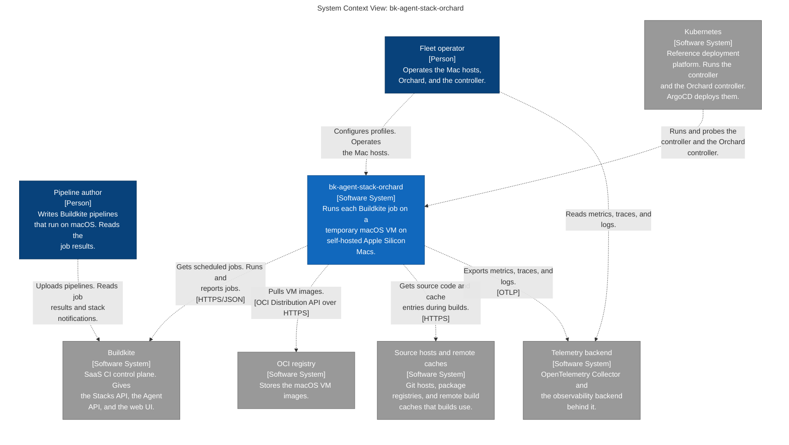
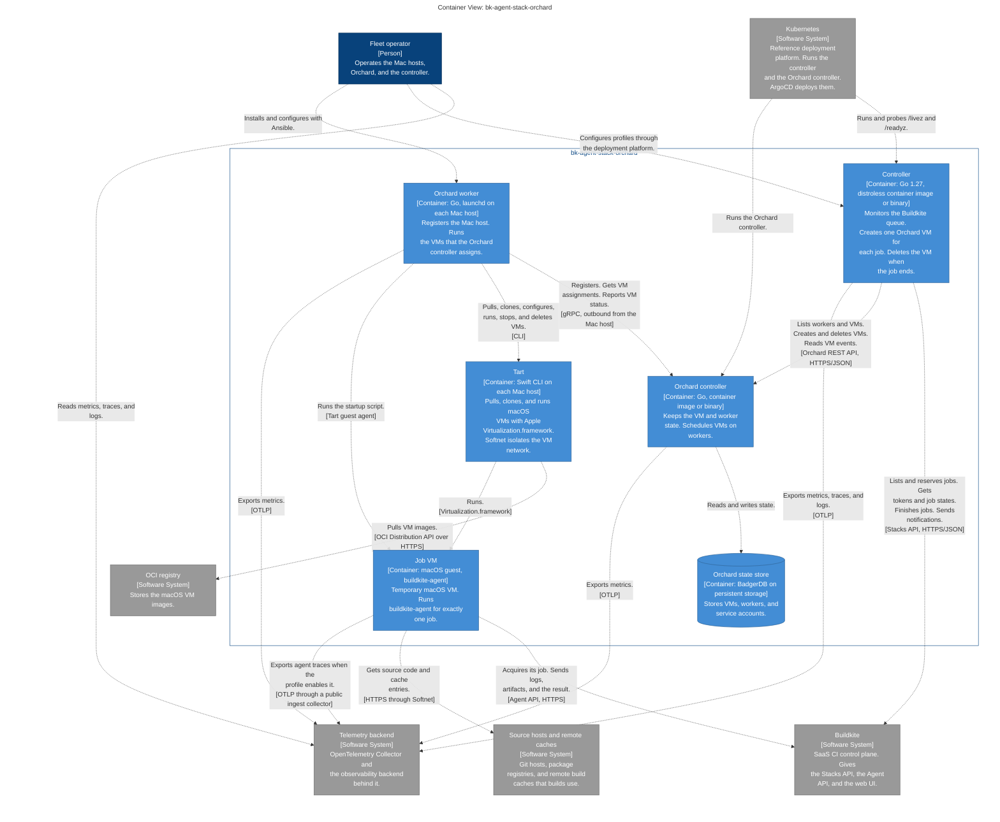
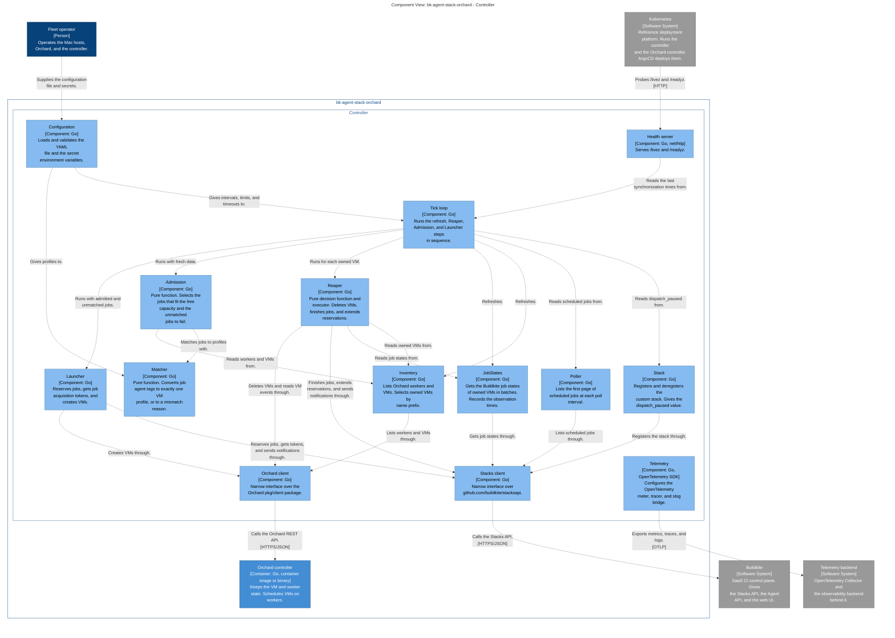

# bk-agent-stack-orchard — C4 diagrams

<!-- Generated by docs/architecture/render-c4-md.sh from workspace.dsl. Do not edit this file. -->

This file contains Mermaid versions of the C4 views in `workspace.dsl`. The workspace is the source of truth. CI runs `render-c4-md.sh` and fails if the committed file is different.

## Level 1 — System context

## Level 2 — Containers

## Level 3 — Controller components

