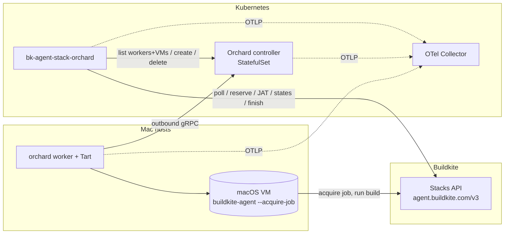
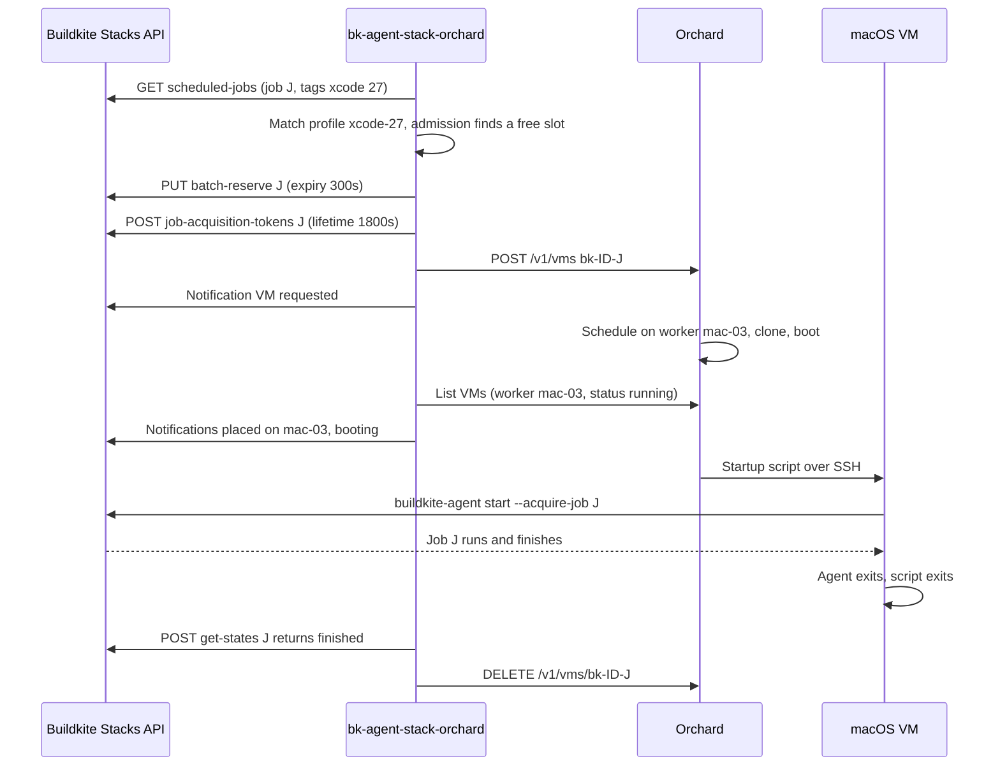

# bk-agent-stack-orchard — Target design

* Status: accepted
* Date: 2026-09-19
* Approved: 2026-09-20
* Companion documents:
  * [Product requirements](../product/requirements.md): requirement identifiers such as `PR-005`
  * [System design baseline](system-design-baseline.md): driver identifiers such
    as `QA-01`
  * [Architecture decision records](../adrs/README.md): ADR-0001 to ADR-0008

## Conventions

The key words "MUST", "MUST NOT", "REQUIRED", "SHALL", "SHALL NOT", "SHOULD", "SHOULD NOT",
"RECOMMENDED", "NOT RECOMMENDED", "MAY", and "OPTIONAL" in this document are to be
interpreted as described in BCP 14 [RFC 2119] [RFC 8174] when, and only when, they appear in
all capitals, as shown here.

This document uses ASD-STE100 Simplified Technical English. Code identifiers, API names, and
state names in `code format` are technical names.

## 1. Purpose

`bk-agent-stack-orchard` runs Buildkite jobs on temporary macOS virtual machines (VMs). The
VMs operate on self-hosted Apple Silicon Macs.

The controller monitors a Buildkite queue for scheduled jobs. For each job, it starts one new
Tart VM through Orchard. When the job ends, the controller deletes the VM. This behavior is the
macOS equivalent of the Buildkite `agent-stack-k8s`.

The fleet is new. This project introduces Tart, Orchard, and the controller.

## 2. Scope

**In scope**

1. One Go binary that implements a Buildkite **custom stack** with the Stacks API.
2. One temporary VM for each job. The controller creates the VM on demand and deletes it after
   the job ends.
3. Selection of a VM **profile** by job tags. A profile sets the image, CPU, memory, disk, and
   worker labels.
4. Procedures for failures, timeouts, and restart recovery, without persistent controller state.
5. OpenTelemetry metrics, traces, and logs.
6. A reference deployment of the controller and the Orchard controller on Kubernetes. The Mac
   hosts are Orchard workers. The controller MUST NOT depend on Kubernetes. It MUST run as a
   plain process on other platforms.

**Target scale.** The design MUST support 10 to 50 Macs (20 to 100 concurrent macOS VMs). The
first rollout uses 2 to 10 Macs. Development uses one Mac (SC-01, SC-02).

**Quality targets.** The system design baseline owns the quality targets. The start time is 60 s
or less (QA-01). The wait time is 15 min or less at planned capacity (QA-02). The recovery time is
less than 15 min (QA-03). The design MUST meet these targets.

**Non-goals** (§14 gives the roadmap)

* Warm pools of started VMs. The controller creates VMs only for scheduled jobs.
* Automatic scaling of the Mac hosts. The host pool is fixed and always on.
* Host directory caches, or other state that jobs share.
* Secret injection for each job. Jobs get secrets through standard Buildkite mechanisms.
* High availability of the controller or of Orchard. Instead, recovery takes less than 15 min
  (QA-03).
* Operation in more than one region. Each additional region uses a new queue with its own fleet
  (SE-10).

## 3. Background and constraints

The design depends on these facts. Each fact was verified against source code or documentation.

| Fact | Source | Result for the design |
|---|---|---|
| The Stacks API accepts only a cluster agent token (`bkct_`). | Buildkite docs, `apis/agent_api/stacks.md` | The controller keeps a cluster agent token (§9.2). |
| The scheduled-jobs list gives all jobs in the queue. It does not filter by other tags. It does not include reserved jobs. | Stacks API docs | The controller does the tag match (§5). |
| A reservation lasts 900 s by default and 3600 s maximum. A second reserve call extends it. When a reservation expires, the job becomes `scheduled` again. | Stacks API docs | The controller uses short reservations. It extends them while a VM starts (§6, §7). |
| A job acquisition token (`bkjat_`) connects an agent to one reserved job. The token expires early if the reservation expires. At agent registration, Buildkite applies the expiry and the allowed IP addresses of the agent token that issued the JAT. | `buildkite/stacksapi` v1.2.0 `IssueJobAcquisitionTokens`; `buildkite/docs` `pages/agent/self_hosted/job_acquisition_tokens.md` (2026-08-26) | Only a job acquisition token goes into a VM (§9.1). The agent token allowlist MUST contain the job VM egress addresses (§9.2). |
| `buildkite-agent start --acquire-job` exits with code 27 if the job is already taken, cancelled, or complete (HTTP 422). | `buildkite/agent` v4.0.3 release notes (2026-09-10); `core/client.go` | The rule "the job is terminal, delete the VM" covers this case. |
| Buildkite agent v4 is the stable line (v4.0.0 on 2026-09-01; v4.3.0 on 2026-10-08, checked 2026-10-10). v4 exits immediately when a flag is not defined. v4 keeps `--acquire-job`, `BUILDKITE_AGENT_ACQUIRE_JOB`, and `BUILDKITE_OPENTELEMETRY_TRACING`, and it adds `BUILDKITE_OPENTELEMETRY_METRICS`. v4 removes the OpenTracing and Datadog backends. | `buildkite/agent` releases and `clicommand/agent_start.go` at v4.0.4 (2026-09-19) | The image contains agent v4 (§5). The startup script uses only v4 flags. |
| Orchard `startup_script.transport` accepts `ssh` (the default) and `tart-guest-agent`. The guest-agent transport operates only on the Tart runtime, and the worker connects through the VM control socket. For both transports, the worker builds the same script: `set -e`, one `export` line for each `env` entry, then `script_content`. | Orchard `pkg/resource/v1/v1.go` and `internal/worker/vmmanager/base` at tag 0.57.0 | §6.4 uses the guest-agent transport. VM specifications need no SSH credentials. |
| Apple permits 2 concurrent macOS VMs on each host. Orchard models this limit with the worker resource `org.cirruslabs.tart-vms: 2`. | Orchard `api_vms.go`; Apple EULA | Capacity is small. Admission examines capacity before it reserves a job (§6.3). |
| Orchard VM `labels` are placement constraints. Orchard puts a VM only on a worker whose labels contain all VM labels. | Orchard `scheduler.go` | Labels contain only worker constraints. The VM name identifies the owner (§6.1). |
| The Orchard VM list can filter only by `worker=`. | Orchard `pkg/resource/v1/v1.go` `Match` | The controller lists all VMs and filters them by name prefix. |
| Orchard recommends names that contain only `[a-z0-9-]`, have a maximum of 63 characters, and start and end with a letter or a digit. | Orchard `internal/simplename` | This sets the VM name format and the `controllerID` length limit (§6.1). |
| If a startup script exits with 0, the VM stays `running`. A non-zero exit or a guest shutdown changes the VM to `failed`. Orchard does not delete VMs automatically. | Orchard `vmmanager/base/base.go`, `worker/fsm.go` | The Buildkite job state controls teardown. The controller deletes each VM that it creates (§7). |
| Orchard bin-packs CPU and memory only when a VM requests them as resources. | Orchard `scheduler.go` | Each VM requests `logical-cores` and `memory-mib` resources. |
| Orchard releases before 0.57.0 can release worker capacity before a VM stops. Pull requests #465 and #470 correct this. Orchard 0.57.0 (2026-09-15) contains both. | Orchard 0.57.0 release notes | §9.2 sets the minimum Orchard version. |
| Orchard exports OTel metrics through OTLP. If the endpoint is not set, Orchard uses `localhost:4318`. | Orchard `internal/opentelemetry` | Each Orchard process MUST have an explicit endpoint (§11). |
| Tart and Orchard use the FSL-1.1-ALv2 licence (since 2026-06-05). The licence permits all use except a competing commercial product. | `LICENSE` in `openai/tart` and `openai/orchard` | This project can use Tart and Orchard without cost. The tart.run licensing page is out of date. The `LICENSE` file is the authority. |
| Orchard and its Go client carry the FSL-1.1-ALv2 licence, which permits every purpose except a competing use. This project uses the AGPL-3.0, which forbids a further restriction on a distributed work. The Orchard OpenAPI file is also under the FSL. | `LICENSE` of `openai/orchard`; AGPL-3.0 section 10 (2026-09-19) | The controller contains no Orchard code, and it does not generate code from an Orchard file. §15 gives the client rule. |

**References.** ADR-0005 records the selection of Tart and Orchard. ADR-0006 records the tag
match. ADR-0007 records the dedicated queue. ADR-0008 records the cluster agent token. ADR-0009
records the startup-script transport.

## 4. Architecture

### C4 model

The C4 model of this project is in `docs/architecture/workspace.dsl` (Structurizr DSL). The
model has three views:

| C4 level | View | Contents |
|---|---|---|
| 1 — System context | `SystemContext` | `bk-agent-stack-orchard`, the pipeline author, the fleet operator, and the external systems: Buildkite, the OCI registry, source hosts and remote caches, Kubernetes, and the telemetry backend. |
| 2 — Container | `Containers` | The controller, the Orchard controller, the Orchard state store, the Orchard worker, Tart, and the job VM. |
| 3 — Component | `ControllerComponents` | The components of the controller (see "Components" below). The other containers are third-party software, so the model does not decompose them. |

The workspace MUST be the source of truth for these diagrams. A change to a component, a
container, or a relationship MUST update the workspace in the same commit.

CI MUST validate the workspace with the `structurizr/structurizr` image. The earlier
`structurizr/cli` image receives no more updates, so CI MUST NOT use it.

```sh
docker run --rm \
  -v "$(git rev-parse --show-toplevel)/docs/architecture:/usr/local/structurizr" \
  structurizr/structurizr validate -workspace /usr/local/structurizr/workspace.dsl
```

The command uses the repository root, so it operates from all directories in the repository.
If the mount source does not exist, Docker mounts an empty directory, and the command fails
with "workspace.dsl does not exist".

`docs/architecture/c4.md` contains Mermaid versions of the three views for review in Markdown.
`docs/architecture/render-c4-md.sh` generates the file. The script exports the views with
`structurizr/structurizr export -format mermaid` and converts the HTML labels to plain text.
Markdown renderers that run Mermaid with `securityLevel: strict` and `htmlLabels: false` cannot
show HTML labels. CI MUST run the script and MUST fail if the committed file is different.

### Overview



The controller does not keep durable state. At each tick, it gets its view from two sources:

* the Orchard VM list and worker list,
* the Buildkite job states.

In-memory data is only a cache. The loss of this cache is always safe.

### Components

| Component | Function | Dependencies |
|---|---|---|
| **Stack** | Registers one stack at start-up: `type: custom`, `key = controllerID`, `queue_key = buildkite.queue`. Deregisters the stack at shutdown. Gives the `dispatch_paused` value. | `Stacks` client |
| **Poller** | Lists the first page of scheduled jobs at each `pollInterval` (1 s). Obeys `Retry-After`. | `Stacks` client |
| **Matcher** | Pure function. Converts the job `agent_query_rules` to exactly one profile, or to a mismatch reason. | Configuration |
| **Inventory** | Lists Orchard workers and VMs at each `inventoryInterval` (1 s). Selects owned VMs by name prefix. Parses the job UUIDs. | `Orchard` client |
| **JobStates** | Gets the Buildkite job states of owned VMs in one batch at each `jobStatesInterval` (5 s). Records the observation time for each job, and whether Buildkite named the job. A call that fails keeps the states before it, with their times. | `Stacks` client |
| **Admission** | Pure function. Input: scheduled jobs, inventory, profiles, and `maxInFlight`. Output: jobs to start, and unmatched jobs to fail. | Matcher, Inventory |
| **Launcher** | For admitted jobs: reserves the jobs, gets job acquisition tokens, and creates VMs. Sends stack notifications. | `Stacks` client, `Orchard` client |
| **Reaper** | Pure decision function for each owned VM, and an executor. Actions: delete the VM, finish the job, extend the reservation, or send a notification. | Inventory, JobStates |
| **Telemetry** | Configures the OTel meter, tracer, and slog bridge from the standard `OTEL_*` environment variables. | OTel SDK |

`Stacks` and `Orchard` MUST be narrow Go interfaces over `github.com/buildkite/stacksapi` and the
Orchard client of this project (§15). All other components MUST be testable with in-memory fakes of
these interfaces.

### Control loop

One goroutine runs the tick. Each tick does these steps in sequence:

1. If the interval is complete, refresh Inventory and JobStates.
2. Run the Reaper on each owned VM.
3. If the stack is not paused, and the Inventory data and Poller data are fresh, run Admission.
   Then run the Launcher.

API calls in one step MAY run concurrently, with a concurrency limit. The steps MUST run in
sequence. Because of this, Admission always sees the Reaper deletions of the same tick.

The loop MUST decide when a source is due, and it MUST measure the interval of a source between
ticks, not between the answers of the source. An answer arrives after its tick, and later still
for a source that waits for the ones before it in the same tick, so a comparison of answers reads
a source whose interval equals the tick interval at only every other tick. A source that failed
MUST wait for its interval like one that answered.

With 100 VMs, the controller makes approximately three API calls each second. All rate limits
are higher. The Stacks API limits are 10 requests/s for list and reserve, and 20 requests/s for
get-states.

**Implements.** PR-001, PR-005, PR-010, QA-01, QA-04, DR-01, OP-04.

## 5. VM profiles and job match

A profile describes one type of VM:

```yaml
profiles:
  - name: xcode-27
    match: {xcode: "27"}
    image: ghcr.io/acme/bkaso-pilot@sha256:<digest>
    cpu: 8
    memoryMiB: 28672
    diskSizeGB: 150
    workerLabels: {pool: general}
    softnetAllow: ["10.20.30.40/32"]
    startupTransport: tart-guest-agent
    timeouts: {boot: 20m}
    otel: {enabled: false}
  - name: default
    match: {}
    image: ghcr.io/acme/bkaso-agent@sha256:<digest>
    cpu: 8
    memoryMiB: 28672
    diskSizeGB: 150
    workerLabels: {pool: general}
    startupTransport: tart-guest-agent
```

The CPU and memory values are examples. Pilot measurements set the real VM size (SC-08). Two VMs
run on each host, so the two VMs together MUST NOT need more than the host has (SC-02, SC-04). The
pilot profile uses Xcode 27 (PR-026).

**Match rule.** The Matcher MUST use exact match:

1. Parse the job `agent_query_rules` into a map.
2. Remove the `queue` key.
3. Select the profile whose `match` map is equal to the result.

For example, a job with the tags `{queue: macos, xcode: "27", size: large}` MUST NOT match a
profile with `match: {xcode: "27"}`. A profile with `match: {}` matches jobs that have no tag
other than `queue`.

**Unmatched jobs.** A job is unmatched if one of these conditions is true:

* No profile has a `match` map that is equal to the job tags.
* A rule does not have the format `key=literal`. Wildcards, negations, and rules with an
  incorrect format are in this group.

The controller MUST reserve an unmatched job and finish it immediately with
`exit_status: -1`. The detail message MUST list the job tags and the `match` maps of all
profiles. Unmatched jobs do not use capacity. While the queue is paused, the controller MUST NOT
finish unmatched jobs.

**Validation at start-up.** The controller MUST NOT start if one of these conditions is false:

* Profile names are unique and match `[a-z0-9-]+`.
* No two profiles have equal `match` maps.
* `match` keys and values are literals that are not empty. `queue` is not a key.
* `startupTransport` is `tart-guest-agent` (the default) or `ssh` (ADR-0009).
* A profile with `startupTransport: ssh` has `vmCredentials`, and both referenced environment
  variables exist and are not empty. Orchard uses `admin/admin` when a VM specification has no
  credentials. Because of this, a missing value is a fatal error for this transport. A profile
  with the guest-agent transport MUST NOT have `vmCredentials`.
* For each profile, `unplaced + boot + acquire ≤ jobTokenLifetime` (§7.3).

If a profile `image` has no digest, the controller MUST write a warning. The controller then
starts.

The fleet operator MUST set `diskSizeGB` to at least the disk size of the profile image. The pilot
image has a 104 GB disk, and other Xcode images up to 140 GB (SC-07). Tart refuses a disk that is
smaller than the disk of the image, in bytes. A macOS 27 guest grows its APFS container to the disk
at boot (2026-10-10), so a larger `diskSizeGB` gives a job more space.

**Image contents.** Each profile image MUST contain `buildkite-agent` v4 and its hooks (CO-06).
An image for the guest-agent transport MUST also run the Tart guest agent. The
`cirruslabs/macos-image-templates` base template installs it and its launch agent (as of
2026-09-19).

**Implements.** PR-003, PR-004, PR-020, PR-021, PR-026, QA-05, SC-07, SC-08.

## 6. Job lifecycle

### 6.1 Identity

* **Stack key:** `controllerID`.
* **VM name:** `bk-<controllerID>-<job-uuid>`. `controllerID` MUST match
  `^[a-z0-9]([a-z0-9-]{0,21}[a-z0-9])?$` (maximum 23 characters). Because of this, the VM name
  has a maximum of 63 characters.
* **Owner:** the controller owns a VM if, and only if, the VM name starts with
  `bk-<controllerID>-`. The remaining text is the job UUID.
* **VM labels:** only the profile `workerLabels`.
* **Profile of an owned VM:** not necessary. Capacity accounting uses the `resources` and
  `labels` of the VM.

### 6.2 Normal sequence



### 6.3 Admission

Admission MUST run only when all of these conditions are true:

* The queue is not `dispatch_paused`.
* The Inventory data is newer than `stateFreshness` (60 s).
* The scheduled-jobs list is newer than `stateFreshness`.

A source whose calls fail keeps its last data. The Reaper continues, because its own rules (§7.2)
decide what old data permits it to do.

Admission does these steps:

1. **Candidates.** Select the matched scheduled jobs that have no owned VM with the same name,
   and that this process does not hold. A job that this process reserved, or whose VM it
   requested, is its own even when the Inventory data does not show the VM yet: the Inventory
   learns of a launch only at its next refresh, and a poll that fails keeps an answer that still
   lists the job. Sort them by Buildkite `priority` (highest first), then by `scheduled_at` (oldest
   first).
2. **In-flight limit.** Stop when the number of owned VMs, plus the VMs that this process
   requested and the Inventory data does not show yet, plus admitted jobs, is equal to
   `maxInFlight`. The default value of `maxInFlight` is 0, which means the total VM slots of the
   eligible workers. Because of this, the limit follows the fleet, and it does not hold slots
   empty at the target scale (SC-01, QA-02). A value more than 0 limits the controller to that
   number of VMs, for example during a pilot.
3. **Eligible workers for each profile.** A worker is eligible if it is online, it is not paused
   for scheduling, and its labels contain the profile `workerLabels`.
4. **Free resources of each worker.** Subtract the resources of all VMs on the worker from the
   resources that the worker advertises. Include the VMs of all owners. Count the VMs in the
   same way as the Orchard scheduler (`internal/controller/scheduler/scheduler.go` at the minimum
   Orchard version of §9.2).
5. **Unplaced VMs.** Give a hypothetical placement to the VMs of all owners that have no worker,
   and to the VMs that this process requested and the Inventory data does not show yet. Use the
   first eligible worker with sufficient free resources. For a VM of Orchard, a worker is eligible
   only if its labels contain the labels of the VM, and the VMs go in the order of their creation.
   The Orchard scheduler does the same. A VM that no worker can take takes no resources.
6. **Admit.** For each candidate in sequence, find the first eligible worker with sufficient
   free `tart-vms`, `logical-cores`, and `memory-mib`. Subtract the resources. If no worker has
   sufficient resources, skip the candidate. A skipped candidate does not stop the next
   candidates.

Hypothetical placement is only for accounting. Orchard makes the real placement decision. The
controller MUST NOT pin a VM to a worker. A second scheduler in the controller can disagree with
the Orchard scheduler. Image pull before use (§11) gives most of the benefit of placement that
knows the image cache.

Admission also gives the list of unmatched scheduled jobs (§5). The Launcher MUST reserve these
jobs in the same `batch-reserve` call as the admitted jobs. The Launcher MUST then finish each
reserved unmatched job with its mismatch message. The Launcher MUST NOT get a token or create a
VM for these jobs.

### 6.4 Launch

For the admitted jobs, the Launcher MUST do these steps:

1. Send `PUT batch-reserve` with `reservation_expiry_seconds = reservationExpiry` (300).
   Continue only with the jobs in the `reserved` list. Record `reservedUntil` in memory, counted
   from the time that the call left. The reservation starts when Buildkite handles the call, which
   is after the call left, so this end is never later than the true end, and the renewal of row 13
   comes early and never late.
2. Send `POST job-acquisition-tokens` for the reserved jobs with
   `token_lifetime_seconds = jobTokenLifetime` (1800). Skip the jobs in `not_issued`. Their
   reservations expire.
3. Send `POST /v1/vms` for each job, with the specification below.
4. Send a stack notification for each job: "VM requested".

```json
{
  "name": "bk-macos-prod-<job-uuid>",
  "image": "<profile.image>",
  "imagePullPolicy": "IfNotPresent",
  "os": "darwin",
  "cpu": 8,
  "memory": 28672,
  "diskSize": 150,
  "headless": true,
  "randomSerial": true,
  "netSoftnet": true,
  "netSoftnetAllow": ["<profile.softnetAllow>"],
  "restart_policy": "Never",
  "labels": {"pool": "general"},
  "resources": {
    "org.cirruslabs.tart-vms": 1,
    "org.cirruslabs.logical-cores": 8,
    "org.cirruslabs.memory-mib": 28672
  },
  "startup_script": {
    "transport": "tart-guest-agent",
    "script_content": "buildkite-agent start --tags \"queue=${BK_AGENT_STACK_QUEUE},agent-stack=orchard,profile=${BK_AGENT_STACK_PROFILE}\"",
    "env": {
      "BUILDKITE_AGENT_TOKEN": "<job acquisition token>",
      "BUILDKITE_AGENT_ACQUIRE_JOB": "<job-uuid>",
      "BUILDKITE_AGENT_NAME": "bk-macos-prod-<job-uuid>",
      "BK_AGENT_STACK_QUEUE": "macos",
      "BK_AGENT_STACK_PROFILE": "xcode-27"
    }
  }
}
```

A `409 Conflict` response means that a VM with the same name exists. The Launcher MUST treat
this response as a successful launch.

Orchard adds `set -e` before the script, and one `export` line for each `env` entry. Because of
this, a non-zero agent exit status is also the script exit status.

The transport is `tart-guest-agent` (ADR-0009). With this transport, the Orchard worker uses the
VM control socket, and the VM specification contains no credentials. A profile with
`startupTransport: ssh` gets `username` and `password` from its `vmCredentials` instead. The
`env` values and the event log are the same for both transports.

The image MUST contain `buildkite-agent` v4 and its hooks (§5). The controller MUST add only
the environment variables above. When `profile.otel.enabled` is true, the controller also adds
the OTel variables of §10.4.

**Implements.** PR-001, PR-005, PR-006, PR-007, PR-009, QA-01, QA-02, DR-01, SC-02.

## 7. Failures and recovery

### 7.1 Principles

1. **Observed state only.** Decisions MUST use Inventory data and JobStates data. Decisions
   MUST NOT use counters. Timeouts MUST use the Orchard timestamps `createdAt`, `scheduled_at`,
   and `started_at`. Because of this, timeouts continue to operate after a controller restart.
2. **Causally fresh job state.** The Reaper MUST use a job state for a VM only if the controller
   observed the state after the VM `createdAt`. If the state is older, the Reaper MUST wait for
   the next JobStates refresh. The observation time of a state MUST be the time that JobStates
   sent the request, which is the earliest moment that the answer can describe. A time taken
   from the answer makes a state look newer than it is, and this rule and the next one would
   then trust it too soon.
3. **Fresh data or no action.** If the job state of a VM is older than `stateFreshness` (60 s),
   the Reaper MUST do only the orphan action and the maximum-lifetime action.
4. **Permanent errors are terminal.** If finish, get-states, or delete returns 404 or 422, the
   controller MUST mark the job as ignored in memory. The controller MUST NOT send the call
   again in a loop.
5. **Fail a job only before an agent acquires it.** After an agent acquires a job, the Buildkite
   lost-agent procedure controls the job result. The controller MUST NOT finish that job. The
   controller MUST only delete the VM.

### 7.2 Reaper decision table

The Reaper MUST examine each owned VM at each tick. The first row that matches applies.

| # | VM (Orchard) | Job (Buildkite) | Action | `reason` |
|---|---|---|---|---|
| 1 | The name has the owned prefix but no valid UUID | — | Delete the VM. | `orphan` |
| 2 | The age since `createdAt` is more than `maxVMLifetime` (25 h) | Any | Delete the VM. | `lifetime` |
| 3 | Any | Not causally fresh, or stale | No action. | — |
| 4 | Any | Terminal: `finished`, `canceled`, `expired`, `timed_out`, `skipped`, `broken` | Delete the VM. | `job_terminal` |
| 5 | Any | Unknown to Buildkite (404, or not in the get-states result) | Delete the VM. Ignore the job. | `job_unknown` |
| 6 | Any | `scheduled` (the reservation expired) | Delete the VM. | `reservation_lapsed` |
| 7 | `failed` | An agent owns the job: `assigned`, `accepted`, `running`, `canceling`, `timing_out` | Send a notification with `status_message`. Delete the VM. | `vm_failed` |
| 8 | Not `failed` | An agent owns the job | No action. | — |
| 9 | `failed` | `reserved` | Finish the job (`-1`, `status_message`, and the last 50 startup-script log lines when the script wrote any). Delete the VM. | `vm_failed` |
| 10 | `pending`, no worker, and the age since `createdAt` is more than `unplaced` (2 min) | `reserved` | Delete the VM. Do not extend the reservation. The job becomes `scheduled` again, and Admission starts it again. | `unplaced_timeout` |
| 11 | `pending`, a worker is set, and the age since `scheduled_at` is more than `boot` (15 min) | `reserved` | Finish the job (`-1`, `status_message`). Delete the VM. | `boot_timeout` |
| 12 | `running`, and the age since `started_at` is more than `acquire` (5 min) | `reserved` | Finish the job (`-1`, the last 50 startup-script log lines from `GET /v1/vms/{name}/events`). Delete the VM. | `acquire_timeout` |
| 13 | `pending` or `running` | `reserved` | Extend the reservation when `reservedUntil − now` is less than `reservationRenewBefore` (120 s). If `reservedUntil` is unknown, extend it immediately. | — |

The timeouts of a VM are the effective timeouts of its profile. A VM does not carry the name of
its profile (§6.1), so after a restart the controller cannot name the profile of a VM that it did
not start. The Reaper MUST then use the largest value of each timeout across the profiles. A
restart MUST NOT end a VM sooner than its own profile allows: a VM that stays longer costs a slot,
and a job that the controller ends early costs a build.

Orchard sets the VM status to `running` when the Tart VM process starts. At this time, macOS has
not completed its boot. Because of this:

* The `boot` timeout includes the image pull, the clone, and the configuration.
* The `acquire` timeout includes the guest OS boot, SSH, and the agent start.

If no row matches (for example, a job state that the controller does not know), the Reaper MUST
take no action. The Reaper MUST write a warning log with the VM phase and the job state. Row 2
still limits the life of this VM.

The controller MUST cut finish-job detail messages to a maximum of 4 KB at a rune boundary. The
`stacksapi` library makes this cut, at the end of the detail, and it notes the cut there. A message
whose end holds its reason MUST shorten itself below the limit of the library, so that the library
cuts nothing: the message of an acquire timeout drops its oldest startup-script lines, and keeps its
newest. The controller MUST send all reservation extensions of one tick in one `batch-reserve`
call.

### 7.3 Timeout consistency

The sum `unplaced + boot + acquire` MUST NOT be more than `jobTokenLifetime`. If the sum is
more, a slow but healthy VM can start with an expired token.

With the default values, the sum is 2 min + 15 min + 5 min = 22 min. This is less than 30 min.
The controller MUST validate this sum for each profile at start-up. The validation MUST include
the timeout values that a profile overrides.

### 7.4 Crash windows and restart

At start-up, before the first Admission, the controller MUST do these steps:

1. Register the stack. This call is idempotent.
2. List all VMs, and select the owned VMs.
3. Get the job states of these VMs.
4. Run a full Reaper pass. `reservedUntil` is unknown, so row 13 extends all reservations
   immediately.

| Stop point | Result |
|---|---|
| After the reservation, before the VM creation | No VM exists, so the controller cannot see the job. The reservation expires in a maximum of `reservationExpiry` (300 s). Admission then starts the job again. The accepted cost is a delay of up to 5 minutes for these jobs. |
| After the VM creation | The controller finds the VM by its name. The Reaper then controls the VM. |
| Between the finish call and the delete call | The controller sends the delete call again at the next tick. A second finish call returns 422. The controller treats 422 as complete. |

### 7.5 Dependency outages

| Outage | Behavior |
|---|---|
| The Orchard controller is not available | Inventory data becomes stale. Admission stops. The Reaper cannot delete VMs. VMs on the workers continue to run. Readiness fails. Liveness passes. |
| The Buildkite API is not available, or applies a rate limit | The controller obeys `Retry-After`. JobStates data becomes stale. The controller does not reserve or finish jobs. The controller deletes VMs only for rows 1 and 2. |
| A worker is offline | After the worker offline timeout (3 min), Orchard sets the VMs of the worker to `failed`. Rows 7 and 9 apply. `restart_policy: Never` prevents a new VM for the same job on a different worker. |
| The queue is `dispatch_paused` | Admission stops. The controller does not finish unmatched jobs. The Reaper continues for existing VMs. |

### 7.6 Pipeline guidance

Controller failures have `signal_reason: stack_error`. Pipelines on this queue SHOULD add this
retry rule:

```yaml
retry:
  automatic:
    - signal_reason: stack_error
      limit: 1
```

With this rule, Buildkite tries the job again one time after a temporary infrastructure failure.
Examples are a lost worker or a failed image pull. Buildkite does not try the job again many
times when a profile is broken.

**Artifact destination.** Build artifacts MUST NOT go to Buildkite-managed storage (PR-032,
SE-08). Each image MUST have an `environment` agent hook that sets
`BUILDKITE_ARTIFACT_UPLOAD_DESTINATION` to owner-managed storage in the operating country, for
example `s3://<owner-bucket>/$BUILDKITE_PIPELINE_SLUG/$BUILDKITE_BUILD_ID/$BUILDKITE_JOB_ID`. A
pipeline step MAY set a different destination in the same storage. The end-to-end scenarios
(§12) MUST confirm that a job with an artifact writes to this storage only.

**Implements.** PR-002, PR-007, PR-008, PR-010, PR-011, PR-012, QA-03, QA-05, QA-06, DR-02.

## 8. Configuration

The configuration is one YAML file. The file MUST NOT contain secrets. Secrets MUST come from
environment variables. The platform that runs the controller supplies these variables. On
Kubernetes, Secrets supply them. On other platforms, the process manager or a secret store
supplies them.

```yaml
controllerID: macos-prod
buildkite:
  queue: macos
  endpoint: https://agent.buildkite.com/v3
  pollInterval: 1s
  jobStatesInterval: 5s
  reservationExpiry: 300s
  reservationRenewBefore: 120s
  jobTokenLifetime: 1800s
orchard:
  url: https://orchard.internal:6120
  serviceAccount: bk-agent-stack-orchard
  inventoryInterval: 1s
  workerOfflineTimeout: 3m # MUST match the worker offline timeout of the Orchard controller
maxInFlight: 0 # 0 means the total VM slots of the eligible workers
stateFreshness: 60s
healthAddress: ":8080" # the gRPC health service of the probes
defaults:
  timeouts:
    unplaced: 2m
    boot: 15m
    acquire: 5m
    maxVMLifetime: 25h
profiles: [] # see §5
```

The controller serves the gRPC health checking protocol (`grpc.health.v1`) on `healthAddress`,
with the services `liveness` and `readiness`. The empty service name, which is the health of the
whole server in the protocol, follows `readiness`. The controller serves no other endpoint, and
gRPC is in the binary already, because the OTLP exporters use it. Kubernetes probes the service
natively (`grpc: {port, service}`).

`liveness` serves while the process serves, and it does not depend on either API, because a
restart cures nothing that an API causes. `readiness` stops serving while the last answer of a
source is older than 30 s, or after the Stacks API returned HTTP 401. The protocol carries no
reason, so the controller writes a log record at each change of readiness, and a record of
`not ready` names each reason. A `healthAddress` that another process holds fails the start.

The configuration MUST set `pollInterval`, `jobStatesInterval`, and `inventoryInterval` shorter
than `stateFreshness`. Admission and the Reaper act only on data newer than `stateFreshness`, so a
source that the controller reads less often stops them permanently. The controller refuses such a
configuration when it starts.

Each secret belongs to the settings of the component that uses it: the agent token to the
Buildkite settings, and the Orchard token and certificate to the Orchard settings. A component
then receives one value that is complete, and no part of the controller holds a collection of
secrets that it does not need. The type of a secret refuses to print itself, so a log line, a
JSON encoder, or a format verb writes `[redacted]`.

| Environment variable | Contents |
|---|---|
| `BK_AGENT_STACK_ORCHARD_CONFIG` | The path to the configuration file. The default is `/etc/bk-agent-stack-orchard/config.yaml`. |
| `BK_AGENT_STACK_ORCHARD_BUILDKITE_AGENT_TOKEN` | The cluster agent token (`bkct_…`). |
| `BK_AGENT_STACK_ORCHARD_ORCHARD_TOKEN` | The Orchard service account token. |
| `BK_AGENT_STACK_ORCHARD_ORCHARD_CA_CERT` | The PEM of the Orchard controller certificate or CA. The calls to Orchard trust it beside the authorities of the system, and the calls to Buildkite do not. Text that holds no certificate fails the start. |
| Profile variables (for example, `XCODE_VM_PASSWORD`) | The VM image SSH credentials. Only for a profile with `startupTransport: ssh`. |
| `OTEL_*` | The standard OpenTelemetry SDK configuration. |

Configuration changes apply after a restart. The controller MUST NOT reload the configuration
while it runs. In the Kubernetes reference deployment, the Helm chart MUST add a checksum
annotation of the ConfigMap to the Deployment. Because of this, ArgoCD restarts the Deployment
when the ConfigMap changes.

**Implements.** PR-020, PR-021, PR-022, CO-04.

## 9. Security

### 9.1 Trust model

The controller MUST treat all builds as untrusted (PR-030). Each VM MUST have these properties:

* The VM is for one job only. The controller MUST NOT use the VM again. `restart_policy` is
  `Never`.
* Softnet is on. The VM can reach globally routable addresses. The VM cannot reach other VMs or
  private ranges. The only exception is the CIDRs in `profile.softnetAllow`.
* The VM cannot reach the host, except for DHCP and DNS. Softnet lets a VM reach the gateway of
  its network on every port, and the gateway is the host (2026-09-27, a probe from a VM of the
  controller specification reached a service of the host through its gateway; Softnet 0.24.1
  `lib/proxy/vm.rs` keeps that rule). A Softnet block of the gateway also blocks DNS, because the
  gateway is the DNS server of the VM. pf rules on each host therefore close it (§11). Softnet 0.24
  gives each VM a network of its own, with an address of the host in a private range that it
  picks when the VM starts, and pf on macOS has no interface groups, and its `(self)` matches
  nothing (2026-10-10, tested on a VM). The rules therefore block by destination: from any
  interface but the admin interfaces of the host, only DHCP and DNS reach the host, and only the
  `softnetAllow` CIDRs of the profiles of the host reach the private ranges.
* The VM has no host directory mounts. Profiles cannot configure them.
* The VM gets only a job acquisition token for its own job. The token lifetime is a maximum of
  30 minutes. After the agent acquires the job, the token has no use.

The cluster agent token and the Orchard credentials MUST NOT go into a VM.

### 9.2 Credentials and privileges

| Credential | Location | Scope and controls |
|---|---|---|
| Cluster agent token | Controller environment variable, from a secret store | Only this controller uses it. `expires_at` MUST be 90 days or less. `allowed_ip_addresses` MUST contain the egress addresses of the controller and of the job VMs, because JAT registration applies the restrictions of this token. Replacement MUST follow the token replacement procedure below. |
| Orchard service account `bk-agent-stack-orchard` | Controller environment variable, from a secret store | Roles: `compute:read` and `compute:write` only. No `compute:connect`, no `host-process:*`, and no `admin:*`. The `compute:write` role also permits the creation and deletion of workers. Orchard 0.57.0 has no narrower role, so this risk is accepted. |
| Job acquisition token | VM specification and VM environment | One job. Maximum 30 min. Orchard accounts with `compute:read` can read it. |
| VM image SSH credentials | Controller environment; VM specification | Only for a profile with `startupTransport: ssh`. The Orchard worker then uses the username and password in the VM specification to run the startup script. An image MUST NOT accept a well-known credential, such as `admin/admin`, over the network. The Tart guest agent needs the automatic login of `admin`, and macOS 27 does not log in automatically after a change of the password (2026-09-27), so an image for the guest-agent transport keeps the local password and turns off SSH (Remote Login) and Screen Sharing. An image for the `ssh` transport MUST change the password, and the profile gives the new one. Softnet limits the exposure to the worker host. The guest-agent transport (ADR-0009) removes this credential. |
| Orchard bootstrap admin token | Kubernetes Secret of the Orchard StatefulSet | Only the bootstrap Job uses it, to create service accounts. |

**Token replacement.** The operator MUST replace the cluster agent token in this sequence:

1. Create a new token with the same `allowed_ip_addresses`.
2. Supply the new token to the controller. Restart the controller.
3. Revoke the old token only when no VM that the controller created before the restart exists.
   A revocation stops the job acquisition tokens that the old token issued.

The controller MUST fail its readiness check when the Stacks API returns HTTP 401.

**Queue separation.** The controller MUST serve a dedicated queue (PR-031). The cluster MAY
contain other queues. A leaked cluster agent token reaches all self-hosted queues of the cluster.

**Orchard version.** The minimum Orchard version MUST be 0.57.0 (released 2026-09-15). Pull
request #465 makes the worker wait for VM shutdown before it releases capacity. Pull request #470
corrects an overcommit problem. Orchard 0.57.0 contains both. The controller, the workers, and CI
MUST use the same Orchard version.

**Tart version.** The minimum Tart version on a worker MUST be 2.39.0 (released 2026-09-26). The
macOS 27 images have ASIF disks, and before 2.39.0 `tart list` fails while a VM with an ASIF disk
runs, because the disk is locked
([openai/tart#1344](https://github.com/openai/tart/issues/1344), corrected by pull request #1349).
The Orchard worker lists its VMs with `tart list`, so a worker with an older Tart fails as soon as
one VM runs (2026-09-27, Tart 2.38.0 with Orchard 0.57.0).

**Startup-script transport.** The controller MUST use the `tart-guest-agent` transport for
startup scripts (ADR-0009). Orchard 0.57.0 contains this transport
([pull request #490](https://github.com/openai/orchard/pull/490), merged 2026-09-09). The VM
specification then contains no credentials. A profile MAY select `ssh` when its image does not
run the Tart guest agent.

### 9.3 Data sovereignty

* Source code checkouts, build data, and job VMs MUST stay on owner infrastructure, in the
  operating country (PR-032, SE-05).
* Pipelines MUST upload build artifacts to owner-managed storage in the operating country, not to
  Buildkite-managed artifact storage (PR-032, SE-08).
* Job logs MAY go to Buildkite SaaS (PR-033, SE-07).
* The location of the Git provider is outside the scope of this design (SE-09).
* Telemetry MUST NOT contain source code, because the telemetry provider can be outside owner
  infrastructure (OP-05).

**Implements.** PR-030, PR-031, PR-032, PR-033, SE-01, SE-02, SE-03, SE-05, SE-07, SE-08, SE-10.

**References.** ADR-0004 records the decision to treat all builds as untrusted. ADR-0007 records
the dedicated queue. ADR-0008 records the cluster agent token. ADR-0009 records the
startup-script transport.

## 10. Observability

All telemetry MUST use OpenTelemetry. The controller MUST export telemetry through OTLP to an
OpenTelemetry Collector. The standard `OTEL_*` environment variables configure the export. The
controller MUST NOT have a Prometheus endpoint. Because of this, the controller MUST refuse a
value of `OTEL_<signal>_EXPORTER` that is not `otlp` or `none`, and it MUST NOT build an
exporter that the value names. A rule that an environment variable can break is not a rule.

### 10.1 Metrics

The instruments follow the OpenTelemetry semantic conventions. The prefix `bkaso` below is
`bk_agent_stack_orchard`, which this table shortens for width only.

| Instrument | Name (unit) | Attributes |
|---|---|---|
| UpDownCounter | `bkaso.job.waiting.count` (`{job}`) | `bkaso.profile` |
| Gauge | `bkaso.job.waiting.oldest.age` (`s`) | `bkaso.profile` |
| Counter | `bkaso.job.unmatched` (`{job}`) | — |
| Counter | `bkaso.job.failed` (`{job}`) | `error.type` |
| UpDownCounter | `bkaso.slot.count` (`{slot}`) | `bkaso.pool`, `bkaso.slot.state` = `total`/`used`/`free` |
| UpDownCounter | `bkaso.vm.count` (`{vm}`) | `bkaso.profile`, `bkaso.vm.phase` = `unplaced`/`booting`/`running`/`failed` |
| UpDownCounter | `cicd.worker.count` (`{worker}`) | `cicd.worker.state` = `available`/`busy`/`offline` |
| Histogram | `bkaso.job.phase.duration` (`s`) | `bkaso.profile`, `bkaso.job.phase` = `scheduled_to_reserved`/`reserved_to_placed`/`placed_to_running`/`running_to_accepted`/`total` |
| Counter | `bkaso.vm.deletions` (`{vm}`) | `bkaso.vm.delete.reason` (§7.2) |
| Counter | `cicd.system.errors` (`{error}`) | `cicd.system.component` = `buildkite`/`orchard`, `error.type` |
| Histogram | `bkaso.tick.duration` (`s`) | `bkaso.tick.step` |
| Gauge | `bkaso.source.staleness` (`s`) | `bkaso.source` = `scheduled_jobs`/`job_states`/`inventory` |

These rules come from the conventions and MUST hold:

* **An attribute that the conventions do not define carries the prefix of this project.** A bare
  word such as `state`, `reason`, or `source` can collide with a name that OpenTelemetry gives a
  meaning later, and it says nothing in a backend that holds several systems.
* **A count of things is an up-down counter, and a gauge is for a value that does not add up.**
  The conventions use an up-down counter for every level, such as `cicd.worker.count`. An age is
  a gauge.
* **A level comes from a callback.** The controller computes its levels from observed state at
  each tick, so it gives the whole observation and an asynchronous instrument reports it. A
  series that leaves an observation stops, which is why a profile that no longer exists cannot
  report its last count for ever.
* **The worker of the conventions is the virtual machine**, because `cicd.worker` is the thing
  that does the work of a job. The Mac host is not that worker, and the attribute for its name
  is `bkaso.worker.name`.
* **The controller MUST NOT define a metric for its own HTTP calls.** `otelhttp` gives
  `http.client.request.duration` with the attributes of the conventions, and a second instrument
  for the same measurement would disagree with it. A rate limit and a status that the controller
  cannot use are `cicd.system.errors`. The controller counts each call to either API that fails,
  in one place in front of each API, with `error.type` = `unauthorized`, `rate_limited`,
  `timeout`, or `_OTHER`. An answer about one job, such as a job that ended or a VM that exists,
  is not an error of the system.
* **`bkaso.source.staleness` is an age and not a time.** The readiness alert reads a number that
  needs no clock of its own, and the value cannot disagree with the clock of the backend.

Metric attributes MUST NOT contain job UUIDs or VM names. The `bkaso.pool` attribute is the value
of the worker `pool` label. If the worker has no `pool` label, the value is `none`.

The controller observes phase changes at poll intervals. Because of this, phase durations have a
tolerance of ±`jobStatesInterval`. Outgoing HTTP clients MUST use `otelhttp`.

### 10.2 Traces

* **One trace for each Buildkite job.** The trace ID MUST be the 128 bits of the job UUID.
  Because of this, all spans of a job are in one trace, also after controller restarts. A person
  can find the trace from the job UUID.
* **Spans:** `job.match`, `job.admit`, `stacks.reserve`, `stacks.issue_token`,
  `orchard.vm.create`, `reaper.decide` (attributes `bkaso.vm.phase`, `bkaso.job.state`,
  `bkaso.reaper.decision`, `bkaso.reaper.reason`), `stacks.finish_job`, `orchard.vm.delete`.
  Orchard state changes (placement on a worker, `running`) are span events. A span carries
  `cicd.pipeline.task.run.id` for its job, and the HTTP client spans come from `otelhttp`.
  `job.match` is written once for each job that a process sees in the queue, with
  `bkaso.job.matched` and `bkaso.profile`, and an error status with the reason when no profile
  matches. `job.admit` is written when admission starts the job. A span at each tick would put
  one span each second into the trace of a job that waits.
* **Tick spans** (`tick.poll`, `tick.inventory`, `tick.job_states`, `tick.reap`, `tick.admit`)
  are separate short traces. They have span links to the job traces that they affect.

### 10.3 Logs

The controller MUST send `slog` records to OTLP through the `otelslog` bridge. The controller
MUST also write the records to stdout as JSON. Both destinations MUST be exporters of one logger
provider, so that the record on stdout and the record in the backend are the same record in the
same shape, which is the OpenTelemetry log data model.

When a span is active, each record MUST contain the trace and the span. Records MUST also
contain `cicd.pipeline.task.run.id` (the Buildkite job), `cicd.pipeline.name`,
`cicd.pipeline.run.id`, `bkaso.vm.name`, `bkaso.profile`, and `bkaso.worker.name` when these
values are known. Buildkite has the shape that the CI/CD conventions describe, so a person with a
backend of several CI systems can ask one question of all of them. Each Reaper
action MUST write exactly one decision record with its table row and its `reason`.

### 10.4 Agent telemetry (optional for each profile)

When `profile.otel.enabled` is true, the VM environment MUST also contain these values:

* `BUILDKITE_OPENTELEMETRY_TRACING=true`. Agent v4 keeps this variable and adds
  `BUILDKITE_OPENTELEMETRY_METRICS`. Agent v4 has no OpenTracing backend and no Datadog backend,
  so OTLP is the only export (CO-06).
* `OTEL_EXPORTER_OTLP_ENDPOINT` with the value of `profile.otel.endpoint`.
* `OTEL_EXPORTER_OTLP_HEADERS` from the environment variable that `profile.otel.headersEnv`
  names.
* A W3C `traceparent` for the job trace.

With these values, the build spans are in the same trace as the VM creation spans.

The endpoint MUST be a dedicated ingest collector on the public internet. The collector MUST
have authentication and a rate limit. Because of this, Softnet can continue to block private
ranges.

The implementation MUST verify how `buildkite-agent` uses an injected parent context
(`tracing-propagate-traceparent`). If the agent cannot use it, the agent traces are not linked to
the job trace. The default value of `profile.otel.enabled` is false.

### 10.5 Buildkite stack notifications

The controller MUST send a notification at each step: "VM requested", "placed on mac-03",
"booting", "failed: …", and "VM deleted: …". Pipeline authors can then find problems from the
job page.

The Launcher sends "VM requested" when it creates the VM. At each tick, before the Reaper, the
controller compares each owned VM with what it saw before: it sends "placed on <worker>" when
Orchard first gives the VM a worker, and "booting" when Orchard first reports the VM `running`,
because macOS starts after that. The Reaper sends "failed: <status message>" for row 7, and
"VM deleted: <reason>" after each deletion. After a restart, the controller does not send a
step again for a VM that the last process started, because the job page already shows it. The
same steps are span events in the job trace, and the times between them are the phase durations
of §10.1.

### 10.6 Alert conditions

These alert conditions are part of the design. Rule files and dashboards for a specific backend
are out of scope, because they depend on the backend behind the collector.

| Alert | Condition |
|---|---|
| Jobs wait too long | `bkaso.job.waiting.oldest.age` is more than 15 min. This value is the QA-02 target. |
| Controller is not ready | `bkaso.source.staleness` of a source is more than 2 min. |
| Controller fails jobs | `bkaso.job.failed` increases for 15 min. |
| Timeouts repeat | `bkaso.vm.deletions{bkaso.vm.delete.reason=~".*_timeout"}` increases. |
| Orphans exist | `bkaso.vm.deletions{bkaso.vm.delete.reason="orphan"}` is more than 0. |
| Fleet is full | `bkaso.slot.count{bkaso.slot.state="free"}` is 0 for 30 min. |

**Implements.** PR-009, PR-025, QA-01, QA-02, OP-05.

## 11. Deployment

Kubernetes is the reference deployment for the controller and the Orchard controller. The
controller MUST NOT call Kubernetes APIs. The controller MUST operate on any platform that can
run a Linux or macOS process, supply environment variables, and reach the Buildkite and Orchard
APIs.

| Component | Location | Configuration |
|---|---|---|
| bk-agent-stack-orchard | Kubernetes | A Helm chart that ArgoCD deploys. A `Deployment` with 1 replica and `strategy: Recreate`. A ConfigMap for the configuration. Secrets as environment variables. gRPC probes of the health service on `healthAddress`: `liveness` (the process is alive) and `readiness` (all sources synchronized in the last 30 s). `OTEL_EXPORTER_OTLP_ENDPOINT`, `OTEL_SERVICE_NAME=bk-agent-stack-orchard`, and `OTEL_RESOURCE_ATTRIBUTES` (`controller.id`, and `k8s.*` from the downward API). A NetworkPolicy that permits egress only to `agent.buildkite.com:443`, Orchard `:6120`, and the collector. The image comes from §15. |
| Orchard controller | Kubernetes | `deploy/orchard`, a kustomize base. The image is the Orchard release at the version of §9.2, built by `deploy/orchard/image` for the registry of the fleet, because `ghcr.io/openai/orchard` does not answer a pull without credentials (2026-09-26, [openai/orchard#501](https://github.com/openai/orchard/issues/501)). A 1-replica StatefulSet with a PVC at `/data`, a headless governing Service, and the certificate and key of a Secret that an authority of the operator signs. A StatefulSet, because Orchard keeps its state in an embedded database with one scheduler and no leader election, so at most one pod may write to `/data`, and a StatefulSet starts no replacement until the old pod is gone. A deletion of the StatefulSet leaves the PVC. An internal LoadBalancer on port 6120 that the Mac hosts can reach. `ORCHARD_BOOTSTRAP_ADMIN_TOKEN` from a Secret. A bootstrap Job that sets the `bk-agent-stack-orchard` service account and the worker service account through the REST API, on every run. An explicit `OTEL_EXPORTER_OTLP_ENDPOINT`. The loss of the PVC is recoverable, because workers register again and the controller removes in-flight VMs. A backup is not necessary. |
| Mac hosts | Mac mini with M5 Pro, 64 GB memory, and 1 TB storage (SC-04) | Ansible and launchd (`deploy/hosts`). Install Tart, Softnet, and Orchard at pinned versions, from their release archives, checked against their SHA-256. Softnet has the setuid bit, because Tart starts it with root for each VM (§9.1), and without the bit Tart asks for a password on a terminal. Turn off the sleep of the system and the disks, and start the host again after a power failure (`pmset`): Orchard fails the VMs of a worker that does not report for its offline timeout, so a host that sleeps fails its jobs. Load a pf anchor at each start of the host that blocks traffic from the VM networks to the host, except DHCP and DNS, and to the private ranges, except the `softnetAllow` CIDRs of the profiles of the host (§9.1). The anchor is under `com.apple/`, which `/etc/pf.conf` evaluates, so the host keeps the `/etc/pf.conf` of macOS. Run `orchard worker run --bootstrap-token-stdin --labels pool=<pool>` as root with `--user`. The bootstrap token carries the CA of the controller certificate, so a host trusts that CA with no change of its trust settings, and a new certificate of the same CA needs no new token. The token is in a file that only root can read, not in an argument. The automatic login of the worker user unlocks the login keychain. On macOS 27, `sysadminctl -autologin set` failed and a written `/etc/kcpassword` was ignored (2026-09-27), so the operator turns it on in System Settings, and the playbook checks it. Set `OTEL_EXPORTER_OTLP_ENDPOINT`. Run `tart pull` for the image of each profile whose `workerLabels` the worker labels contain. Read the image list from the controller configuration file. Because of this, the pulled images always agree with the profiles. The pilot image has a 104 GB disk, of which the host stores 59 GB, and other Xcode images up to 140 GB, so a 1 TB host holds only a few images (SC-09). The images build from a vanilla macOS image with only the software of an explicit list, and the build fails on anything else (ADR-0012). The pilot image is `images/build.sh pilot`: Xcode 27 from an archive that the owner downloads with an Apple ID, so that no build signs in to Apple, its iOS simulator runtime, and the Homebrew formulae of its list (PR-026). The image contains `buildkite-agent` v4 and the Tart guest agent (§5). Each host MUST run a macOS version that can host the guest version. For a macOS 27 guest, the fleet assumes a macOS 27 host (CO-07). |
| Local development | One Mac | `orchard dev` and `bk-agent-stack-orchard` with a `dev.yaml` file. A separate Buildkite test cluster and queue. |

The chart is `deploy/helm/bk-agent-stack-orchard`. A standard Kubernetes NetworkPolicy matches
addresses, pods, and namespaces, and not DNS names. The chart therefore limits the egress to the
Stacks API by the port 443 and the peers that the values give, and not by the name
`agent.buildkite.com`. A cluster whose CNI has a policy for DNS names, such as Cilium or Calico, can
add that limit. The controller calls no Kubernetes API, so its pod mounts no service account token.

Exactly one controller replica MUST serve a queue. Two controllers MUST NOT use the same
`controllerID`. The controller cannot detect a second replica with the same `controllerID`. Two
replicas can reserve more jobs than the free slots. The unplaced-VM timeout then releases these
jobs, and the "Timeouts repeat" alert (§10.6) shows the effect. Outside the reference deployment,
the platform MUST run exactly one replica.

**Implements.** PR-022, PR-023, PR-024, OP-03, OP-04, CO-02, CO-06.

## 12. Testing

The Matcher, Admission, and Reaper decision logic MUST be pure functions with an injected clock.

| Layer | Scope | Method |
|---|---|---|
| Static analysis (CI) | All Go code | `golangci-lint run` and `golangci-lint fmt --diff` with the configuration of §15. CI MUST fail if a command reports a problem. |
| Unit | `Match`, `Admit`, `Decide`, configuration validation | Table-driven tests. The `Decide` tests MUST have one case for each row of §7.2. |
| Component | Full tick loop | In-memory fakes of `Stacks` and `Orchard`. The fakes model reservation expiry, VM phases, and injected failures. Property-based tests use random event sequences: jobs arrive and are cancelled, workers stop, and the controller restarts. The tests MUST assert these invariants: owned VMs do not exceed capacity or `maxInFlight`; each job has a maximum of one VM; the controller deletes each owned VM at the end; the controller does not finish a job that an agent acquired. |
| Integration (CI, macOS on arm64) | Real Orchard API and scheduler | `orchard dev --synthetic --workers 5` (in-memory VMs, no Tart), and a fake Stacks API HTTP server. The fake server uses the `fake_agent_server` of `agent-stack-k8s` as a model. The host MUST be macOS on arm64: Orchard places a VM only on a worker of the same architecture and runtime, a macOS VM is arm64 and runs on Tart, and a synthetic worker takes its architecture from the host and its runtime from the host OS, Tart on macOS and Vetu on Linux. On Linux the scheduler never places the VM. |
| Load (CI, nightly) | Target scale | Synthetic Orchard with 50 workers × 2 slots, and 500 generated jobs. The job arrivals follow the demand model of the system design baseline (SC-05). The test MUST assert the tick duration, the API call budget, and zero leaked VMs. |
| End-to-end (development Mac) | Real Tart and a Buildkite test cluster | A scenario pipeline: normal sequence; unmatched tags; cancel during boot; incorrect image digest (`boot_timeout`); an image with an agent that does not start (`acquire_timeout`); 3 jobs with 2 slots; controller stop during work; Orchard controller restart; a job that uploads an artifact, to confirm the artifact destination (§7.6). The scenarios run with the `tart-guest-agent` transport. Run it before each release. |

Development MUST use TDD. Each change of behavior MUST start with a failing test.

**Implements.** QA-04, DR-01, PR-001, PR-002, PR-005.

## 13. Rollout

| Phase | Scope | Exit criteria |
|---|---|---|
| 0 — Development | One Mac, `orchard dev`, a Buildkite test cluster | The end-to-end scenarios and the synthetic load test pass. |
| 1 — Pilot | Orchard on Kubernetes, 2 to 4 Macs, one queue, 1 or 2 profiles. Only non-critical pipelines that opt in. Telemetry and alerts are active. The pilot profile uses Xcode 27 (PR-026). The pilot starts in approximately 1 month (SC-03). | Two weeks with zero leaked VMs and zero jobs that the controller failed incorrectly. The start time and the wait time are measured against QA-01 and QA-02. |
| 2 — Adoption | Increase to 10 Macs and more profiles. Move pipelines to the queue. Adjust timeouts from telemetry. Adoption and scale start in approximately 3 months (SC-03). | The warm-pool decision is examined again with measured `job.phase.duration` data. |
| 3 — Scale | 10 to 50 Macs | The load test agrees with production behavior. High availability and controller placement are decided only if telemetry shows a need. |

**Implements.** PR-026, SC-01, SC-03, QA-01, QA-02.

## 14. Out of scope and roadmap

Each item MUST have its own ADR before implementation:

* Warm pools of started VMs. Decide in phase 2 with latency data.
* Controller placement that knows the image cache (§6.3).
* Controller high availability and leader election.
* More than one queue in one controller process.
* Scaling of Mac hosts, including cloud Macs.
* Host caches or shared build caches.
* Alert rules and dashboards for a specific backend.

## 15. Implementation conventions

* **Go version:** 1.27.
* **Dependency updates:** Renovate proposes the Go module, the image, and the action updates each
  week, after a release is three days old. Its commit messages use the conventional types of the
  contributing guide.
* **Tool versions:** one `mise.toml` file pins Go, golangci-lint, GoReleaser, Packer, and
  Ansible. A developer and CI use the same versions. CI runs `mise install` before each task.
  The golangci-lint documentation gives `mise` as an installation method, and it states that
  `go install` and `tool` directives are not guaranteed to work, because the local Go version
  builds the tool (2026-09-19).
* **Module path:** `github.com/joshwrightcodes/bk-agent-stack-orchard`.
* **One clock:** each component MUST read the time from the clock that `internal/app` gives it,
  and it MUST NOT read the clock of the machine. A component without a clock refuses to start.
  Because of this, the component suite (T-020) runs the controller in its own time, and a test
  passes at every moment. The `forbidigo` linter refuses `time.Now`, `time.Since`, and
  `time.Until` outside tests. The binary gives `time.Now`. A measure of real elapsed time, such as
  the duration of a tick step, is the only exception, and it carries a `nolint` comment.
* **Buildkite dependency:** `github.com/buildkite/stacksapi` v1.2.0 or later.
* **Configuration dependency:** `github.com/goccy/go-yaml`. It decodes `time.Duration`, it
  refuses a key that the configuration does not declare, and its errors name the line and the
  column. `gopkg.in/yaml.v3` is archived (2025-04-01).
* **Test dependency:** `pgregory.net/rapid` runs the property-based component suite (T-020). It
  draws random sequences of events, and it shrinks a sequence that breaks an invariant to a short
  one. Only tests import it, so the binary does not carry it. It uses the MPL-2.0, which permits
  use with the AGPL-3.0.
* **Telemetry dependencies:** the OpenTelemetry Go SDK, its semantic conventions package, the
  OTLP exporters of the three signals, the stdout exporter of the log signal, the `minsev`
  processor, `otelslog`, and `otelhttp`. The CI/CD conventions are a release candidate, so a
  version of them can still change a name. The names that this project takes from them are worth
  that: the alternative is a bare word that is wrong today. The `autoexport` package of the
  contrib repository is not one of them, because it carries a Prometheus exporter into the
  binary.

**Orchard client.** The controller MUST call the Orchard REST API with the client in
`internal/orchard` (ADR-0010). The licence makes this necessary: Orchard carries FSL-1.1-ALv2,
which restricts the field of use, and this project uses the AGPL-3.0, which forbids a further
restriction on a distributed work.

These rules apply:

* `go.mod` MUST NOT contain an Orchard dependency, and it MUST NOT contain a `replace` directive
  for one.
* The repository MUST NOT contain a file of the Orchard repository, and the project MUST NOT
  generate code from one.
* The client MUST cover only these calls: create a VM, list VMs, delete a VM, list workers, and
  read the events of a VM.
* The client MUST define its own types for the fields of §6.4, and it MUST ignore the fields that
  the design does not use.
* The client MUST obey the same retry rules as the Buildkite client, and it MUST use `otelhttp`.

The minimum Orchard version of §9.2 applies to the server that the fleet runs, not to a Go
dependency.

**Wire types.** `tools/orchardgen` writes the wire types from the Orchard resource types of the
pinned commit, and `go generate ./internal/orchard/` runs it (ADR-0011). The directive MUST carry
a commit, not a tag, because a tag can move, and the generator MUST stop when the tag of the
minimum version no longer points at that commit. The generated file
carries the field names, the JSON tags, and a type for each field, and no behaviour of Orchard. A
field whose type the controller does not read carries `json.RawMessage`.

The generator reads the Go types, not the published description, because the Go types are what
the server marshals: the description of version 0.57.0 omits `randomSerial`, `createdAt`,
`last_seen`, and `scheduling_paused`, and its paths leave out the `/v1` prefix.

**Contract drift.** CI MUST run `go generate ./...` and MUST fail when a generated file is
different from the file in the tree, which turns an upstream change into a failed gate. That job
runs for a pull request that touches the client, the generator, or this document, because those
are the changes that can move a generated file, and it reads an API that limits a caller. The
weekly upstream watch runs the same check without a change, which catches a tag that moved and a
release later than the pinned version. The integration tests against a real Orchard prove the
behaviour, and they are the only layer that can.

**Build and release.** GoReleaser (v2.18 or later) MUST build the release binaries, the
archives, the checksums, and the container image. GoReleaser MUST use ko through its `kos`
section to build the image. The image MUST be distroless. The repository MUST NOT have a
`.ko.yaml` file, because GoReleaser sets all ko options.

The `.goreleaser.yaml` file MUST contain this configuration. `goreleaser check` validates it.

```yaml
version: 2

project_name: bk-agent-stack-orchard

builds:
  - id: bk-agent-stack-orchard
    main: ./cmd/bk-agent-stack-orchard
    binary: bk-agent-stack-orchard
    env:
      - CGO_ENABLED=0
    goos: [linux, darwin]
    goarch: [amd64, arm64]
    ignore:
      - goos: darwin
        goarch: amd64
    flags: [-trimpath]
    ldflags:
      - -s -w -X main.version={{ .Version }} -X main.commit={{ .ShortCommit }}
    mod_timestamp: "{{ .CommitTimestamp }}"

archives:
  - id: bk-agent-stack-orchard
    ids: [bk-agent-stack-orchard]
    formats: [tar.gz]
    name_template: "{{ .ProjectName }}_{{ .Version }}_{{ .Os }}_{{ .Arch }}"

checksum:
  name_template: checksums.txt

kos:
  - id: bk-agent-stack-orchard
    build: bk-agent-stack-orchard
    base_image: gcr.io/distroless/static-debian13:nonroot
    repositories: [ghcr.io/joshwrightcodes/bk-agent-stack-orchard]
    platforms: [linux/amd64, linux/arm64]
    tags:
      - "{{ .Tag }}"
      - "{{ if not .Prerelease }}latest{{ end }}"
    bare: true
    creation_time: "{{ .CommitTimestamp }}"
    ko_data_creation_time: "{{ .CommitTimestamp }}"
    sbom: spdx
```

These rules apply to the configuration:

* The builds use `CGO_ENABLED=0` and `-trimpath`. Builds MUST NOT enable CGO.
* The archives contain binaries for `linux/amd64`, `linux/arm64`, and `darwin/arm64`. The
  `darwin/arm64` binary is for local development.
* ko builds the binary again with the settings of the `bk-agent-stack-orchard` build.
* `base_image` MUST be `gcr.io/distroless/static-debian13:nonroot`. This image is distroless, it
  runs as the non-root user 65532, and it contains CA certificates and time zone data, which the
  controller needs for TLS and for timestamps. Its version tags are public, so the build can pin a
  digest. The GoReleaser default is `cgr.dev/chainguard/static`, and the free Chainguard catalogue
  gives only the `latest` tag. Version tags need a paid subscription (Chainguard, 2026-09-19).
  Because of this, the configuration MUST set `base_image`.
* In `--snapshot` mode, GoReleaser loads the image into the local Docker daemon as
  `goreleaser.ko.local`. It does not push the image. Use `goreleaser release --snapshot --clean`
  to build the image locally.
* In release mode, GoReleaser pushes the image to
  `ghcr.io/joshwrightcodes/bk-agent-stack-orchard`. The push needs a registry login, for
  example `docker login ghcr.io`.

**Static analysis.** golangci-lint (v2.13 or later) MUST examine all Go code. In CI the analysis
MUST report each finding as an annotation on the line that carries it, so that a person reads the
finding in the pull request and not in a log. The
`.golangci.yaml` file MUST contain this configuration. `golangci-lint config verify` validates
it.

```yaml
version: "2"

run:
  go: "1.27"
  # The integration test sits behind a build tag, and the analysis covers all Go code.
  build-tags:
    - integration

linters:
  default: standard
  enable:
    - bodyclose
    - contextcheck
    - errorlint
    - gocritic
    - gosec
    - misspell
    - noctx
    - revive
    - sloglint
    - unconvert
    - usestdlibvars

formatters:
  enable:
    - gofumpt
    - goimports
  settings:
    goimports:
      local-prefixes:
        - github.com/joshwrightcodes/bk-agent-stack-orchard
```

CI MUST run `golangci-lint run` and `golangci-lint fmt --diff`. CI MUST fail if one of these
commands reports a problem.

## 16. References

* BCP 14: RFC 2119 — https://www.rfc-editor.org/rfc/rfc2119 and RFC 8174 — https://www.rfc-editor.org/rfc/rfc8174
* ASD-STE100 Simplified Technical English — https://www.asd-ste100.org
* Buildkite Stacks API — https://buildkite.com/docs/apis/agent-api/stacks
* Buildkite job acquisition tokens — https://buildkite.com/docs/agent/self-hosted/job-acquisition-tokens
* Buildkite agent `start` reference — https://buildkite.com/docs/agent/cli/reference/start
* Buildkite cluster agent tokens REST API — https://buildkite.com/docs/apis/rest-api/clusters/agent-tokens
* `buildkite/agent-stack-k8s` v0.50.0 — https://github.com/buildkite/agent-stack-k8s
* `buildkite/stacksapi` — https://github.com/buildkite/stacksapi
* `openai/orchard` — https://github.com/openai/orchard
* `openai/tart` — https://github.com/openai/tart
* GoReleaser — https://goreleaser.com
* GoReleaser ko integration — https://goreleaser.com/customization/package/ko/
* ko — https://ko.build
* golangci-lint — https://golangci-lint.run
* Distroless images — https://github.com/GoogleContainerTools/distroless
