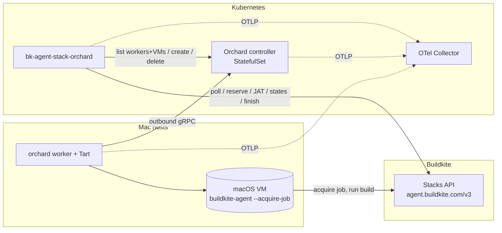
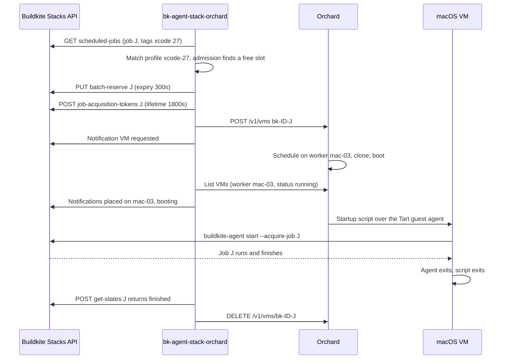

# bk-agent-stack-orchard — Target design

* Status: accepted
* Date: 2026-09-19
* Approved: 2026-09-20
* Companion documents:
  * [Product requirements](../product/requirements.md): requirement identifiers such as `PR-005`
  * [System design baseline](system-design-baseline.md): driver identifiers such
    as `QA-01`
  * [Architecture decision records](../adrs/README.md): ADR-0001 to ADR-0016

## Conventions

The key words "MUST", "MUST NOT", "REQUIRED", "SHALL", "SHALL NOT", "SHOULD", "SHOULD NOT",
"RECOMMENDED", "NOT RECOMMENDED", "MAY", and "OPTIONAL" in this document are to be
interpreted as described in BCP 14 [RFC 2119] [RFC 8174] when, and only when, they appear in
all capitals, as shown here.

This document uses ASD-STE100 Simplified Technical English. Code identifiers, API names, and
state names in `code format` are technical names.

## 1. Purpose

`bk-agent-stack-orchard` runs Buildkite jobs on temporary macOS virtual machines (VMs). The
VMs operate on self-hosted Apple silicon Macs.

The controller monitors a Buildkite queue for scheduled jobs. For each job, it starts one new
Tart VM through Orchard. When the job ends, the controller deletes the VM. This behavior is the
macOS equivalent of the Buildkite `agent-stack-k8s`.

The fleet is new. This project introduces Tart, Orchard, and the controller.

## 2. Scope

**In scope**

1. One Go binary that implements a Buildkite **custom stack** with the Stacks API.
2. One temporary VM for each job. The controller creates the VM on demand and deletes it after
   the job ends.
3. Selection of a VM **profile** by job tags. A profile sets the image, CPU, memory, disk, and
   worker labels.
4. Procedures for failures, timeouts, and restart recovery, without persistent controller state.
5. OpenTelemetry metrics, traces, and logs.
6. A reference deployment of the controller and the Orchard controller on Kubernetes. The Mac
   hosts are Orchard workers. The controller MUST NOT depend on Kubernetes. It MUST run as a
   plain process on other platforms.

**Target scale.** The design MUST support 10 to 50 Macs (20 to 100 concurrent macOS VMs). The
first rollout uses 2 to 10 Macs. Development uses one Mac (SC-01, SC-02).

**Quality targets.** The system design baseline owns the quality targets. The start time is 60 s
or less (QA-01). The wait time is 15 min or less at planned capacity (QA-02). The recovery time is
less than 15 min (QA-03). The design MUST meet these targets.

**Non-goals** (§14 gives the roadmap)

* Warm pools of started VMs. The controller creates VMs only for scheduled jobs.
* Automatic scaling of the Mac hosts. The host pool is fixed and always on.
* Host directory caches, or other state that jobs share.
* Secret injection for each job. Jobs get secrets through standard Buildkite mechanisms.
* High availability of the controller or of Orchard. Instead, recovery takes less than 15 min
  (QA-03).
* Operation in more than one region. Each additional region uses a new queue with its own fleet
  (SE-10).

## 3. Background and constraints

The design depends on these facts. Each fact was verified against source code or documentation.

| Fact | Source | Result for the design |
|---|---|---|
| The Stacks API accepts only a cluster agent token (`bkct_`). | Buildkite docs, `apis/agent_api/stacks.md` | The controller keeps a cluster agent token (§9.2). |
| The scheduled-jobs list gives all jobs in the queue. It does not filter by other tags. It does not include reserved jobs. | Stacks API docs | The controller does the tag match (§5). |
| The scheduled-jobs call takes `limit` (page size, maximum 1000) and `after` (a cursor). The answer has `page_info.has_next_page` and `page_info.end_cursor`. The API orders the jobs by `scheduled_at`, oldest first. A call returns one page, and the library does not read the next page. Paging does not cover a snapshot: new jobs can appear behind the cursor. The documentation advises to read the first few pages only, and to reserve the jobs. | Buildkite Stacks API documentation, https://buildkite.com/docs/apis/agent-api/stacks (read 2026-11-01); `buildkite/stacksapi` v1.2.0 `scheduled_jobs.go` | The Poller asks for 1000 jobs in each call, and it reads at most 3 pages in one tick, from the head of the list (§6.3). |
| A reservation lasts 900 s by default and 3600 s maximum. A second reserve call extends it. When a reservation expires, the job becomes `scheduled` again. | Stacks API docs | The controller uses short reservations. It extends them while a VM starts (§6, §7). |
| A job acquisition token (`bkjat_`) connects an agent to one reserved job. The token expires early if the reservation expires. At agent registration, Buildkite applies the expiry and the allowed IP addresses of the agent token that issued the JAT. | `buildkite/stacksapi` v1.2.0 `IssueJobAcquisitionTokens`; `buildkite/docs` `pages/agent/self_hosted/job_acquisition_tokens.md` (2026-08-26) | Only a job acquisition token goes into a VM (§9.1). The agent token allowlist MUST contain the job VM egress addresses (§9.2). |
| `token_lifetime_seconds` of a job acquisition token has a minimum of 1, a maximum of 3600, and a default of 900. `reservation_expiry_seconds` has a default of 900 and a maximum of 3600. | Buildkite Stacks API documentation, https://buildkite.com/docs/apis/agent-api/stacks (read 2026-11-01) | The limits of 3600 s are the limits of the API. The controller refuses a `reservationExpiry` that is more than 3600 s. It refuses a `jobTokenLifetime` that is more than 1800 s, which is the security limit of §9.1. It refuses both values if they are less than 1 s, so that the refusal comes at start-up and not at the first job (§8). |
| The `detail` of a stack notification must not be empty and cannot exceed 256 characters. The unit is characters. | Buildkite Stacks API documentation, https://buildkite.com/docs/apis/agent-api/stacks (read 2026-11-01) | The controller cuts a detail to 256 characters, counted as runes and cut between characters, and ends a cut detail with an ellipsis. It sends "(no detail)" in place of an empty detail (§10.5). |
| A stack notification needs no reservation, and the job does not have to be in a particular state. Only a job that finished more than 300 s ago cannot get one. A job can have at most 100 notifications. A request can carry at most 1000 notifications. When some lines fail, the response has `errors` entries with 0-based `indexes`, and the valid notifications are still created. The limit is 200 requests per second for each stack. | Buildkite Stacks API documentation, https://buildkite.com/docs/apis/agent-api/stacks (read 2026-11-01) | The controller sends a skip notice for a job that it does not hold. It sends at most 1000 lines in one call (`NotificationsPerRequest`), and it reads the refused indexes of a partial answer. A notice for each job is written once while the job stays listed (§5), so that the 100-line limit of one job stays far away. |
| The `detail` of a finish request has a maximum of 4 KB. The documentation does not state the unit. `exit_status` defaults to -1. | Buildkite Stacks API documentation, https://buildkite.com/docs/apis/agent-api/stacks (read 2026-11-01) | The controller counts the 4 KB in bytes, which is never more than a count in characters, and it shortens the detail to the budget before it finishes a job (§6). |
| The finish request has no `signal_reason` field, so the controller cannot set it. The Buildkite platform generates a `signal_reason` of `stack_error` for such a job. Pipeline authors use `signal_reason: stack_error` with `limit: 0` in their automatic retry rules. Whether the platform generates `stack_error` for every job that the controller finishes is `UNKNOWN` (owner: the maintainer; trigger: the first runs of T-100 to T-105). | Buildkite Stacks API documentation, https://buildkite.com/docs/apis/agent-api/stacks (read 2026-11-01); `buildkite/stacksapi` v1.2.0 `finish.go` | The controller finishes a failed job with exit status -1 and a detail (§7.6). |
| `maxVMLifetime` is 25 h by default. The Reaper deletes a VM that is older than this, for any job state (row 2 of §7.2). A job that still runs at 25 h loses its VM and its agent. After the agent acquired the job, the Buildkite lost-agent procedure controls the result, and the controller does not finish the job (§7.1, rule 5). The job result that Buildkite gives in this case is `UNKNOWN` (owner: the maintainer; trigger: the first end-to-end run of a job that outlives `maxVMLifetime`). | Derived from `internal/reaper/decide.go` and §7.2, §7.1 (checked 2026-11-01) | A pipeline step with a run time near 25 h MUST set a lower job timeout. The default of 25 h is the safety limit in SC-06, not a job limit. |
| `buildkite-agent start --acquire-job` exits with code 27 if the job is already taken, cancelled, or complete (HTTP 422). | `buildkite/agent` v4.0.3 release notes (2026-09-10); `core/client.go` | The rule "the job is terminal, delete the VM" covers this case. |
| Buildkite agent v4 is the stable line (v4.0.0 on 2026-09-01; v4.9.0 on 2026-10-30, checked 2026-11-01). v4.7.0 is a security release: it rejects compromised eMudhra certificate chains (CVE-2026-111943). v4 exits immediately when a flag is not defined. v4 keeps `--acquire-job`, `BUILDKITE_AGENT_ACQUIRE_JOB`, and `BUILDKITE_OPENTELEMETRY_TRACING`, and it adds `BUILDKITE_OPENTELEMETRY_METRICS`. v4 removes the OpenTracing and Datadog backends. | `buildkite/agent` releases and `clicommand/agent_start.go` at v4.0.4 (2026-09-19) | The image MUST contain agent v4.7.0 or later (§5). The startup script uses only v4 flags. |
| Orchard `startup_script.transport` accepts `ssh` (the default) and `tart-guest-agent`. The guest-agent transport operates only on the Tart runtime, and the worker connects through the VM control socket. For both transports, the worker builds the same script: `set -e`, one `export` line for each `env` entry, then `script_content`. | Orchard `pkg/resource/v1/v1.go` and `internal/worker/vmmanager/base` at tag 0.57.0 | §6.4 uses the guest-agent transport. VM specifications need no SSH credentials. |
| Apple permits 2 concurrent macOS VMs on each host. Orchard models this limit with the worker resource `org.cirruslabs.tart-vms: 2`. | Orchard `api_vms.go`; Apple EULA | Capacity is small. Admission examines capacity before it reserves a job (§6.3). |
| Orchard VM `labels` are placement constraints. Orchard puts a VM only on a worker whose labels contain all VM labels. | Orchard `scheduler.go` | Labels contain only worker constraints. The VM name identifies the owner (§6.1). |
| The Orchard VM list can filter only by `worker=`. | Orchard `pkg/resource/v1/v1.go` `Match` | The controller lists all VMs and filters them by name prefix. |
| Orchard recommends names that contain only `[a-z0-9-]`, have a maximum of 63 characters, and start and end with a letter or a digit. | Orchard `internal/simplename` | This sets the VM name format and the `controllerID` length limit (§6.1). |
| If a startup script exits with 0, the VM stays `running`. A non-zero exit or a guest shutdown changes the VM to `failed`. Orchard does not delete VMs automatically. | Orchard `vmmanager/base/base.go`, `worker/fsm.go` | The Buildkite job state controls teardown. The controller deletes each VM that it creates (§7). |
| Orchard bin-packs CPU and memory only when a VM requests them as resources. | Orchard `scheduler.go` | Each VM requests `logical-cores` and `memory-mib` resources. |
| Orchard releases before 0.57.0 can release worker capacity before a VM stops. Pull requests #465 and #470 correct this. Orchard 0.57.0 (2026-09-15) contains both. | Orchard 0.57.0 release notes | §9.2 sets the minimum Orchard version. |
| Orchard exports OTel metrics through OTLP. If the endpoint is not set, Orchard uses `localhost:4318`. | Orchard `internal/opentelemetry` | Each Orchard process MUST have an explicit endpoint (§11). |
| Tart and Orchard use the FSL-1.1-ALv2 licence (since 2026-06-05). The licence permits all use except a competing commercial product. | `LICENSE` in `openai/tart` and `openai/orchard` | This project can use Tart and Orchard without cost. The tart.run licensing page is out of date. The `LICENSE` file is the authority. |
| Orchard and its Go client carry the FSL-1.1-ALv2 licence, which permits every purpose except a competing use. This project uses the AGPL-3.0, which forbids a further restriction on a distributed work. The Orchard OpenAPI file is also under the FSL. | `LICENSE` of `openai/orchard`; AGPL-3.0 section 10 (2026-09-19) | The controller contains no Orchard code, and it does not generate code from an Orchard file. §15 gives the client rule. |

**References.** ADR-0005 records the selection of Tart and Orchard. ADR-0006 records the tag
match. ADR-0007 records the dedicated queue. ADR-0008 records the cluster agent token. ADR-0009
records the startup-script transport.

## 4. Architecture

### C4 model

The C4 model of this project is in `docs/architecture/workspace.dsl` (Structurizr DSL). The
model has three views:

| C4 level | View | Contents |
|---|---|---|
| 1 — System context | `SystemContext` | `bk-agent-stack-orchard`, the pipeline author, the fleet operator, and the external systems: Buildkite, the OCI registry, source hosts and remote caches, Kubernetes, and the telemetry backend. |
| 2 — Container | `Containers` | The controller, the Orchard controller, the Orchard state store, the Orchard worker, Tart, and the job VM. |
| 3 — Component | `ControllerComponents` | The components of the controller (see "Components" below). The other containers are third-party software, so the model does not decompose them. |

The workspace MUST be the source of truth for these diagrams. A change to a component, a
container, or a relationship MUST update the workspace in the same commit.

CI MUST validate the workspace with the `structurizr/structurizr` image. The earlier
`structurizr/cli` image receives no more updates, so CI MUST NOT use it.

```sh
docker run --rm \
  -v "$(git rev-parse --show-toplevel)/docs/architecture:/usr/local/structurizr" \
  structurizr/structurizr validate -workspace /usr/local/structurizr/workspace.dsl
```

The command uses the repository root, so it operates from all directories in the repository.
If the mount source does not exist, Docker mounts an empty directory, and the command fails
with "workspace.dsl does not exist".

`docs/architecture/c4.md` contains Mermaid versions of the three views for review in Markdown.
`docs/architecture/render-c4-md.sh` generates the file. The script exports the views with
`structurizr/structurizr export -format mermaid` and converts the HTML labels to plain text.
Markdown renderers that run Mermaid with `securityLevel: strict` and `htmlLabels: false` cannot
show HTML labels. CI MUST run the script and MUST fail if the committed file is different.

### Overview



The controller does not keep durable state. At each tick, it gets its view from two sources:

* the Orchard VM list and worker list,
* the Buildkite job states.

In-memory data is only a cache. The loss of this cache is always safe.

### Components

| Component | Function | Dependencies |
|---|---|---|
| **Stack** | Registers one stack at start-up: `type: custom`, `key = controllerID`, `queue_key = buildkite.queue`. Deregisters the stack at shutdown. Gives the `dispatch_paused` value. | `Stacks` client |
| **Poller** | Lists the first page of scheduled jobs at each `pollInterval` (1 s). Obeys `Retry-After`. | `Stacks` client |
| **Matcher** | Pure function. Converts the job `agent_query_rules` to exactly one profile, or to a mismatch reason. | Configuration |
| **Inventory** | Lists Orchard workers and VMs at each `inventoryInterval` (1 s). Selects owned VMs by name prefix. Parses the job UUIDs. | `Orchard` client |
| **JobStates** | Gets the Buildkite job states of owned VMs in one batch at each `jobStatesInterval` (5 s). Records the observation time for each job, and whether Buildkite named the job. A call that fails keeps the states before it, with their times. | `Stacks` client |
| **Admission** | Pure function. Input: scheduled jobs, inventory, profiles, and `maxInFlight`. Output: jobs to start, and unmatched jobs to skip. | Matcher, Inventory |
| **Launcher** | For admitted jobs: reserves the jobs, gets job acquisition tokens, and creates VMs. Sends stack notifications. | `Stacks` client, `Orchard` client |
| **Reaper** | Pure decision function for each owned VM, and an executor. Actions: delete the VM, finish the job, extend the reservation, or send a notification. | Inventory, JobStates |
| **Telemetry** | Configures the OTel meter, tracer, and slog bridge from the standard `OTEL_*` environment variables. | OTel SDK |

`Stacks` and `Orchard` MUST be narrow Go interfaces over `github.com/buildkite/stacksapi` and the
Orchard client of this project (§15). All other components MUST be testable with in-memory fakes of
these interfaces.

### Control loop

One goroutine runs the tick. Each tick does these steps in sequence:

1. If the interval is complete, refresh Inventory and JobStates.
2. Run the Reaper on each owned VM.
3. If the stack is not paused, and the Inventory data and Poller data are fresh, run Admission.
   Then run the Launcher.

API calls in one step MAY run concurrently, with a concurrency limit. The steps MUST run in
sequence. Because of this, Admission always sees the Reaper deletions of the same tick.

An accepted delete, or a 404 for a VM that is already gone, takes the VM out of the last Inventory
answer. The VM stays out until the next refresh replaces the answer. Admission counts the room
that the delete freed for this reason. If Orchard is slow, the next refresh can list the VM again.

The loop MUST decide when a source is due, and it MUST measure the interval of a source between
ticks, not between the answers of the source. An answer arrives after its tick, and later still
for a source that waits for the ones before it in the same tick, so a comparison of answers reads
a source whose interval equals the tick interval at only every other tick. A source that failed
MUST wait for its interval like one that answered.

With 100 VMs, the controller makes approximately three API calls each second in a normal tick. A
tick that lists a long queue makes up to 3 list requests (one for each page of 1000 jobs), and each
batch of at most 1000 notice lines adds one more call. All rate limits are higher. The Stacks API
limits are 10 requests/s for list and reserve, and 20 requests/s for get-states.

**Implements.** PR-001, PR-005, PR-010, QA-01, QA-04, DR-01, OP-04.

## 5. VM profiles and job match

A profile describes one type of VM:

```yaml
profiles:
  - name: xcode-27
    match: {xcode: "27"}
    image: ghcr.io/acme/bkaso-pilot@sha256:<digest>
    cpu: 8
    memoryMiB: 28672
    diskSizeGB: 150
    workerLabels: {pool: general}
    softnetAllow: ["10.20.30.40/32"]
    startupTransport: tart-guest-agent
    timeouts: {boot: 20m}
    otel: {enabled: false}
  - name: default
    match: {}
    image: ghcr.io/acme/bkaso-agent@sha256:<digest>
    cpu: 8
    memoryMiB: 28672
    diskSizeGB: 150
    workerLabels: {pool: general}
    startupTransport: tart-guest-agent
```

The CPU and memory values are examples. Pilot measurements set the real VM size (SC-08). Two VMs
run on each host, so the two VMs together MUST NOT need more than the host has (SC-02, SC-04). The
pilot profile uses Xcode 27 (PR-026).

**Match rule.** The Matcher MUST use exact match:

1. Parse the job `agent_query_rules` into a map.
2. Remove the `queue` key.
3. Select the profile whose `match` map is equal to the result.

For example, a job with the tags `{queue: macos, xcode: "27", size: large}` MUST NOT match a
profile with `match: {xcode: "27"}`. A profile with `match: {}` matches jobs that have no tag
other than `queue`.

**Unmatched jobs.** A job is unmatched if one of these conditions is true:

* No profile has a `match` map that is equal to the job tags.
* A rule does not have the format `key=literal`. Wildcards, negations, and rules with an
  incorrect format are in this group. A rule whose key or value has a comma, a newline, a
  carriage return, or a quote (`"` or `'`) is in this group also, because the agent of the job
  reads its tags as one comma-separated list (§5, VM specification). A key or a value with
  white space at an end is in this group also, because the agent trims each tag. A rule for
  `agent-stack` or `profile` is in this group with its own reason, because the controller sets
  both tags on every agent. The `queue` rule is not in this group: the matcher reads it and
  takes it out of the tags.

The controller MUST skip an unmatched job (ADR-0016). It MUST NOT reserve the job, MUST NOT finish
it, and MUST NOT give it capacity (I-8). The job stays `scheduled`, so that another stack or agent
of the queue can carry it. Buildkite times the job out, or a person cancels it.

For each unmatched job that has no entry in the notified set, the controller MUST do these things:

* Write one stack notification. The detail says in short why no profile carries the job: the
  reason, then the tags of the job. The Notify call cuts a detail at 256 characters
  (`NotificationLimit`), so the long message does not fit.
* Write the full message at info level in the log. It has the job identifier, the tags of the job,
  and the `match` map of each profile. The job identifier is in the log, and not in a metric
  (I-7).
* Add 1 to the counter `bkaso.job.skipped` (§10.1), for each notice that it writes.

The controller writes these notices after it reserves and starts the admitted jobs of the same
tick, so that a slow notification call cannot delay an admitted job. It sends at most 1000 lines
in one call (`NotificationsPerRequest`, §3). Each call has its own time limit of 10 s
(`notifyTimeout`), so that a call that retries cannot hold the loop for more than 10 s. The
Buildkite client and the Orchard client each have a limit of 30 s for a whole call for the same
reason. The Buildkite client also limits the body of an answer to 16 MiB, and a longer body fails
the call.

The controller keeps the identifiers of the jobs that it notified in a set in memory, so that it
writes the notice for a job once while the job stays listed and the process runs. The set has
these rules:

* A job enters the set when Buildkite accepts its line. If a call fails as a whole, the jobs of
  that call do not enter the set, and the controller tries again at the next tick. The controller
  still sends the later calls of the tick, so that a fixed refusal of one call cannot starve the
  jobs behind it. It writes one warning for each tick that has a failed call. If a call is partly
  refused, the response has the 0-based indexes of the refused lines. The accepted jobs enter the
  set, and only the refused jobs are tried again at the next tick.
* The controller evicts jobs from the set only after a complete listing: the read was not cut at
  `MaxPages`, and the last page had no cursor (§6.3). After a complete listing, a job that is
  not unmatched in the decision leaves the set. A job that comes back is notified again, and
  counted again.
* After a truncated listing, the controller keeps every entry, because a job that is not in the
  listing may only be hidden behind the pages.
* The set has a cap of 10 000 identifiers (`NotifiedLimit`). When the set is over the cap, the
  controller evicts the identifiers that it saw least recently. A decision cannot name more than
  3000 jobs (3 pages of 1000), so the cap holds only when the listing is truncated for a long time.
* The set is not stored. After a restart, the controller MAY write the notice for a job again,
  and it counts the job again. This costs one extra line on the job page, and a job gets at most
  100 lines (§3).

While the queue is paused, the controller MUST NOT start VMs, and it MUST NOT write new
notifications for unmatched jobs.

**Validation at start-up.** The controller MUST NOT start if one of these conditions is false:

* Profile names are unique and match `[a-z0-9-]+`.
* No two profiles have equal `match` maps.
* `match` keys and values are literals that are not empty. `queue`, `profile`, and `agent-stack`
  are not keys, because the controller sets these tags. No value has a comma, a quote, a newline,
  a carriage return, or white space at an end, because the agent reads its tags as one
  comma-separated list.
* `startupTransport` is `tart-guest-agent` (the default) or `ssh` (ADR-0009).
* A profile with `startupTransport: ssh` has `vmCredentials`, and both referenced environment
  variables exist and are not empty. Orchard uses `admin/admin` when a VM specification has no
  credentials. Because of this, a missing value is a fatal error for this transport. A profile
  with the guest-agent transport MUST NOT have `vmCredentials`.
* Each profile field that names an environment variable for its VM (`vmCredentials.usernameEnv`,
  `vmCredentials.passwordEnv`, and `otel.headersEnv`) names a variable that starts with
  `VM_`. The pod of the controller holds other secrets (for example a proxy URL with a password),
  and only a variable that the operator marks for the VM may go into one. The controller also
  refuses every name that starts with `BK_AGENT_STACK_ORCHARD_` (the controller secrets) or
  `OTEL_` (the collector credential and the per-signal headers variables), with a message that
  names the controller, as a second defence. The error names the profile, the field, and the
  variable.
* Each `softnetAllow` entry is an IPv4 CIDR range with a prefix length (`10.20.30.40/32`).
  Softnet takes IPv4 CIDRs only: it reads each `--allow` value as a rule that it builds with
  `ipnet::Ipv4Net` (Softnet `src/main.rs` and `lib/proxy/rule.rs`, read 2026-11-01), so the
  controller refuses every IPv6 prefix, including an IPv4-mapped one. The controller also
  refuses a bare address, an entry with host bits set (`10.0.0.1/16`, where the error gives the
  written form `10.0.0.0/16`), a default route (`0.0.0.0/0`), a range wider than /16, and a
  duplicate. It refuses the Softnet targets `@host` and `@peers` on purpose: `@host` opens the
  Mac host to the build, and `@peers` opens the other VMs, and §9.1 closes both. The CIDRs go
  unchanged into the VM specification and into the pf rules of the hosts, so the controller does
  not correct an entry, and an error names the profile and the entry. The /16 bound is a project
  choice, and the project does not test a bare address.
* When `profile.otel.enabled` is true, `profile.otel.endpoint` uses `https`. Plain HTTP is
  acceptable only on a loopback address (§10.4).
* For each profile, `unplaced + boot + acquire ≤ jobTokenLifetime` (§7.3).

If a profile `image` has no digest, the controller MUST write a warning. The controller then
starts.

If a profile has `softnetAllow` entries, the controller MUST write a warning at start that names
the profile and says that every pipeline on the queue gets the allow (§9.1).

The fleet operator MUST set `diskSizeGB` to at least the disk size of the profile image. The pilot
image has a 104 GB disk, and other Xcode images up to 140 GB (SC-07). Tart refuses a disk that is
smaller than the disk of the image, in bytes. A macOS 27 guest grows its APFS container to the disk
at boot (2026-10-10), so a larger `diskSizeGB` gives a job more space.

**Image contents.** Each profile image MUST contain `buildkite-agent` v4 and its hooks (CO-06).
An image for the guest-agent transport MUST also run the Tart guest agent. The image build of
this project installs it and its launchd jobs (ADR-0012, 2026-11-01).

**Implements.** PR-003, PR-004, PR-020, PR-021, PR-026, QA-05, SC-07, SC-08.

## 6. Job lifecycle

### 6.1 Identity

* **Stack key:** `controllerID`.
* **VM name:** `bk-<controllerID>-<job-uuid>`. `controllerID` MUST match
  `^[a-z0-9]([a-z0-9-]{0,21}[a-z0-9])?$` (maximum 23 characters). Because of this, the VM name
  has a maximum of 63 characters.
* **Owner:** the controller owns a VM if, and only if, the VM name starts with
  `bk-<controllerID>-`. The remaining text is the job UUID.
* **VM labels:** only the profile `workerLabels`.
* **Profile of an owned VM:** not necessary. Capacity accounting uses the `resources` and
  `labels` of the VM.

### 6.2 Normal sequence



### 6.3 Admission

Admission MUST run only when all of these conditions are true:

* The queue is not `dispatch_paused`.
* The Inventory data is newer than `stateFreshness` (60 s).
* The scheduled-jobs list is newer than `stateFreshness`.

A source whose calls fail keeps its last data. The Reaper continues, because its own rules (§7.2)
decide what old data permits it to do.

Admission does these steps:

1. **Candidates.** Select the matched scheduled jobs that have no owned VM with the same name,
   and that this process does not hold. This process owns each job that it reserved, and each
   job whose VM it requested. This is also true when the Inventory does not show the VM yet. The
   Inventory sees a launch only at its next refresh. A failed poll keeps the last answer, and that
   answer can still list the job. Sort them by Buildkite `priority` (highest first), then by
   `scheduled_at` (oldest first).
2. **In-flight limit.** Stop when the number of owned VMs, plus the VMs that this process requested
   and the Inventory data does not show yet, plus admitted jobs, is equal to `maxInFlight`. The
   count includes every owned VM, also a VM in the `failed` status, until the Reaper deletes it. A
   delete that Orchard accepts takes the VM out of the count in the same tick (§4). The Reaper
   tries again at the next tick after a delete that failed, so the count is conservative and it
   lasts a short time. The default value of `maxInFlight` is 0, which means the total VM slots of
   the eligible workers. Because of this, the limit follows the fleet, and it does not hold slots
   empty at the target scale (SC-01, QA-02). A value more than 0 limits the controller to that
   number of VMs, for example during a pilot.
3. **Eligible workers for each profile.** A worker is eligible if it is online, it is not paused
   for scheduling, and its labels contain the profile `workerLabels`.
4. **Free resources of each worker.** Subtract the resources of all VMs on the worker from the
   resources that the worker advertises. Include the VMs of all owners. Count the VMs in the
   same way as the Orchard scheduler (`internal/controller/scheduler/scheduler.go` at the minimum
   Orchard version of §9.2). A VM holds resources only when it is scheduled. The controller reads
   the `scheduled` condition of the VM, as `IsScheduled` of `pkg/resource/v1/v1.go` does. When
   the VM has no `scheduled` condition, the VM is scheduled if, and only if, it has a worker.
   Orchard sets the condition to `false` for a VM that reached a terminal state, and the VM keeps
   its worker name. Such a VM holds no resources (Orchard 0.58.0, commit 22bd63c34674, checked
   2026-11-01).
   The controller also gives no hypothetical placement to a VM in the `failed` status, because the
   Orchard scheduler skips a VM in a terminal state when it places VMs.
5. **Unplaced VMs.** Give a hypothetical placement to the VMs of all owners that are not scheduled
   and are not failed, and to the VMs that this process requested and the Inventory data does not
   show yet. Use the first eligible worker with sufficient free resources. For a VM of Orchard, a
   worker is eligible only if its labels contain the labels of the VM, and the VMs go in the order
   of their creation. The Orchard scheduler does the same. A VM that no worker can take takes no
   resources.
6. **Admit.** For each candidate in sequence, find the first eligible worker with sufficient
   free `tart-vms`, `logical-cores`, and `memory-mib`. Subtract the resources. If no worker has
   sufficient resources, skip the candidate. A skipped candidate does not stop the next
   candidates.

Hypothetical placement is only for accounting. Orchard makes the real placement decision. The
controller MUST NOT pin a VM to a worker. A second scheduler in the controller can disagree with
the Orchard scheduler. Image pull before use (§11) gives most of the benefit of placement that
knows the image cache.

Admission also gives the list of unmatched scheduled jobs (§5). The Launcher MUST NOT reserve
these jobs, and MUST NOT finish them. It MUST NOT get a token or create a VM for them. It writes
one notification for each of them, once (§5, unmatched jobs). The `batch-reserve` call holds the
admitted jobs only.

**Reading the queue.** The Poller reads the list from its head at each tick. It asks for 1000
jobs in each call, which is the largest page that the API accepts (§3). The size is a constant
and it does not follow the slots of the fleet, because the list holds jobs that never leave it:
unmatched jobs, which the controller skips (ADR-0016), jobs for other tags, and jobs that the API
refuses with 422. The Poller reads at most 3 pages (`MaxPages`) in one tick. It keeps each job
once, at its first place, because a cursor over a list that changes can give a job twice. If a
page fails, the Poller keeps the answer of the last whole read.

More than 3 pages of 1000 jobs that never leave the list hide the jobs after them, and the
controller never sees these jobs. This limit is `UNKNOWN`, in the sense that it is not measured
(owner: the maintainer; trigger: the pilot, or the first warning of this kind). A read that
stops at the cap with a page left writes a warning in the log, and it adds 1 to the counter
`bkaso.queue.truncated` (§10.1). An operator MUST treat this counter as a sign that jobs may be
hidden.

### 6.4 Launch

For the admitted jobs, the Launcher MUST do these steps:

1. Send `PUT batch-reserve` with `reservation_expiry_seconds = reservationExpiry` (300).
   Continue only with the jobs in the `reserved` list. Record `reservedUntil` in memory, counted
   from the time that the call left. The reservation starts when Buildkite handles the call, which
   is after the call left, so this end is never later than the true end, and the renewal of row 13
   comes early and never late.
2. Send `POST job-acquisition-tokens` for the reserved jobs with
   `token_lifetime_seconds = jobTokenLifetime` (1800). Skip the jobs in `not_issued`. Their
   reservations expire.
3. Send `POST /v1/vms` for each job, with the specification below.
4. Send a stack notification for each job: "VM requested".

```json
{
  "name": "bk-macos-prod-<job-uuid>",
  "image": "<profile.image>",
  "imagePullPolicy": "IfNotPresent",
  "os": "darwin",
  "cpu": 8,
  "memory": 28672,
  "diskSize": 150,
  "headless": true,
  "randomSerial": true,
  "netSoftnet": true,
  "netSoftnetAllow": ["<profile.softnetAllow>"],
  "restart_policy": "Never",
  "labels": {"pool": "general"},
  "resources": {
    "org.cirruslabs.tart-vms": 1,
    "org.cirruslabs.logical-cores": 8,
    "org.cirruslabs.memory-mib": 28672
  },
  "startup_script": {
    "transport": "tart-guest-agent",
    "script_content": "buildkite-agent start",
    "env": {
      "BUILDKITE_AGENT_TOKEN": "<job acquisition token>",
      "BUILDKITE_AGENT_ACQUIRE_JOB": "<job-uuid>",
      "BUILDKITE_AGENT_NAME": "bk-macos-prod-<job-uuid>",
      "BUILDKITE_AGENT_TAGS": "queue=macos,agent-stack=orchard,profile=xcode-27,xcode=27"
    }
  }
}
```

A `409 Conflict` response means that a VM with the same name exists. The Launcher MUST treat
this response as a successful launch.

Orchard adds `set -e` before the script, and one `export NAME=value` line for each `env` entry.
Because of this, a non-zero agent exit status is also the script exit status. The worker refuses
a name that is not a valid shell name, and it quotes each value with `syntax.Quote` of
`mvdan.cc/sh/v3/syntax`, in the zsh dialect for a `darwin` VM. A value that the function cannot
quote (a value with a NUL byte) fails the VM with an error, and it never becomes script text.
The function wraps a value in single quotes, or in `$'...'` with escapes when the value has a
character that cannot be printed (`syntax/quote.go` of `mvdan/sh`, read on 2026-11-01). Both
transports use the same script (`internal/worker/vmmanager/base/base.go` of Orchard 0.58.0, read
through the GitHub API on 2026-11-01). The order of the `export` lines is the order of a Go map,
so it is not stable, and no value can depend on another.

The transport is `tart-guest-agent` (ADR-0009). With this transport, the Orchard worker uses the
VM control socket, and the VM specification contains no credentials. A profile with
`startupTransport: ssh` gets `username` and `password` from its `vmCredentials` instead. The
`env` values and the event log are the same for both transports.

`BUILDKITE_AGENT_TAGS` is the tag list of the agent. It holds `queue=<queue>`,
`agent-stack=orchard`, and `profile=<profile name>`, in this order, and then each `key=value` of
the literal tags of the job, without the `queue` tag, sorted by key. A comma joins the entries.
The agent reads `BUILDKITE_AGENT_TAGS` as the source of its `--tags` option (`buildkite/agent`,
`clicommand/agent_start.go` at v4.9.0, checked 2026-11-01). Because of this, the startup script
has no tag text, and no tag value is ever part of shell text. The controller MUST refuse a tag
whose key or value is empty, has white space at an end, or has a comma, a newline, a carriage
return, or a quote, and a tag named `queue`, `agent-stack`, or `profile`. The
matcher refuses these tags first (§5, unmatched jobs), and the VM specification builder refuses
them again.

The image MUST contain `buildkite-agent` v4 and its hooks (§5). The controller MUST add only
the environment variables above. When `profile.otel.enabled` is true, the controller also adds
the OTel variables of §10.4.

**Implements.** PR-001, PR-005, PR-006, PR-007, PR-009, QA-01, QA-02, DR-01, SC-02.

## 7. Failures and recovery

### 7.1 Principles

1. **Observed state only.** Decisions MUST use Inventory data and JobStates data. Decisions
   MUST NOT use counters. Timeouts MUST use the Orchard timestamps `createdAt`, `scheduled_at`,
   and `started_at`. Because of this, timeouts continue to operate after a controller restart.
2. **Causally fresh job state.** The Reaper MUST use a job state for a VM only if the controller
   observed the state after the VM `createdAt`. If the state is older, the Reaper MUST wait for
   the next JobStates refresh. The observation time of a state MUST be the time that JobStates
   sent the request, which is the earliest moment that the answer can describe. A time taken
   from the answer makes a state look newer than it is, and this rule and the next one would
   then trust it too soon.
3. **Fresh data or no action.** If the job state of a VM is older than `stateFreshness` (60 s),
   the Reaper MUST do only the orphan action and the maximum-lifetime action.
4. **Permanent errors are terminal.** If finish, get-states, or delete returns 404 or 422, the
   controller MUST mark the job as ignored in memory. The controller MUST NOT send the call
   again in a loop.
5. **Fail a job only before an agent acquires it.** After an agent acquires a job, the Buildkite
   lost-agent procedure controls the job result. The controller MUST NOT finish that job. The
   controller MUST only delete the VM.

### 7.2 Reaper decision table

The Reaper MUST examine each owned VM at each tick. The first row that matches applies.

| # | VM (Orchard) | Job (Buildkite) | Action | `reason` |
|---|---|---|---|---|
| 1 | The name has the owned prefix but no valid UUID | — | Delete the VM. | `orphan` |
| 2 | The age since `createdAt` is more than `maxVMLifetime` (25 h) | Any | Delete the VM. | `lifetime` |
| 3 | Any | Not causally fresh, or stale | No action. | — |
| 4 | Any | Terminal: `finished`, `canceled`, `expired`, `timed_out`, `skipped`, `broken` | Delete the VM. | `job_terminal` |
| 5 | Any | Unknown to Buildkite (404, or not in the get-states result) | Delete the VM. Ignore the job. | `job_unknown` |
| 6 | Any | `scheduled` (the reservation expired) | Delete the VM. | `reservation_lapsed` |
| 7 | `failed` | An agent owns the job: `assigned`, `accepted`, `running`, `canceling`, `timing_out` | Send a notification with `status_message`. Delete the VM. | `vm_failed` |
| 8 | Not `failed` | An agent owns the job | No action. | — |
| 9 | `failed` | `reserved` | Finish the job (`-1`, `status_message`, and the last 50 startup-script log lines when the script wrote any). Delete the VM. | `vm_failed` |
| 10 | `pending`, no worker, and the age since `createdAt` is more than `unplaced` (2 min) | `reserved` | Delete the VM. Do not extend the reservation. The job becomes `scheduled` again, and Admission starts it again. | `unplaced_timeout` |
| 11 | `pending`, a worker is set, and the age since `scheduled_at` is more than `boot` (15 min) | `reserved` | Finish the job (`-1`, `status_message`). Delete the VM. | `boot_timeout` |
| 12 | `running`, and the age since `started_at` is more than `acquire` (5 min) | `reserved` | Finish the job (`-1`, the last 50 startup-script log lines from `GET /v1/vms/{name}/events`). Delete the VM. | `acquire_timeout` |
| 13 | `pending` or `running` | `reserved` | Extend the reservation when `reservedUntil − now` is less than `reservationRenewBefore` (120 s). If `reservedUntil` is unknown, extend it immediately. | — |

The timeouts of a VM are the effective timeouts of its profile. A VM does not carry the name of
its profile (§6.1), so after a restart the controller cannot name the profile of a VM that it did
not start. The Reaper MUST then use the largest value of each timeout across the profiles. A
restart MUST NOT end a VM sooner than its own profile allows: a VM that stays longer costs a slot,
and a job that the controller ends early costs a build.

Orchard sets the VM status to `running` when the Tart VM process starts. At this time, macOS has
not completed its boot. Because of this:

* The `boot` timeout includes the image pull, the clone, and the configuration.
* The `acquire` timeout includes the guest OS boot, the guest agent, and the agent start.

If no row matches (for example, a job state that the controller does not know), the Reaper MUST
take no action. The Reaper MUST write a warning log with the VM phase and the job state. Row 2
still limits the life of this VM.

The controller MUST cut finish-job detail messages to a maximum of 4 KB at a rune boundary. The
`stacksapi` library makes this cut, at the end of the detail, and it notes the cut there. A message
whose end holds its reason MUST shorten itself below the limit of the library, so that the library
cuts nothing: the message of an acquire timeout drops its oldest startup-script lines, and keeps its
newest. A guest writes the startup-script lines and can influence the status message of a VM, so
the controller MUST drop each control character of this text, except the line break and the tab,
and each Unicode format character (category Cf, such as the bidirectional overrides and the
zero-width characters) and each line or paragraph separator, before it builds the message. The
message MUST hold at most a quarter of the budget (`statusBudget`) of the status message of the
VM, cut between characters, so that the lines of the startup script keep their room. The controller
MUST send all reservation extensions of one tick in
one `batch-reserve` call.

### 7.3 Timeout consistency

The sum `unplaced + boot + acquire` MUST NOT be more than `jobTokenLifetime`. If the sum is
more, a slow but healthy VM can start with an expired token.

With the default values, the sum is 2 min + 15 min + 5 min = 22 min. This is less than 30 min.
The controller MUST validate this sum for each profile at start-up. The validation MUST include
the timeout values that a profile overrides.

### 7.4 Crash windows and restart

At start-up, before the first Admission, the controller MUST do these steps:

1. Register the stack. This call is idempotent.
2. List all VMs, and select the owned VMs.
3. Get the job states of these VMs.
4. Run a full Reaper pass. `reservedUntil` is unknown, so row 13 extends all reservations
   immediately.

| Stop point | Result |
|---|---|
| After the reservation, before the VM creation | No VM exists, so the controller cannot see the job. The reservation expires in a maximum of `reservationExpiry` (300 s). Admission then starts the job again. The accepted cost is a delay of up to 5 minutes for these jobs. |
| After the VM creation | The controller finds the VM by its name. The Reaper then controls the VM. |
| Between the finish call and the delete call | The controller sends the delete call again at the next tick. A second finish call returns 422. The controller treats 422 as complete. |

### 7.5 Dependency outages

| Outage | Behavior |
|---|---|
| The Orchard controller is not available | Inventory data becomes stale. Admission stops. The Reaper cannot delete VMs. VMs on the workers continue to run. Readiness fails. Liveness passes. |
| The Buildkite API is not available, or applies a rate limit | The controller obeys `Retry-After`. JobStates data becomes stale. The controller does not reserve or finish jobs. The controller deletes VMs only for rows 1 and 2. |
| A worker is offline | After the worker offline timeout (3 min), Orchard sets the VMs of the worker to `failed`. Rows 7 and 9 apply. `restart_policy: Never` prevents a new VM for the same job on a different worker. |
| The queue is `dispatch_paused` | Admission stops. The controller does not write new notifications for unmatched jobs. The Reaper continues for existing VMs. |

### 7.6 Pipeline guidance

The controller finishes a job that it fails with exit status -1 and a detail. It cannot set a
`signal_reason`, because the finish request has no such field. The Buildkite platform generates
the `signal_reason` `stack_error` for such a job. Pipeline authors use `signal_reason:
stack_error` with `limit: 0` in the automatic retry rules of their steps (Buildkite Stacks API
documentation, read 2026-11-01). Whether the platform generates `stack_error` for every job that
the controller finishes is `UNKNOWN` (owner: the maintainer; trigger: the first runs of T-100 to
T-105). The pipeline author guide gives the retry guidance.

**Artifact destination.** Build artifacts MUST NOT go to Buildkite-managed storage (PR-032,
SE-08). Each image MUST have an `environment` agent hook that sets
`BUILDKITE_ARTIFACT_UPLOAD_DESTINATION` to owner-managed storage in the operating country, for
example `s3://<owner-bucket>/$BUILDKITE_PIPELINE_SLUG/$BUILDKITE_BUILD_ID/$BUILDKITE_JOB_ID`. A
pipeline step MAY set a different destination in the same storage. The end-to-end scenarios
(§12) MUST confirm that a job with an artifact writes to this storage only.

**Implements.** PR-002, PR-007, PR-008, PR-010, PR-011, PR-012, QA-03, QA-05, QA-06, DR-02.

## 8. Configuration

The configuration is one YAML file. The file MUST NOT contain secrets. Secrets MUST come from
environment variables. The platform that runs the controller supplies these variables. On
Kubernetes, Secrets supply them. On other platforms, the process manager or a secret store
supplies them.

```yaml
controllerID: macos-prod
buildkite:
  queue: macos
  endpoint: https://agent.buildkite.com/v3
  pollInterval: 1s
  jobStatesInterval: 5s
  reservationExpiry: 300s
  reservationRenewBefore: 120s
  jobTokenLifetime: 1800s
orchard:
  url: https://orchard.internal:6120
  serviceAccount: bk-agent-stack-orchard
  inventoryInterval: 1s
  workerOfflineTimeout: 3m # MUST match the worker offline timeout of the Orchard controller
maxInFlight: 0 # 0 means the total VM slots of the eligible workers
stateFreshness: 60s
healthAddress: ":8080" # the gRPC health service of the probes
defaults:
  timeouts:
    unplaced: 2m
    boot: 15m
    acquire: 5m
    maxVMLifetime: 25h
profiles: [] # see §5
```

The controller MUST refuse a `reservationExpiry` that is more than 3600 s, and a
`jobTokenLifetime` that is more than 1800 s. It MUST also refuse either value if it is less than
1 s or not a whole number of seconds (§3). The limit of 3600 s is the limit of the API. The limit
of 1800 s for the token is the security limit of §9.1, and it is shorter than the limit of the
API. The controller also refuses a `buildkite.queue` with a comma, a quote, a newline, a carriage
return, or white space at an end, because the queue is the first tag of the agent. It reports the
key and the limit, and it does not start.

The controller serves the gRPC health checking protocol (`grpc.health.v1`) on `healthAddress`,
with the services `liveness` and `readiness`. The empty service name, which is the health of the
whole server in the protocol, follows `readiness`. The controller serves no other endpoint, and
gRPC is in the binary already, because the OTLP exporters use it. Kubernetes probes the service
natively (`grpc: {port, service}`).

`liveness` serves while the process serves, and it does not depend on either API, because a
restart cures nothing that an API causes. `readiness` stops serving while the last answer of a
source is older than `stateFreshness` (§8), or after the Stacks API returned HTTP 401. The
controller gives `stateFreshness` to the readiness check as its window. The configuration requires
`stateFreshness` to be longer than the interval of each source, so a source that answers on time
never makes the controller unready. The protocol carries no reason, so the controller writes a log
record at each change of readiness, and a record of `not ready` names each reason. A
`healthAddress` that another process holds fails the start.

`buildkite.endpoint` and `orchard.url` MUST use `https`, because a token travels with each
request. The controller refuses a configuration that does not. Plain `http` is accepted only on a
loopback address (`localhost`, `127.0.0.0/8`, `::1`), where the integration tests run, and for
`buildkite.endpoint` only when `buildkite.plainHTTPEndpoint: true` permits it. That setting is for
a test cluster with a fake Stacks API, and the controller warns at start that the agent token
travels unencrypted.

The configuration MUST set `pollInterval`, `jobStatesInterval`, and `inventoryInterval` shorter
than `stateFreshness`. Admission and the Reaper act only on data newer than `stateFreshness`, so a
source that the controller reads less often stops them permanently. The controller refuses such a
configuration when it starts.

Each secret belongs to the settings of the component that uses it: the agent token to the
Buildkite settings, and the Orchard token and certificate to the Orchard settings. A component
then receives one value that is complete, and no part of the controller holds a collection of
secrets that it does not need. The type of a secret refuses to print itself, so a log line, a
JSON encoder, or a format verb writes `[redacted]`.

| Environment variable | Contents |
|---|---|
| `BK_AGENT_STACK_ORCHARD_CONFIG` | The path to the configuration file. The default is `/etc/bk-agent-stack-orchard/config.yaml`. |
| `BK_AGENT_STACK_ORCHARD_BUILDKITE_AGENT_TOKEN` | The cluster agent token (`bkct_…`). |
| `BK_AGENT_STACK_ORCHARD_ORCHARD_TOKEN` | The Orchard service account token. |
| `BK_AGENT_STACK_ORCHARD_ORCHARD_CA_CERT` | The PEM of the Orchard controller certificate or CA. The calls to Orchard trust it beside the authorities of the system, and the calls to Buildkite do not. Text that holds no certificate fails the start. |
| Profile variables (for example, `XCODE_VM_PASSWORD`) | The VM image SSH credentials. Only for a profile with `startupTransport: ssh`. |
| `OTEL_*` | The standard OpenTelemetry SDK configuration. |

Configuration changes apply after a restart. The controller MUST NOT reload the configuration
while it runs. In the Kubernetes reference deployment, the Helm chart MUST add a checksum
annotation of the ConfigMap to the Deployment. Because of this, ArgoCD restarts the Deployment
when the ConfigMap changes.

**Implements.** PR-020, PR-021, PR-022, CO-04.

## 9. Security

### 9.1 Trust model

The controller MUST treat all builds as untrusted (PR-030). Each VM MUST have these properties:

* The VM is for one job only. The controller MUST NOT use the VM again. `restart_policy` is
  `Never`.
* Softnet is on. The VM can reach globally routable addresses. The VM cannot reach other VMs or
  private ranges. The only exception is the CIDRs in `profile.softnetAllow`.
* The VM cannot reach the host, except for DHCP and DNS. Softnet lets a VM reach the gateway of
  its network on every port, and the gateway is the host (2026-09-27, a probe from a VM of the
  controller specification reached a service of the host through its gateway; Softnet 0.24.1
  `lib/proxy/vm.rs` keeps that rule). A Softnet block of the gateway also blocks DNS, because the
  gateway is the DNS server of the VM. pf rules on each host therefore close it (§11). Softnet 0.24
  gives each VM a network of its own, with an address of the host in a private range that it
  picks when the VM starts, and pf on macOS has no interface groups, and its `(self)` matches
  nothing (2026-10-10, tested on a VM). The rules therefore block by destination: from any
  interface but the admin interfaces of the host, only DHCP and DNS reach the host, and only the
  `softnetAllow` CIDRs of the profiles of the host reach the private ranges.
* The allow of a profile belongs to every pipeline on the queue. The pipeline author selects the
  profile with the agent tags (§5), and the controller does not check who the author is. A job
  that selects a profile with `softnetAllow` can therefore reach those CIDRs, whoever wrote the
  pipeline. The CIDRs MUST be narrow (§5), and a profile MUST NOT permit an address that only a
  trusted pipeline may reach. A separate trust level needs a separate queue, with its own
  controller and its own profiles. ADR-0004 (accepted, so it stays unchanged) treats all builds
  as untrusted, and this rule follows from it.
* The VM has no host directory mounts. Profiles cannot configure them.
* The VM gets only a job acquisition token for its own job. The token lifetime is a maximum of 30
  minutes (1800 s), and the controller refuses a longer `jobTokenLifetime` at start-up (§8). After
  the agent acquires the job, the token has no use.

The cluster agent token and the Orchard credentials MUST NOT go into a VM.

### 9.2 Credentials and privileges

| Credential | Location | Scope and controls |
|---|---|---|
| Cluster agent token | Controller environment variable, from a secret store | Only this controller uses it. `expires_at` MUST be 90 days or less. `allowed_ip_addresses` MUST contain the egress addresses of the controller and of the job VMs, because JAT registration applies the restrictions of this token. Replacement MUST follow the token replacement procedure below. |
| Orchard service account `bk-agent-stack-orchard` | Controller environment variable, from a secret store | Roles: `compute:read` and `compute:write` only. No `compute:connect`, no `host-process:*`, and no `admin:*`. The `compute:write` role also permits the creation and deletion of workers. Orchard 0.57.0 has no narrower role, so this risk is accepted. |
| Orchard service account `worker-<host>`, one for each Mac host | Mac host, in a file that only root reads (§11). The token is in Ansible Vault, and in the Kubernetes Secret `orchard-worker-tokens` | Roles: `compute:read` and `compute:write` only, the roles that an Orchard worker needs (2026-11-02, Orchard 0.58.0: the worker creates, reads, and updates its worker record, lists its VMs, and updates VM states, `internal/worker/worker.go`; the API needs `compute:write` for the first group and for state updates, and `compute:read` for the reads). A host has its own account and its own token, so the operator revokes one host without a change on the other hosts. **Orchard does not bind an account to a worker name.** `createWorker` in `internal/controller/api_workers.go` (tag 0.58.0, read on 2026-11-02) needs `compute:write` and a valid name, and it stores no account on the worker record. A stolen host token can therefore register, update, and delete any worker name, and it can read and write VMs. This risk is accepted, and the alert "Unknown worker" (§10.6) is the control. |
| Job acquisition token | VM specification and VM environment | One job. Maximum 30 min. Orchard accounts with `compute:read` can read it. |
| VM image SSH credentials | Controller environment; VM specification | Only for a profile with `startupTransport: ssh`. The Orchard worker then uses the username and password in the VM specification to run the startup script. An image MUST NOT accept a well-known credential, such as `admin/admin`, over the network. The Tart guest agent needs the automatic login of `admin`, and macOS 27 does not log in automatically after a change of the password (2026-09-27), so an image for the guest-agent transport keeps the local password and turns off SSH (Remote Login) and Screen Sharing. An image for the `ssh` transport MUST change the password, and the profile gives the new one. Softnet limits the exposure to the worker host. The guest-agent transport (ADR-0009) removes this credential. |
| Orchard bootstrap admin token | Kubernetes Secret of the Orchard StatefulSet | Only the bootstrap Job uses it, to create service accounts. |

**Worker accounts.** The Secret `orchard-worker-tokens` holds one key `worker-<host>` for each Mac
host. The bootstrap Job reads the keys, checks that each host is a DNS label, and sets one account
for each host. The Job never deletes an account. Orchard 0.58.0 keeps no mark that tells an account
of the Job from an account that a person made (`ServiceAccount` has a token, roles, and a name
only, `pkg/resource/v1/service_account.go`, read on 2026-11-02), so a Job that deleted the accounts
that the list does not name could delete an account that a person made, and a typo in the list
would delete the account of a live host. The operator therefore removes a host by hand (runbook
`orchard-worker-accounts`).

**Token replacement.** The operator MUST replace the cluster agent token in this sequence:

1. Create a new token with the same `allowed_ip_addresses`.
2. Supply the new token to the controller. Restart the controller.
3. Revoke the old token only when no VM that the controller created before the restart exists.
   A revocation stops the job acquisition tokens that the old token issued.

The controller MUST fail its readiness check when the Stacks API returns HTTP 401.

**Queue separation.** The controller MUST serve a dedicated queue (PR-031). The cluster MAY
contain other queues. A leaked cluster agent token reaches all self-hosted queues of the cluster.

**Orchard version.** The minimum Orchard version MUST be 0.58.0 (released 2026-10-19). Pull
request #465 makes the worker wait for VM shutdown before it releases capacity. Pull request #470
corrects an overcommit problem. Orchard 0.57.0 contains both. Orchard 0.58.0 adds 64 KiB receive
windows for the Tart guest agent transport (pull request #520), and it corrects the health check of
a replacement VM that is not scheduled (pull request #522). The controller, the workers, and CI
MUST use the same Orchard version.

**Tart version.** The minimum Tart version on a worker MUST be 2.39.0 (released 2026-09-26). The
macOS 27 images have ASIF disks, and before 2.39.0 `tart list` fails while a VM with an ASIF disk
runs, because the disk is locked
([openai/tart#1344](https://github.com/openai/tart/issues/1344), corrected by pull request #1349).
The Orchard worker lists its VMs with `tart list`, so a worker with an older Tart fails as soon as
one VM runs (2026-09-27, Tart 2.38.0 with Orchard 0.57.0).

**Startup-script transport.** The controller MUST use the `tart-guest-agent` transport for
startup scripts (ADR-0009). Orchard 0.57.0 contains this transport
([pull request #490](https://github.com/openai/orchard/pull/490), merged 2026-09-09). The VM
specification then contains no credentials. A profile MAY select `ssh` when its image does not
run the Tart guest agent.

### 9.3 Data sovereignty

* Source code checkouts, build data, and job VMs MUST stay on owner infrastructure, in the
  operating country (PR-032, SE-05).
* Pipelines MUST upload build artifacts to owner-managed storage in the operating country, not to
  Buildkite-managed artifact storage (PR-032, SE-08).
* Job logs MAY go to Buildkite SaaS (PR-033, SE-07).
* The location of the Git provider is outside the scope of this design (SE-09).
* Telemetry MUST NOT contain source code, because the telemetry provider can be outside owner
  infrastructure (OP-05).

**Implements.** PR-030, PR-031, PR-032, PR-033, SE-01, SE-02, SE-03, SE-05, SE-07, SE-08, SE-10.

**References.** ADR-0004 records the decision to treat all builds as untrusted. ADR-0007 records
the dedicated queue. ADR-0008 records the cluster agent token. ADR-0009 records the
startup-script transport.

## 10. Observability

All telemetry MUST use OpenTelemetry. The controller MUST export telemetry through OTLP to an
OpenTelemetry Collector. The standard `OTEL_*` environment variables configure the export. The
controller MUST NOT have a Prometheus endpoint. Because of this, the controller MUST refuse a
value of `OTEL_<signal>_EXPORTER` that is not `otlp` or `none`, and it MUST NOT build an
exporter that the value names. A rule that an environment variable can break is not a rule.

### 10.1 Metrics

The instruments follow the OpenTelemetry semantic conventions. In this section, the text `bkaso.` at
the start of a name stands for `bk_agent_stack_orchard.`, which the text shortens for width only.
The name that an operator queries has the full prefix.

| Instrument | Name (unit) | Attributes |
|---|---|---|
| UpDownCounter | `bkaso.job.waiting.count` (`{job}`) | `bkaso.profile` |
| Gauge | `bkaso.job.waiting.oldest.age` (`s`) | `bkaso.profile` |
| Counter | `bkaso.job.skipped` (`{job}`) | — |
| Counter | `bkaso.queue.truncated` (`{read}`) | — |
| Counter | `bkaso.job.failed` (`{job}`) | `error.type` |
| UpDownCounter | `bkaso.slot.count` (`{slot}`) | `bkaso.pool`, `bkaso.slot.state` = `total`/`used`/`free` |
| UpDownCounter | `bkaso.vm.count` (`{vm}`) | `bkaso.profile`, `bkaso.vm.phase` = `unplaced`/`booting`/`running`/`failed` |
| UpDownCounter | `cicd.worker.count` (`{worker}`) | `cicd.worker.state` = `available`/`busy`/`offline` |
| Histogram | `bkaso.job.phase.duration` (`s`) | `bkaso.profile`, `bkaso.job.phase` = `scheduled_to_reserved`/`reserved_to_placed`/`placed_to_running`/`running_to_accepted`/`finished_to_deleted`/`total` |
| Counter | `bkaso.vm.deletions` (`{vm}`) | `bkaso.vm.delete.reason` (§7.2) |
| Counter | `cicd.system.errors` (`{error}`) | `cicd.system.component` = `buildkite`/`orchard`, `error.type` |
| Histogram | `bkaso.tick.duration` (`s`) | `bkaso.tick.step` |
| Gauge | `bkaso.vm.leftover` (`{vm}`) | — |
| Gauge | `bkaso.source.staleness` (`s`) | `bkaso.source` = `scheduled_jobs`/`job_states`/`inventory` |

These rules come from the conventions and MUST hold:

* **An attribute that the conventions do not define carries the prefix of this project.** A bare
  word such as `state`, `reason`, or `source` can collide with a name that OpenTelemetry gives a
  meaning later, and it says nothing in a backend that holds several systems.
* **A count of things is an up-down counter, and a gauge is for a value that does not add up.**
  The conventions use an up-down counter for every level, such as `cicd.worker.count`. An age is
  a gauge.
* **A level comes from a callback.** The controller computes its levels from observed state at
  each tick, so it gives the whole observation and an asynchronous instrument reports it. A
  series that leaves an observation stops, which is why a profile that no longer exists cannot
  report its last count for ever.
* **The worker of the conventions is the virtual machine**, because `cicd.worker` is the thing
  that does the work of a job. The Mac host is not that worker, and the attribute for its name
  is `bkaso.worker.name`.
* **The controller MUST NOT define a metric for its own HTTP calls.** `otelhttp` gives
  `http.client.request.duration` with the attributes of the conventions, and a second instrument
  for the same measurement would disagree with it. A rate limit and a status that the controller
  cannot use are `cicd.system.errors`. The controller counts each call to either API that fails,
  in one place in front of each API, with `error.type` = `unauthorized`, `rate_limited`,
  `timeout`, or `_OTHER`. An answer about one job, such as a job that ended or a VM that exists,
  is not an error of the system.
* **`bkaso.source.staleness` is an age and not a time.** The readiness alert reads a number that
  needs no clock of its own, and the value cannot disagree with the clock of the backend.

* **`bkaso.vm.leftover` counts the owned VMs whose job is terminal.** At each tick, the controller
  counts the VMs in the last inventory whose job has a terminal state in the last job states
  (`finished`, `canceled`, `expired`, `timed_out`, `skipped`, or `broken`, the states of row 4 of
  §7.2). An orphan has no job, so it is not in the count. The Reaper acts before the controller
  takes the count, in the same tick and on the same job states. Because of this, the value is more
  than 0 only when the Reaper did not delete a VM whose job it saw as terminal. This can be a delete
  that Orchard refused, a VM that row 3 of §7.2 holds because the job states are not fresh, or a
  Reaper that did not run. The window is the number of consecutive ticks in which this is true. It
  is 10 ticks (10 s with the default `pollInterval`). The delay before the controller sees that a
  job ended (up to `jobStatesInterval`) is not in the window. A delete that Orchard refuses is tried
  again at each tick, so 10 ticks give 10 tries. A VM that is in the count for more than 10 ticks is
  a leak, except while Buildkite is down: the Reaper waits for fresh job states (§7.2, row 3), so
  the count stays above 0 until the states are fresh again, and `bkaso.source.staleness` shows the
  period. The default export interval is 60 s, which is longer than the window. Because of this, one
  export that is more than 0 can be inside the window, and two exports in a row that are more than 0
  are not.
* **`finished_to_deleted` is the lag of the Reaper.** It starts at the first tick that saw the job
  in a terminal state, and it ends at the deletion that Orchard accepted. A failed deletion does
  not end it. A restart loses the start, so the first tick after a restart starts the time again.
  It has the tolerance of `jobStatesInterval`, like the other phases. The value of the
  attribute `bkaso.profile` is `unknown` for a VM that this process did not start.

Metric attributes MUST NOT contain job UUIDs or VM names. The `bkaso.pool` attribute is the value
of the worker `pool` label. If the worker has no `pool` label, the value is `none`.

The controller observes phase changes at poll intervals. Because of this, phase durations have a
tolerance of ±`jobStatesInterval`. Outgoing HTTP clients MUST use `otelhttp`.

**Cold or warm start: `UNKNOWN`.** The target of QA-01 is for an image that is on the host, but the
controller cannot say if a start pulled the image. The events of a VM from Orchard 0.58.0 have one
kind, `log_line`, and it carries the lines of the startup script. The worker sets the status message
"pulling VM image..." only while it pulls an image, and the next status message replaces it, so a
poll can miss it. The worker also records a pull time in its own metric
`org.cirruslabs.orchard.worker.vm.pull_time`, which the controller cannot read. Source: the Orchard
repository at tag 0.58.0, `pkg/resource/v1/v1.go` and `internal/worker/vmmanager/tart/tart.go`
(checked 2026-11-02). The controller therefore has no attribute for it, and the start phases include
the cold starts. Owner: the maintainer. Trigger: O-7 of the test strategy records the events of real
VMs; the attribute is added when they show a pull.

### 10.2 Traces

* **One trace for each Buildkite job.** The trace ID MUST be the 128 bits of the job UUID.
  Because of this, all spans of a job are in one trace, also after controller restarts. A person
  can find the trace from the job UUID.
* **Spans:** `job.match`, `job.admit`, `stacks.reserve`, `stacks.issue_token`,
  `orchard.vm.create`, `reaper.decide` (attributes `bkaso.vm.phase`, `bkaso.job.state`,
  `bkaso.reaper.decision`, `bkaso.reaper.reason`), `stacks.finish_job`, `orchard.vm.delete`.
  Orchard state changes (placement on a worker, `running`) are span events. A span carries
  `cicd.pipeline.task.run.id` for its job, and the HTTP client spans come from `otelhttp`.
  `job.match` is written once for each job that a process sees in the queue, with
  `bkaso.job.matched` and `bkaso.profile`. When no profile matches, it also has the attribute
  `bkaso.job.skipped` set to true, and the reason as the event `no profile`. A skip is not an
  error of the controller, so the span has no error status. `job.admit` is written when admission
  starts the job. `stacks.notify_skipped` is written when the controller writes skip notices. A
  span at each tick would put one span each second into the trace of a job that waits.
* **Tick spans** (`tick.poll`, `tick.inventory`, `tick.job_states`, `tick.reap`, `tick.admit`)
  are separate short traces. They have span links to the job traces that they affect.

### 10.3 Logs

The controller MUST send `slog` records to OTLP through the `otelslog` bridge. The controller
MUST also write the records to stdout as JSON. Both destinations MUST be exporters of one logger
provider, so that the record on stdout and the record in the backend are the same record in the
same shape, which is the OpenTelemetry log data model.

When a span is active, each record MUST contain the trace and the span. Records MUST also
contain `cicd.pipeline.task.run.id` (the Buildkite job), `cicd.pipeline.name`,
`cicd.pipeline.run.id`, `bkaso.vm.name`, `bkaso.profile`, and `bkaso.worker.name` when these
values are known. Buildkite has the shape that the CI/CD conventions describe, so a person with a
backend of several CI systems can ask one question of all of them. Each Reaper
action MUST write exactly one decision record with its table row and its `reason`.

### 10.4 Agent telemetry (optional for each profile)

When `profile.otel.enabled` is true, the VM environment MUST also contain these values:

* `BUILDKITE_OPENTELEMETRY_TRACING=true`. Agent v4 keeps this variable and adds
  `BUILDKITE_OPENTELEMETRY_METRICS`. Agent v4 has no OpenTracing backend and no Datadog backend,
  so OTLP is the only export (CO-06).
* `OTEL_EXPORTER_OTLP_ENDPOINT` with the value of `profile.otel.endpoint`.
* `OTEL_EXPORTER_OTLP_HEADERS` from the environment variable that `profile.otel.headersEnv`
  names.
* A W3C `traceparent` for the job trace.

With these values, the build spans are in the same trace as the VM creation spans.

The value of `profile.otel.headersEnv` goes into the VM, so the name MUST start with `VM_`.
The controller MUST also refuse any `BK_AGENT_STACK_ORCHARD_` or `OTEL_` name. The controller
uses `OTEL_EXPORTER_OTLP_HEADERS`, and the variables of each signal, for its own collector, and
the agent in the VM would send that credential to the collector of the profile. The controller
MUST refuse such a profile at start-up. The headers travel with each export, so
`profile.otel.endpoint` MUST use `https`, unless it names a loopback address.

The endpoint MUST be a dedicated ingest collector on the public internet. The collector MUST
have authentication and a rate limit. Because of this, Softnet can continue to block private
ranges.

The implementation MUST verify how `buildkite-agent` uses an injected parent context
(`tracing-propagate-traceparent`). If the agent cannot use it, the agent traces are not linked to
the job trace. The default value of `profile.otel.enabled` is false.

### 10.5 Buildkite stack notifications

The controller MUST send a notification at each step: "VM requested", "placed on mac-03",
"booting", "failed: …", and "VM deleted: …". Pipeline authors can then find problems from the
job page.

The Launcher sends "VM requested" when it creates the VM. At each tick, before the Reaper, the
controller compares each owned VM with what it saw before: it sends "placed on <worker>" when
Orchard first gives the VM a worker, and "booting" when Orchard first reports the VM `running`,
because macOS starts after that. The Reaper sends "failed: <status message>" for row 7, and
"VM deleted: <reason>" after each deletion. After a restart, the controller does not send a
step again for a VM that the last process started, because the job page already shows it. The
same steps are span events in the job trace, and the times between them are the phase durations
of §10.1.

A notification detail MUST NOT be longer than 256 characters. The controller cuts a longer
detail between characters, and the cut detail ends with an ellipsis (§3).
A notification is one line of plain text, so the controller MUST replace each control character of
a detail with a space, and it MUST do the same for each Unicode format character and each line
or paragraph separator, before it counts the characters. A detail with only blanks left MUST give
"(no detail)".

### 10.6 Alert conditions

These alert conditions are part of the design. Rule files and dashboards for a specific backend
are out of scope, because they depend on the backend behind the collector.

| Alert | Condition |
|---|---|
| Jobs wait too long | `bkaso.job.waiting.oldest.age` is more than 15 min. This value is the QA-02 target. |
| Controller is not ready | `bkaso.source.staleness` of a source is more than 2 min. |
| Controller fails jobs | `bkaso.job.failed` increases for 15 min. |
| Timeouts repeat | `bkaso.vm.deletions{bkaso.vm.delete.reason=~".*_timeout"}` increases. |
| VMs remain | `bkaso.vm.leftover` is more than 0 in two exports in a row, at the default export interval of 60 s, which is longer than the window of 10 ticks (§10.1). Outages of Buildkite excluded. This value is the QA-04 target. |
| Orphans exist | `bkaso.vm.deletions{bkaso.vm.delete.reason="orphan"}` is more than 0. |
| Fleet is full | `bkaso.slot.count{bkaso.slot.state="free"}` is 0 for 30 min. |
| Unknown worker | The Orchard metric `org.cirruslabs.orchard.controller.worker_resource` has a `worker` attribute whose value is not in the list of host names that the operator keeps for `orchard-worker-tokens`. Orchard 0.58.0 does not tie a worker name to an account (§9.2), so this is the only signal of a stolen token that registers an unknown name, and of a host that runs with the account of another host. The operator keeps the list of host names in the alert rule, for example as a comparison that matches every `worker` value that is not one of `mac-01` and `mac-02`. The list MUST agree with the Secret. The metric is in `internal/controller/controller.go` (tag 0.58.0, read on 2026-11-02). Nobody has yet seen it in a running collector (test strategy, O-8). |

**Implements.** PR-009, PR-025, QA-01, QA-02, OP-05.

## 11. Deployment

Kubernetes is the reference deployment for the controller and the Orchard controller. The
controller MUST NOT call Kubernetes APIs. The controller MUST operate on any platform that can
run a Linux or macOS process, supply environment variables, and reach the Buildkite and Orchard
APIs.

| Component | Location | Configuration |
|---|---|---|
| bk-agent-stack-orchard | Kubernetes | A Helm chart that ArgoCD deploys. A `Deployment` with 1 replica and `strategy: Recreate`. A ConfigMap for the configuration. Secrets as environment variables. gRPC probes of the health service on `healthAddress`: `liveness` (the process is alive) and `readiness` (all sources synchronized within `stateFreshness`). `OTEL_EXPORTER_OTLP_ENDPOINT`, `OTEL_SERVICE_NAME=bk-agent-stack-orchard`, and `OTEL_RESOURCE_ATTRIBUTES` (`controller.id`, and `k8s.*` from the downward API). A NetworkPolicy that permits egress only to `agent.buildkite.com:443`, Orchard `:6120`, and the collector. The image comes from §15. |
| Orchard controller | Kubernetes | `deploy/orchard`, a kustomize base. The image is the Orchard release at the version of §9.2, built by `deploy/orchard/image` for the registry of the fleet, because `ghcr.io/openai/orchard` does not answer a pull without credentials (2026-09-26, [openai/orchard#501](https://github.com/openai/orchard/issues/501)). A 1-replica StatefulSet with a PVC at `/data`, a headless governing Service, and the certificate and key of a Secret that an authority of the operator signs. A StatefulSet, because Orchard keeps its state in an embedded database with one scheduler and no leader election, so at most one pod may write to `/data`, and a StatefulSet starts no replacement until the old pod is gone. A deletion of the StatefulSet leaves the PVC. A ClusterIP Service on port 6120 in the base, so the API of Orchard stays inside the cluster by default, and a NetworkPolicy that admits TCP 6120 only from the controller, the bootstrap Job, and the CIDRs of the Mac hosts. An overlay (`deploy/orchard-overlays/internal-lb` is the example) adds an internal LoadBalancer that the Mac hosts can reach. `ORCHARD_BOOTSTRAP_ADMIN_TOKEN` from a Secret, for the first bootstrap only: the operator then removes the variable and deletes the `bootstrap-admin` account, because Orchard 0.58.0 keeps that account when the variable is not set (runbook `orchard-bootstrap-admin`). A bootstrap Job that sets the `bk-agent-stack-orchard` service account and one `worker-<host>` service account for each key of the Secret `orchard-worker-tokens`, through the REST API, on every run, with the credentials on standard input of `curl`. The Job never deletes an account (§9.2). An explicit `OTEL_EXPORTER_OTLP_ENDPOINT`. The loss of the PVC is recoverable, because workers register again and the controller removes in-flight VMs. A backup is not necessary. |
| Mac hosts | Mac mini with M5 Pro, 64 GB memory, and 1 TB storage (SC-04) | Ansible and launchd (`deploy/hosts`). Install Tart, Softnet, and Orchard at pinned versions, from their release archives, checked against their SHA-256. Softnet has the setuid bit, because Tart starts it with root for each VM (§9.1), and without the bit Tart asks for a password on a terminal. Turn off the sleep of the system and the disks, and start the host again after a power failure (`pmset`): Orchard fails the VMs of a worker that does not report for its offline timeout, so a host that sleeps fails its jobs. Load a pf anchor at each start of the host that blocks traffic from the VM networks to the host, except DHCP and DNS, and to the private ranges, except the `softnetAllow` CIDRs of the profiles of the host (§9.1). The anchor is under `com.apple/`, which `/etc/pf.conf` evaluates, so the host keeps the `/etc/pf.conf` of macOS. Run `orchard worker run --bootstrap-token-stdin --labels pool=<pool>` as root with `--user`. Each host has its own worker name and its own account `worker-<name>` (§9.2). The bootstrap token carries the CA of the controller certificate, so a host trusts that CA with no change of its trust settings, and a new certificate of the same CA needs no new token. The token is in a file that only root can read, not in an argument. The automatic login of the worker user unlocks the login keychain. On macOS 27, `sysadminctl -autologin set` failed and a written `/etc/kcpassword` was ignored (2026-09-27), so the operator turns it on in System Settings, and the playbook checks it. Set `OTEL_EXPORTER_OTLP_ENDPOINT`. Run `tart pull` for the image of each profile whose `workerLabels` the worker labels contain. Read the image list from the controller configuration file. Because of this, the pulled images always agree with the profiles. The pilot image has a 104 GB disk, of which the host stores 59 GB, and other Xcode images up to 140 GB, so a 1 TB host holds only a few images (SC-09). The images build from a vanilla macOS image with only the software of an explicit list, and the build fails on anything else (ADR-0012). The pilot image is `images/build.sh pilot`: Xcode 27 from an archive that the owner downloads with an Apple ID, so that no build signs in to Apple, its iOS simulator runtime, and the Homebrew formulae of its list (PR-026). The image contains `buildkite-agent` v4 and the Tart guest agent (§5). Each host MUST run macOS 27.2 or later, because the job VMs run macOS 27.2 and a macOS guest needs a host of the same version or later (CO-07). The playbook refuses an older host. |
| Local development | One Mac | `orchard dev` and `bk-agent-stack-orchard` with a configuration file. A separate Buildkite test cluster and queue. |

The chart is `deploy/helm/bk-agent-stack-orchard`. A standard Kubernetes NetworkPolicy matches
addresses, pods, and namespaces, and not DNS names. The chart therefore limits the egress to the
Stacks API by the port 443 and the peers that the values give, and not by the name
`agent.buildkite.com`. A cluster whose CNI has a policy for DNS names, such as Cilium or Calico, can
add that limit. The controller calls no Kubernetes API, so its pod mounts no service account token.

The values of the chart have a JSON Schema with `additionalProperties: false`. It mirrors the
rules of §8 that JSON Schema can express, and it is a first check only: the controller checks all
rules when it starts, and it is the authority. A Secret change does not restart the pod, so the
operator restarts the Deployment. The README of the chart explains this and the production
NetworkPolicy.

Exactly one controller replica MUST serve a queue. Two controllers MUST NOT use the same
`controllerID`. The controller cannot detect a second replica with the same `controllerID`. Two
replicas can reserve more jobs than the free slots. The unplaced-VM timeout then releases these
jobs, and the "Timeouts repeat" alert (§10.6) shows the effect. Outside the reference deployment,
the platform MUST run exactly one replica.

**Implements.** PR-022, PR-023, PR-024, OP-03, OP-04, CO-02, CO-06.

## 12. Testing

The Matcher, Admission, and Reaper decision logic MUST be pure functions with an injected clock.

| Layer | Scope | Method |
|---|---|---|
| Static analysis (CI) | All Go code | `golangci-lint run` and `golangci-lint fmt --diff` with the configuration of §15. CI MUST fail if a command reports a problem. |
| Unit | `Match`, `Admit`, `Decide`, configuration validation | Table-driven tests. The `Decide` tests MUST have one case for each row of §7.2. |
| Component | Full tick loop | In-memory fakes of `Stacks` and `Orchard`. The fakes model reservation expiry, VM phases, and injected failures. Property-based tests use random event sequences: jobs arrive and are cancelled, workers stop, and the controller restarts. The tests MUST assert these invariants: owned VMs do not exceed capacity or `maxInFlight`; each job has a maximum of one VM; the controller deletes each owned VM at the end; the controller does not finish a job that an agent acquired. |
| Integration (CI, macOS on arm64) | Real Orchard API and scheduler | `orchard dev --synthetic --workers 5` (in-memory VMs, no Tart), and a fake Stacks API HTTP server. The fake server uses the `fake_agent_server` of `agent-stack-k8s` as a model. The host MUST be macOS on arm64: Orchard places a VM only on a worker of the same architecture and runtime, a macOS VM is arm64 and runs on Tart, and a synthetic worker takes its architecture from the host and its runtime from the host OS, Tart on macOS and Vetu on Linux. On Linux the scheduler never places the VM. |
| Load (CI, nightly) | Target scale | Synthetic Orchard with 50 workers × 2 slots, and 500 generated jobs. The job arrivals follow the demand model of the system design baseline (SC-05). The test MUST assert the tick duration, the API call budget, and zero leaked VMs. |
| End-to-end (development Mac) | Real Tart and a Buildkite test cluster | A scenario pipeline: normal sequence; unmatched tags; cancel during boot; incorrect image digest (`boot_timeout`); an image with an agent that does not start (`acquire_timeout`); 3 jobs with 2 slots; controller stop during work; Orchard controller restart; a job that uploads an artifact, to confirm the artifact destination (§7.6). The scenarios run with the `tart-guest-agent` transport. Run it before each release. |

Development MUST use TDD. Each change of behavior MUST start with a failing test.

**Implements.** QA-04, DR-01, PR-001, PR-002, PR-005.

## 13. Rollout

| Phase | Scope | Exit criteria |
|---|---|---|
| 0 — Development | One Mac, `orchard dev`, a Buildkite test cluster | The end-to-end scenarios and the synthetic load test pass. |
| 1 — Pilot | Orchard on Kubernetes, 2 to 4 Macs, one queue, 1 or 2 profiles. Only non-critical pipelines that opt in. Telemetry and alerts are active. The pilot profile uses Xcode 27 (PR-026). The pilot start date is `UNKNOWN` (SC-03; owner: the maintainer; trigger: a Buildkite test cluster and the Mac hosts are ready). On 2026-09-14, the plan estimated approximately 1 month. | Two weeks with `bkaso.vm.leftover` at 0 outside its window (§10.1), and zero jobs that the controller failed incorrectly (E-1 to E-5 of the test strategy). The start time and the wait time are measured against QA-01 and QA-02. |
| 2 — Adoption | Increase to 10 Macs and more profiles. Move pipelines to the queue. Adjust timeouts from telemetry. The date of adoption and scale is `UNKNOWN` (SC-03; same owner and trigger). On 2026-09-14, the plan estimated approximately 3 months. | The warm-pool decision is examined again with measured `job.phase.duration` data. |
| 3 — Scale | 10 to 50 Macs | The load test agrees with production behavior. High availability and controller placement are decided only if telemetry shows a need. |

**Implements.** PR-026, SC-01, SC-03, QA-01, QA-02.

## 14. Out of scope and roadmap

Each item MUST have its own ADR before implementation:

* Warm pools of started VMs. Decide in phase 2 with latency data.
* Controller placement that knows the image cache (§6.3).
* Controller high availability and leader election.
* More than one queue in one controller process.
* Scaling of Mac hosts, including cloud Macs.
* Host caches or shared build caches.
* Alert rules and dashboards for a specific backend.

## 15. Implementation conventions

* **Go version:** 1.27.
* **Dependency updates:** Renovate proposes the Go module, the image, and the action updates each
  week, after a release is three days old. Its commit messages use the conventional types of the
  contributing guide. A Go module update is a `fix`, because it changes the release artifacts.
* **Tool versions:** one `mise.toml` file pins Go, golangci-lint, GoReleaser, and
  Ansible. A developer and CI use the same versions. CI runs `mise install` before each task.
  The golangci-lint documentation gives `mise` as an installation method, and it states that
  `go install` and `tool` directives are not guaranteed to work, because the local Go version
  builds the tool (2026-09-19).
* **Module path:** `github.com/joshwrightcodes/bk-agent-stack-orchard`.
* **One clock:** each component MUST read the time from the clock that `internal/app` gives it,
  and it MUST NOT read the clock of the machine. A component without a clock refuses to start.
  Because of this, the component suite (T-020) runs the controller in its own time, and a test
  passes at every moment. The `forbidigo` linter refuses `time.Now`, `time.Since`, and
  `time.Until` outside tests. The binary gives `time.Now`. A measure of real elapsed time, such as
  the duration of a tick step, is the only exception, and it carries a `nolint` comment.
* **Buildkite dependency:** `github.com/buildkite/stacksapi` v1.2.0 or later.
* **Configuration dependency:** `github.com/goccy/go-yaml`. It decodes `time.Duration`, it
  refuses a key that the configuration does not declare, and its errors name the line and the
  column. `gopkg.in/yaml.v3` is archived (2025-04-01).
* **Test dependency:** `pgregory.net/rapid` runs the property-based component suite (T-020). It
  draws random sequences of events, and it shrinks a sequence that breaks an invariant to a short
  one. Only tests import it, so the binary does not carry it. It uses the MPL-2.0, which permits
  use with the AGPL-3.0.
* **Telemetry dependencies:** the OpenTelemetry Go SDK, its semantic conventions package, the
  OTLP exporters of the three signals, the stdout exporter of the log signal, the `minsev`
  processor, `otelslog`, and `otelhttp`. The CI/CD conventions are a release candidate, so a
  version of them can still change a name. The names that this project takes from them are worth
  that: the alternative is a bare word that is wrong today. The `autoexport` package of the
  contrib repository is not one of them, because it carries a Prometheus exporter into the
  binary.

**Orchard client.** The controller MUST call the Orchard REST API with the client in
`internal/orchard` (ADR-0010). The licence makes this necessary: Orchard carries FSL-1.1-ALv2,
which restricts the field of use, and this project uses the AGPL-3.0, which forbids a further
restriction on a distributed work.

These rules apply:

* `go.mod` MUST NOT contain an Orchard dependency, and it MUST NOT contain a `replace` directive
  for one.
* The repository MUST NOT contain a file of the Orchard repository, and the project MUST NOT
  generate code from one.
* The client MUST cover only these calls: create a VM, list VMs, delete a VM, list workers, and
  read the events of a VM.
* The client MUST define its own types for the fields of §6.4, and it MUST ignore the fields that
  the design does not use.
* The client MUST obey the same retry rules as the Buildkite client, and it MUST use `otelhttp`.

The minimum Orchard version of §9.2 applies to the server that the fleet runs, not to a Go
dependency.

**Wire types.** `tools/orchardgen` writes the wire types from the Orchard resource types of the
pinned commit, and `go generate ./internal/orchard/` runs it (ADR-0015). The directive MUST carry
a commit, not a tag, because a tag can move, and the generator MUST stop when the tag of the
minimum version no longer points at that commit. The generated file
carries the field names, the JSON tags, and a type for each field, and no behaviour of Orchard. It
MUST carry only the fields on an allow list in the generator, which are the fields that code or a
test in `internal/` reads or sets. The generator MUST fail when a name on the list is not an
upstream field. A field whose type the controller does not read carries `json.RawMessage`. The
file MUST start with a header that names the source repository, the version, the commit, the
FSL-1.1-ALv2 licence, and the copyright notice of the source.

The generator reads the Go types, not the published description, because the Go types are what
the server marshals: the description of version 0.58.0 omits `randomSerial`, `createdAt`,
`last_seen`, and `scheduling_paused`, and its paths leave out the `/v1` prefix.

**Contract drift.** CI MUST run `go generate ./...` and MUST fail when a generated file is
different from the file in the tree, which turns an upstream change into a failed gate. That job
runs for a pull request that touches the client, the generator, or this document, because those
are the changes that can move a generated file, and it reads an API that limits a caller. The
weekly upstream watch runs the same check without a change, which catches a tag that moved and a
release later than the pinned version. The integration tests against a real Orchard prove the
behaviour, and they are the only layer that can.

**Build and release.** GoReleaser (v2.18 or later) MUST build the release binaries, the
archives, the SBOMs of the archives, the checksums, and the container image. GoReleaser MUST use
ko through its `kos` section to build the image. The image MUST be distroless. The repository
MUST NOT have a `.ko.yaml` file, because GoReleaser sets all ko options.

The `.goreleaser.yaml` file ([`.goreleaser.yaml`](../../.goreleaser.yaml)) MUST hold the
configuration that the rules below describe. `goreleaser check` validates it.

These rules apply to the configuration:

* The builds use `CGO_ENABLED=0` and `-trimpath`. Builds MUST NOT enable CGO.
* The archives contain binaries for `linux/amd64`, `linux/arm64`, and `darwin/arm64`. The
  `darwin/arm64` binary is for local development.
* ko builds the binary again with the settings of the `bk-agent-stack-orchard` build.
* `base_image` MUST be `gcr.io/distroless/static-debian13:nonroot`. This image is distroless, it
  runs as the non-root user 65532, and it contains CA certificates and time zone data, which the
  controller needs for TLS and for timestamps. Its version tags are public, so the build can pin a
  digest. The GoReleaser default is `cgr.dev/chainguard/static`, and the free Chainguard catalogue
  gives only the `latest` tag. Version tags need a paid subscription (Chainguard, 2026-09-19).
  Because of this, the configuration MUST set `base_image`. It MUST pin the digest, and Renovate
  updates the digest.
* The image has the tags `v<version>` and `<version>`. It has no `latest` tag, because that tag
  would move before the workflow signs the image.
* In `--snapshot` mode, GoReleaser loads the image into the local Docker daemon as
  `goreleaser.ko.local`. It does not push the image. Use `goreleaser release --snapshot --clean`
  to build the image locally.
* In release mode, GoReleaser pushes the image to
  `ghcr.io/joshwrightcodes/bk-agent-stack-orchard`. The push needs a registry login, for
  example `docker login ghcr.io`.
* `--snapshot` mode MUST skip the signatures (`--skip=sign`), because a snapshot has no OIDC
  token. It still builds the SBOMs.
* `changelog` is off, because release-please writes the release notes.
* Each release artifact MUST carry the licence notices of the third-party code that the binary
  links (AGPL-3.0 and the licences of the dependencies need them). `scripts/licenses.sh`
  (`mise run licenses`) uses `go-licenses` to write the licence texts of the linked modules to
  `build/licenses`, and it adds the licence of the Go standard library. A `before.hooks` entry
  runs it, so a release and a snapshot always generate the texts. Each archive MUST contain
  `LICENSE`, `NOTICE`, `README.md`, `CHANGELOG.md` (when it exists), and the texts in
  `licenses/`. The script also copies `LICENSE`, `NOTICE`, and the texts to
  `cmd/bk-agent-stack-orchard/kodata/licenses`, which Git ignores. ko puts them in the image at
  `/var/run/ko/licenses`, and the texts of the dependencies are in
  `/var/run/ko/licenses/third-party/`. The image MUST have the OCI annotations
  `org.opencontainers.image.licenses=AGPL-3.0-or-later` and `org.opencontainers.image.source`.
  The Helm chart directory MUST contain copies of `LICENSE` and `NOTICE`, so that `helm package`
  includes them. `NOTICE` MUST name each module that the binary links, and it MUST include the
  `NOTICE` text of gRPC. `scripts/check-deps.py` fails when a module is missing from `NOTICE`, or
  when a chart copy differs from the file of the root.

**Release versions.** release-please calculates each version from the Conventional Commits on
`main`, with the 0.x rules of the contributing guide (`release-please-config.json`). It keeps one
release pull request that collects the changes and writes `CHANGELOG.md` and both versions in
`Chart.yaml`. When the maintainer merges it, release-please creates a draft release with the
changelog, and the tag `v<version>` at once. It uses the token of a GitHub App, because GitHub
starts no workflow for a tag that `GITHUB_TOKEN` creates. The client ID and the private key of the
App MUST be secrets of the `release-please` environment, which permits only `main`. The repository
rules MUST permit only the App and the maintainer to create, change, or delete the branch of the
release pull request (`release-please--**`).

**Release signatures.** A tag that matches `v*` starts `.github/workflows/release.yml` in the
`release` environment. The environment permits only `v*` tags, and it MUST need the approval of
the maintainer. The commit of the tag MUST be on `main`, and the version in `Chart.yaml` MUST be
the version of the tag. The workflow checks both before it builds anything, and then does these
steps in this order:

1. GoReleaser builds the archives, an SPDX JSON SBOM of each archive (syft), and `checksums.txt`,
   which covers the archives and the SBOMs. cosign signs `checksums.txt` into the bundle
   `checksums.txt.sigstore.json`. GoReleaser pushes the image, and uploads the assets to the
   draft release of release-please. It keeps the notes of the draft, and it replaces an asset that
   a failed run left.
2. `scripts/release-publish.sh` reads the digest of the image from the record of GoReleaser
   (`dist/artifacts.json`). It MUST NOT get the digest from a tag, because another workflow can
   push to the tag. It signs the image index and each platform image by that digest. It makes an
   SPDX JSON SBOM of each platform image with syft, and attaches it with `cosign attest --type
   spdxjson`. The image has no SBOM from ko, because that SBOM has no signature.
3. The same script packages the chart with `image.digest` set to that digest, signs the package
   into its own bundle, pushes it to `oci://ghcr.io/joshwrightcodes/charts`, signs it there by
   digest, and uploads the package and its bundle to the draft.
4. `scripts/verify-release.sh` verifies each signature and each attestation, and checks that the
   tags in the registry give the digests that step 2 and step 3 signed.
5. `scripts/release-finish.sh` checks that exactly one release has the tag, and that the assets of
   the draft are the verified files, by name and SHA-256. Then it publishes the draft. The
   repository makes a published release immutable, so a changed asset would stay. The same step
   sets the pre-release flag from the tag: a tag `v0.*` is a pre-release and not the latest
   release, and any other tag is neither. GoReleaser resets the flag on the draft, so the tag
   decides at publication (ADR-0014).

Each signature MUST be keyless. cosign gets a short-lived certificate from Sigstore for the OIDC
token of the workflow, and records the signature in the Rekor transparency log. A verification
MUST require the certificate identity
`https://github.com/joshwrightcodes/bk-agent-stack-orchard/.github/workflows/release.yml@refs/tags/<tag>`
and the issuer `https://token.actions.githubusercontent.com`. The workflow MUST NOT restore a
cache, and only its job has `id-token: write`, `packages: write`, and `contents: write`.
`mise.toml` pins cosign and syft.

**Static analysis.** golangci-lint (v2.13 or later) MUST examine all Go code. In CI the analysis
MUST report each finding as an annotation on the line that carries it, so that a person reads the
finding in the pull request and not in a log. The
`.golangci.yaml` file MUST contain this configuration. `golangci-lint config verify` validates
it.

```yaml
version: "2"

run:
  go: "1.27"
  # The integration test sits behind a build tag, and the analysis covers all Go code.
  build-tags:
    - integration

linters:
  default: standard
  enable:
    - bodyclose
    - contextcheck
    - errorlint
    - gocritic
    - gosec
    - misspell
    - noctx
    - revive
    - sloglint
    - unconvert
    - usestdlibvars

formatters:
  enable:
    - gofumpt
    - goimports
  settings:
    goimports:
      local-prefixes:
        - github.com/joshwrightcodes/bk-agent-stack-orchard
```

CI MUST run `golangci-lint run` and `golangci-lint fmt --diff`. CI MUST fail if one of these
commands reports a problem.

## 16. References

* BCP 14: RFC 2119 — https://www.rfc-editor.org/rfc/rfc2119 and RFC 8174 — https://www.rfc-editor.org/rfc/rfc8174
* ASD-STE100 Simplified Technical English — https://www.asd-ste100.org
* Buildkite Stacks API — https://buildkite.com/docs/apis/agent-api/stacks
* Buildkite job acquisition tokens — https://buildkite.com/docs/agent/self-hosted/job-acquisition-tokens
* Buildkite agent `start` reference — https://buildkite.com/docs/agent/cli/reference/start
* Buildkite cluster agent tokens REST API — https://buildkite.com/docs/apis/rest-api/clusters/agent-tokens
* `buildkite/agent-stack-k8s` v0.50.0 — https://github.com/buildkite/agent-stack-k8s
* `buildkite/stacksapi` — https://github.com/buildkite/stacksapi
* `openai/orchard` — https://github.com/openai/orchard
* `openai/tart` — https://github.com/openai/tart
* GoReleaser — https://goreleaser.com
* GoReleaser ko integration — https://goreleaser.com/customization/package/ko/
* GoReleaser signing and SBOMs — https://goreleaser.com/customization/sign/ and
  https://goreleaser.com/customization/sbom/
* Sigstore cosign — https://docs.sigstore.dev/cosign/
* release-please — https://github.com/googleapis/release-please
* syft — https://github.com/anchore/syft
* ko — https://ko.build
* golangci-lint — https://golangci-lint.run
* Distroless images — https://github.com/GoogleContainerTools/distroless
