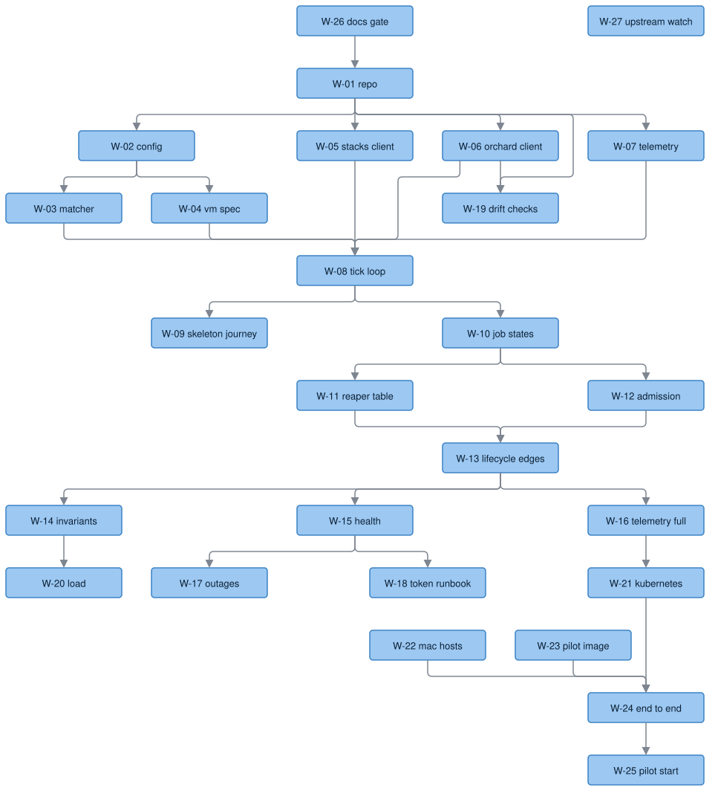

# bk-agent-stack-orchard — Implementation plan

## Related documents

* [Product requirements](../product/requirements.md): identifiers such as `PR-005`
* [System design baseline](../architecture/system-design-baseline.md): identifiers such as
  `QA-01` and `SC-03`
* [Target design](../architecture/target-design.md)
* [Test strategy](../quality/test-strategy.md): risks `R-01` to `R-22`, invariants `I-1` to
  `I-9`, and obligations `T-001` to `T-141`
* [Architecture decision records](../adrs/README.md): [ADR-0001](../adrs/0001-provision-macos-job-vms-with-a-custom-stack-controller.md) to [ADR-0020](../adrs/0020-leave-the-job-vm-images-to-the-operator.md)

## Conventions

The key words "MUST", "MUST NOT", "REQUIRED", "SHALL", "SHALL NOT", "SHOULD", "SHOULD NOT",
"RECOMMENDED", "NOT RECOMMENDED", "MAY", and "OPTIONAL" in this document are to be
interpreted as described in BCP 14 [RFC 2119] [RFC 8174] when, and only when, they appear in
all capitals, as shown here.

This document follows the [writing guide](../writing-guide.md), in the third person.

`W-nn` is a work unit. Each work unit has one observable outcome and its own completion
evidence. A work unit is complete only when its evidence passes, not when its code exists.

## 1. Purpose and scope

This plan gives the order of the work, the boundary of each work unit, and the evidence that ends
it. It does not repeat the design.

In scope: the controller, its two clients, the test harness, the release artifacts, the reference
deployment, the host provisioning, and the pilot image.

Out of scope are these items: the pipelines of the iOS application, a second region, a warm pool,
high availability, and any item in the roadmap of the target design.

One person does this work ([OP-01](../architecture/system-design-baseline.md#op-01)). Because of this, the plan has no parallel work streams for
people. It marks the work that can wait for hardware, so that the person always has work that is
not blocked.

## 2. Increments

The delivery follows the increments of the test strategy, section 2. Each increment ends with
evidence, and each increment leaves the system in a state that a person can demonstrate.

| # | Increment | Observable outcome | Evidence that ends it |
|---|---|---|---|
| 0 | Foundations | Every pull request proves that the documents stay whole, and a weekly job reports a dependency that moved | [T-121](../quality/test-strategy.md#t-121), [T-123](../quality/test-strategy.md#t-123), [T-124](../quality/test-strategy.md#t-124) |
| 1 | Walking skeleton | One job goes from `scheduled` to a deleted VM, against a synthetic Orchard and a fake Stacks server | [T-001](../quality/test-strategy.md#t-001), [T-002](../quality/test-strategy.md#t-002), [T-003](../quality/test-strategy.md#t-003), [T-004](../quality/test-strategy.md#t-004) (capacity), [T-005](../quality/test-strategy.md#t-005) (rows 2 and 4), [T-006](../quality/test-strategy.md#t-006), [T-040](../quality/test-strategy.md#t-040), [T-060](../quality/test-strategy.md#t-060), [T-120](../quality/test-strategy.md#t-120), [T-122](../quality/test-strategy.md#t-122) |
| 2 | Full lifecycle | The controller obeys the complete Reaper decision table, the admission rules, and a restart | [T-004](../quality/test-strategy.md#t-004), [T-005](../quality/test-strategy.md#t-005) (all rows), [T-007](../quality/test-strategy.md#t-007), [T-020](../quality/test-strategy.md#t-020), [T-021](../quality/test-strategy.md#t-021), [T-022](../quality/test-strategy.md#t-022), [T-023](../quality/test-strategy.md#t-023), [T-025](../quality/test-strategy.md#t-025), [T-061](../quality/test-strategy.md#t-061), [T-062](../quality/test-strategy.md#t-062) |
| 3 | Operability | An operator can see the state, replace the token, and survive an outage | [T-008](../quality/test-strategy.md#t-008), [T-009](../quality/test-strategy.md#t-009), [T-024](../quality/test-strategy.md#t-024), [T-041](../quality/test-strategy.md#t-041), [T-063](../quality/test-strategy.md#t-063), [T-064](../quality/test-strategy.md#t-064), [T-121](../quality/test-strategy.md#t-121) |
| 4 | Fleet readiness | A real job builds the iOS application in a real VM on a Mac | [T-080](../quality/test-strategy.md#t-080), [T-100](../quality/test-strategy.md#t-100) to [T-107](../quality/test-strategy.md#t-107), [T-140](../quality/test-strategy.md#t-140), [T-141](../quality/test-strategy.md#t-141) |

The skeleton contains Reaper rows 2 and 4 (test strategy, section 2). Until increment 2 is
complete, the controller MUST NOT serve the pilot queue.

## 3. Repository layout

The layout follows the components of the target design, section 4. Each component is one package
with one responsibility, so that the pure functions stay testable without a VM.

The package map is in the [development guide](../development.md#the-package-map).

`internal/buildkite` and `internal/orchard` MUST expose narrow interfaces, and all other packages
MUST depend on the interfaces only (target design, section 4). Because of this, the in-memory
fakes of [T-020](../quality/test-strategy.md#t-020) can replace both suppliers. `internal/app` wires the parts for the binary and for
[T-020](../quality/test-strategy.md#t-020) in the same way, so the suite runs the controller that ships.

### 3.1 Tool versions and tasks

`mise` pins the tool versions and runs the tasks. One `mise.toml` file gives Go, golangci-lint,
GoReleaser, and Ansible, so a developer and CI use the same versions. CI installs the tools
with the mise action, and runs the tasks of `mise run ci` as separate jobs.

The alternatives and the reason for this selection:

| Option | Tool versions | Tasks | Result |
|---|---|---|---|
| `mise` | Yes | Yes | Selected. One file gives the versions and the tasks, and it covers the tools that are not written in Go |
| `make` | No | Yes | It needs a second mechanism to pin the tool versions |
| `task` (go-task) | No | Yes | Same limit as `make`, with a better syntax |
| `just` | No | Yes | Same limit as `make` |
| Go `tool` directives in `go.mod` | Go tools only | No | The golangci-lint documentation states that `go install`, the tools pattern, and `tool` directives "aren't guaranteed to work", because the local Go version builds the tool (2026-09-19). The project also needs Ansible, which is not a Go tool |

The golangci-lint documentation gives `mise` as a local installation method (2026-09-19).

### 3.2 The fake Stacks API server

Buildkite maintains a fake: `FakeAgentServer` in `github.com/buildkite/agent-stack-k8s/v2/api`
(MIT licence, as of 2026-09-19). It is an `httptest` server that uses the real `stacksapi` types.
It records the reserve calls, the reservation expiry values, and the token requests, and it can
give a configured response, status code, or error. Buildkite tests its own controller with it.

[W-05](#w-05) MUST use this fake, and it MUST NOT contain a new fake of the same API.

[W-05](#w-05) measured the import first, and it copied the file. An import puts `k8s.io/apimachinery`,
`k8s.io/klog/v2`, `k8s.io/utils`, and `go-logr` in the module graph for one test helper. It also
asks for `stacksapi` v1.0.2, which is older than the version that this project needs. The package
carries no release tag, so an import also pins an untagged commit of a Kubernetes controller.
`test/fakestacks` therefore holds the file with its MIT notice and its provenance, and the module
graph gains only `stacksapi` and the two small libraries that it needs.

The copy carries ten changes, because the original models only the calls that its own controller
makes. Each change carries a comment in the file that starts with "Change of this project":

1. The stack key is a field. The original writes `test-stack` into every route, and the stack key
   of this controller comes from its configuration.
2. A scheduled-jobs route exists. The original models none, and [T-040](../quality/test-strategy.md#t-040) asks for an empty page.
3. A test can set the headers of an answer, which the `Retry-After` case of [T-040](../quality/test-strategy.md#t-040) needs.
4. A reserved job leaves the scheduled-jobs list and takes the state `reserved`, as the API
   states. A test that runs the controller end to end ([T-060](../quality/test-strategy.md#t-060)) needs the list to move.
5. A test can do these things while the controller runs, under the lock of the server:
   set a job state, schedule a job again as an expired reservation does ([T-021](../quality/test-strategy.md#t-021)), pause the
   queue ([T-022](../quality/test-strategy.md#t-022)), and read the calls.
6. A finish call records the exit status and the detail that it sends, which [T-062](../quality/test-strategy.md#t-062) reads.
7. A test can revoke the token while the controller runs, and every call then gets HTTP 401
   ([T-063](../quality/test-strategy.md#t-063)).
8. The routes are a handler that a test program serves itself, for the smoke deployment on
   Kubernetes ([W-21](#w-21)).
9. A reservation expires. A reserved job that no second reserve call extends returns to the
   list and to the state `scheduled` after its `reservation_expiry_seconds`, on a clock that a
   test can inject.
10. A finish call of a job that the stack does not hold answers HTTP 422.

The fake is not a conformance suite. Open item [O-1](../quality/test-strategy.md#o-1) of the test strategy stays. The fixtures of
[T-040](../quality/test-strategy.md#t-040) come from recorded responses of a real Buildkite test cluster.

## 4. Work units

### 4.0 Increment 0 — foundations

These units need no Go code, so they start first. Their identifiers follow [W-25](#w-25) because an
identifier never changes after publication. Their position in the order comes from section 5, not
from their number.

| ID | Outcome | Boundary | Depends on | Completion evidence | Requirements |
|---|---|---|---|---|---|
| W-26 | Every pull request proves that the documents stay whole | `.github/workflows/docs.yml`, `mise.toml`, `scripts/check-docs.py`, `scripts/check-commits.py`, `scripts/check-c4.sh` | — | [T-121](../quality/test-strategy.md#t-121), [T-123](../quality/test-strategy.md#t-123), and [T-124](../quality/test-strategy.md#t-124) pass in CI | [CO-04](../architecture/system-design-baseline.md#co-04) |
| W-27 | A weekly job reports an upstream release that needs an answer in the documents | `.github/workflows/upstream.yml` | — | The job opens an issue when Orchard, Tart, a new major version of the Buildkite agent, `stacksapi`, or a published macOS image moves past the version in the documents, and a draft pull request with the new version and SHA-256 when a release of the agent, the Tart guest agent, or Homebrew moves a pin of `images/build.sh` | [CO-02](../architecture/system-design-baseline.md#co-02), [CO-05](../architecture/system-design-baseline.md#co-05), [CO-06](../architecture/system-design-baseline.md#co-06) |

### 4.1 Increment 1 — walking skeleton

| ID | Outcome | Boundary | Depends on | Completion evidence | Requirements |
|---|---|---|---|---|---|
| W-01 | The repository builds, lints, and releases a snapshot image | `go.mod`, `cmd/`, `mise.toml`, `.golangci.yaml`, `.goreleaser.yaml`, `.github/workflows/ci.yml`, `.github/renovate.json5`, `scripts/check-deps.py`, `scripts/check-image.sh` | [W-26](#w-26) | [T-120](../quality/test-strategy.md#t-120) and [T-122](../quality/test-strategy.md#t-122) pass in CI | [CO-04](../architecture/system-design-baseline.md#co-04), [ADR-0005](../adrs/0005-run-and-schedule-vms-with-tart-and-orchard.md) |
| W-02 | A configuration file becomes validated types, and secrets come from the environment | `internal/config`, `internal/profile` | [W-01](#w-01) | [T-002](../quality/test-strategy.md#t-002), [T-006](../quality/test-strategy.md#t-006) | [PR-020](../product/requirements.md#pr-020), [PR-021](../product/requirements.md#pr-021), [PR-022](../product/requirements.md#pr-022) |
| W-03 | Job tags select one profile, or give a mismatch reason | `internal/match` | [W-02](#w-02) | [T-001](../quality/test-strategy.md#t-001) | [PR-003](../product/requirements.md#pr-003), [PR-004](../product/requirements.md#pr-004) |
| W-04 | A profile and a job become a valid Orchard VM specification | `internal/vmspec` | [W-02](#w-02) | [T-003](../quality/test-strategy.md#t-003), and [I-3](../quality/test-strategy.md#i-3) and [I-4](../quality/test-strategy.md#i-4) hold | [PR-030](../product/requirements.md#pr-030), [PR-001](../product/requirements.md#pr-001) |
| W-05 | The controller talks to the Stacks API, and a fake server models it | `internal/buildkite`, `test/fakestacks` (the Buildkite `FakeAgentServer`, section 3.2) | [W-01](#w-01) | [T-040](../quality/test-strategy.md#t-040) | [PR-004](../product/requirements.md#pr-004), [PR-012](../product/requirements.md#pr-012), [PR-024](../product/requirements.md#pr-024) |
| W-06 | The controller calls the Orchard REST API with its own client ([ADR-0010](../adrs/0010-call-the-orchard-api-with-a-client-of-this-project.md)) | `internal/orchard`: create, list, delete, workers, and events, with its own types | [W-01](#w-01) | The client creates, lists, and deletes a VM against `orchard dev --synthetic`, and [T-122](../quality/test-strategy.md#t-122) confirms that `go.mod` has no Orchard dependency | [PR-001](../product/requirements.md#pr-001), [PR-002](../product/requirements.md#pr-002) |
| W-07 | The process exports OTel metrics, traces, and logs | `internal/telemetry` | [W-01](#w-01) | [T-008](../quality/test-strategy.md#t-008); the trace identifier of a job is its UUID | [PR-025](../product/requirements.md#pr-025) |
| W-08 | One tick reserves a job, starts its VM, and deletes the VM when the job ends | `internal/stack`, `internal/inventory`, `internal/admission` (capacity only), `internal/launcher`, `internal/reaper` (rows 2 and 4), `internal/controller`, `cmd/` | [W-03](#w-03), [W-04](#w-04), [W-05](#w-05), [W-06](#w-06), [W-07](#w-07) | [T-004](../quality/test-strategy.md#t-004) (capacity), [T-005](../quality/test-strategy.md#t-005) (rows 2 and 4) | [PR-001](../product/requirements.md#pr-001), [PR-002](../product/requirements.md#pr-002), [PR-005](../product/requirements.md#pr-005) |
| W-09 | The skeleton journey passes in CI without a Mac | `test/integration` | [W-08](#w-08) | [T-060](../quality/test-strategy.md#t-060), and no owned VM remains at the end | [PR-001](../product/requirements.md#pr-001), [PR-002](../product/requirements.md#pr-002), [PR-009](../product/requirements.md#pr-009) |

### 4.2 Increment 2 — full lifecycle

| ID | Outcome | Boundary | Depends on | Completion evidence | Requirements |
|---|---|---|---|---|---|
| W-10 | The controller knows the Buildkite state of each owned VM, with its observation time | `internal/jobstates` | [W-05](#w-05), [W-08](#w-08) | The causal freshness rule and the stale rule of the target design, section 7.1 | [PR-002](../product/requirements.md#pr-002), [PR-010](../product/requirements.md#pr-010) |
| W-11 | The Reaper obeys all thirteen rows and their executor actions | `internal/reaper` | [W-10](#w-10) | [T-005](../quality/test-strategy.md#t-005) (all rows), [T-007](../quality/test-strategy.md#t-007), [T-025](../quality/test-strategy.md#t-025) | [PR-002](../product/requirements.md#pr-002), [PR-007](../product/requirements.md#pr-007), [PR-008](../product/requirements.md#pr-008), [PR-012](../product/requirements.md#pr-012) |
| W-12 | Admission places, orders, and limits candidates correctly | `internal/admission` | [W-10](#w-10) | [T-004](../quality/test-strategy.md#t-004), [T-061](../quality/test-strategy.md#t-061), [T-062](../quality/test-strategy.md#t-062) | [PR-004](../product/requirements.md#pr-004), [PR-005](../product/requirements.md#pr-005), [PR-006](../product/requirements.md#pr-006) |
| W-13 | A cancellation, a paused queue, and a restart change no job result | `internal/controller`, `internal/stack` | [W-11](#w-11), [W-12](#w-12) | [T-021](../quality/test-strategy.md#t-021), [T-022](../quality/test-strategy.md#t-022), [T-023](../quality/test-strategy.md#t-023) | [PR-007](../product/requirements.md#pr-007), [PR-010](../product/requirements.md#pr-010), [PR-011](../product/requirements.md#pr-011) |
| W-14 | Random event sequences hold the invariants | `test/` component suite with in-memory fakes | [W-13](#w-13) | [T-020](../quality/test-strategy.md#t-020), with [I-1](../quality/test-strategy.md#i-1), [I-2](../quality/test-strategy.md#i-2), [I-5](../quality/test-strategy.md#i-5), [I-6](../quality/test-strategy.md#i-6), and [I-8](../quality/test-strategy.md#i-8) | [PR-001](../product/requirements.md#pr-001), [PR-005](../product/requirements.md#pr-005), [PR-008](../product/requirements.md#pr-008) |

### 4.3 Increment 3 — operability

| ID | Outcome | Boundary | Depends on | Completion evidence | Requirements |
|---|---|---|---|---|---|
| W-15 | An operator sees readiness, liveness, and the freshness of each source | `internal/health`, `internal/controller` | [W-13](#w-13) | [T-063](../quality/test-strategy.md#t-063); readiness fails when a source is older than `stateFreshness` or the API returns HTTP 401 | [PR-024](../product/requirements.md#pr-024), [PR-023](../product/requirements.md#pr-023) |
| W-16 | The telemetry proves the quality targets, and the job page shows each step | `internal/telemetry`, `internal/launcher`, `internal/reaper` | [W-13](#w-13) | [T-008](../quality/test-strategy.md#t-008), [T-009](../quality/test-strategy.md#t-009); every metric of the target design, section 10.1 exists | [PR-009](../product/requirements.md#pr-009), [PR-024](../product/requirements.md#pr-024), [PR-025](../product/requirements.md#pr-025) |
| W-17 | An outage or a rate limit degrades the controller safely | `internal/controller`, both clients | [W-15](#w-15) | [T-024](../quality/test-strategy.md#t-024); the controller obeys `Retry-After` | [PR-010](../product/requirements.md#pr-010), [QA-03](../architecture/system-design-baseline.md#qa-03) |
| W-18 | The token replacement procedure works, and a runbook describes it | `docs/user/runbooks/`, `internal/health` | [W-15](#w-15) | The procedure of the target design, section 9.2 passes against a test cluster | [PR-023](../product/requirements.md#pr-023) |
| W-19 | CI detects dependency and model drift | CI workflows | [W-01](#w-01), [W-06](#w-06) | [T-041](../quality/test-strategy.md#t-041), [T-064](../quality/test-strategy.md#t-064), [T-121](../quality/test-strategy.md#t-121) | [CO-02](../architecture/system-design-baseline.md#co-02), [CO-06](../architecture/system-design-baseline.md#co-06) |
| W-20 | The load test measures the target scale | `test/integration/load_test.go` | [W-14](#w-14) | [T-080](../quality/test-strategy.md#t-080) runs nightly and reports | [SC-05](../architecture/system-design-baseline.md#sc-05), [CO-01](../architecture/system-design-baseline.md#co-01) |

### 4.4 Increment 4 — fleet readiness

| ID | Outcome | Boundary | Depends on | Completion evidence | Requirements |
|---|---|---|---|---|---|
| W-21 | The controller and Orchard run on Kubernetes from a chart | `deploy/helm`, `deploy/orchard` | [W-16](#w-16) | A smoke deployment starts, becomes ready, and exports telemetry | [PR-022](../product/requirements.md#pr-022), [OP-04](../architecture/system-design-baseline.md#op-04) |
| W-22 | A Mac host runs an Orchard worker with the correct macOS version | `deploy/hosts` | — (hardware) | A worker registers, and a VM of the pilot image starts on it | [SC-04](../architecture/system-design-baseline.md#sc-04), [CO-07](../architecture/system-design-baseline.md#co-07) |
| W-23 | The pilot image exists in the registry | `images/` | — (can start before the hosts arrive) | The image has macOS 27, Xcode 27, `buildkite-agent` v4, the Tart guest agent, and the environment hook (Homebrew `PATH`, locale, optional owner storage) | [PR-026](../product/requirements.md#pr-026), [PR-032](../product/requirements.md#pr-032) |
| W-24 | Real jobs pass the end-to-end scenarios on one Mac | `test/e2e` pipeline definitions | [W-21](#w-21), [W-22](#w-22), [W-23](#w-23) | [T-100](../quality/test-strategy.md#t-100) to [T-105](../quality/test-strategy.md#t-105) | [PR-001](../product/requirements.md#pr-001), [PR-008](../product/requirements.md#pr-008), [PR-023](../product/requirements.md#pr-023), [PR-030](../product/requirements.md#pr-030), [PR-032](../product/requirements.md#pr-032), [PR-033](../product/requirements.md#pr-033) |
| W-25 | The pilot starts with the correct queue, token, and alerts | Buildkite configuration, alert rules | [W-24](#w-24) | [T-140](../quality/test-strategy.md#t-140), [T-141](../quality/test-strategy.md#t-141); the alert conditions of the target design, section 10.6 are active | [PR-031](../product/requirements.md#pr-031), [PR-033](../product/requirements.md#pr-033), [SE-03](../architecture/system-design-baseline.md#se-03) |

**Scope of increment 4 (owner decision, 2026-11-03).**

* [W-23](#w-23) is out of scope. The project publishes no VM image ([ADR-0020](../adrs/0020-leave-the-job-vm-images-to-the-operator.md)). An operator builds an image
  of its own to the image requirements of the target design, section 5, and the image rules of
  section 9.2. `images/build.sh` is a reference build of such an image. The quick start uses an
  upstream Tart image for evaluation only.
* [W-25](#w-25) is out of scope. The operator of a fleet starts its own pilot, with its own queue, token,
  and alerts. The runbooks and the alert conditions of the target design support that work.
* [W-22](#w-22) and [W-24](#w-24) are complete. The release gate of 2026-11-02 and 2026-11-03 ran [T-100](../quality/test-strategy.md#t-100) to [T-105](../quality/test-strategy.md#t-105)
  on one Mac, with an Orchard worker on macOS 27.2 and job VMs of macOS 27.2 from the reference
  build.

## 5. Order and critical path

The diagram shows each work unit as a node, with an arrow from each unit to the units that depend
on it. The "Depends on" column of the tables in section 4 gives each dependency as text.

The critical path is [W-26](#w-26), [W-01](#w-01), [W-02](#w-02), [W-04](#w-04), [W-08](#w-08), [W-10](#w-10), [W-11](#w-11), [W-13](#w-13), [W-16](#w-16), [W-21](#w-21), [W-24](#w-24).
[W-25](#w-25) is out of scope (section 4.4). [W-27](#w-27) is on no path, and it runs on a schedule after it exists.

[W-22](#w-22) and [W-23](#w-23) are not on the software path. The owner decided on 2026-09-20 that neither one
starts early. The hosts are not necessary for increments 0 to 3. The pilot image blocks no
software work until [W-24](#w-24). [W-23](#w-23) therefore runs last.

This has one consequence to watch. [W-24](#w-24) needs an image that contains `buildkite-agent` v4 and the
Tart guest agent. The end-to-end evidence therefore waits for [W-23](#w-23). This evidence includes the
only proof that the guest-agent transport starts an agent (open item [O-2](../quality/test-strategy.md#o-2)). If the wait becomes a
problem, a smaller step is possible. This step is an image with the agent and the guest agent but
no Xcode. The end-to-end scenarios other than the iOS build can use this image.

## 6. Estimates

These are ranges for one person, in working days. They are not commitments. The assumptions are:
familiar Go, no interruption for other work, and no new decision during the increment.

| Increment | Work units | Range | Main uncertainty |
|---|---|---|---|
| 0 | [W-26](#w-26) and [W-27](#w-27) | 1 to 2 days | The checks of the document integrity script |
| 1 | [W-01](#w-01) to [W-09](#w-09) | 5 to 8 days | The fidelity of the fake Stacks server ([O-1](../quality/test-strategy.md#o-1)) |
| 2 | [W-10](#w-10) to [W-14](#w-14) | 6 to 10 days | The thirteen decision rows and their property tests |
| 3 | [W-15](#w-15) to [W-20](#w-20) | 4 to 7 days | The outage matrix and the load harness |
| 4 | [W-21](#w-21) to [W-25](#w-25) | 5 to 9 days, and machine time for the image | Hardware, the image build, and the first real VM |

The plan keeps to these dates:

* The date at which the Mac hosts are ready is `UNKNOWN`. [W-22](#w-22) cannot start before they arrive.
* The pilot start date is `UNKNOWN`.
* The earliest pilot exit date is `UNKNOWN`. The pilot exit criteria need two weeks of measurement
  ([QA-04](../architecture/system-design-baseline.md#qa-04)).

The maintainers own these dates (checked 2026-11-01). The date of host readiness becomes
known when the Mac hosts are ready. The pilot dates become known when a Buildkite test cluster and
the Mac hosts are ready. The plan of 2026-09-14 had three estimates. The hosts ship on
2026-09-22 ([SC-04](../architecture/system-design-baseline.md#sc-04)). The pilot starts about 2026-10-14 ([SC-03](../architecture/system-design-baseline.md#sc-03)). The earliest exit is about
2026-10-28.

Each work unit carries a day estimate and a size in the GitHub project of the maintainers. The
estimates of an increment sum inside its range above. The project holds the value for each unit.
This document holds the range for each increment. A change to one unit therefore does not need a
change to this document.

The sum of the ranges is 21 to 36 working days. This estimate covers the work units only. It
holds for the lower range when no increment needs a new decision. [W-23](#w-23) runs last, as section 5
states, so the estimate does not depend on an early image build. The pilot entry date is `UNKNOWN`
(checked 2026-11-01). The maintainers own the date. It becomes known when a Buildkite
test cluster and the Mac hosts are ready. The plan of 2026-09-14 expected the pilot entry in the
second half of October 2026.

## 7. Verification

Each work unit names its evidence in section 4. These rules apply to all units:

* Development MUST use TDD. Each change of behaviour starts with a failing test (target design,
  section 12).
* A work unit is complete when its evidence passes in CI, not when the code compiles.
* The integration checks between units are [T-060](../quality/test-strategy.md#t-060) (increment 1), [T-020](../quality/test-strategy.md#t-020) (increment 2), [T-024](../quality/test-strategy.md#t-024)
  (increment 3), and [T-100](../quality/test-strategy.md#t-100) (increment 4). A unit that passes alone but fails its integration check
  is not complete.
* The gates of the test strategy, section 8 hold for every merge and every release.

Requirement coverage: [PR-001](../product/requirements.md#pr-001) to [PR-012](../product/requirements.md#pr-012) map to [W-03](#w-03), [W-04](#w-04), [W-08](#w-08) to [W-14](#w-14), and [W-16](#w-16). [PR-020](../product/requirements.md#pr-020) to
[PR-026](../product/requirements.md#pr-026) map to [W-02](#w-02), [W-07](#w-07), [W-15](#w-15), [W-16](#w-16), [W-22](#w-22), and [W-23](#w-23). [PR-030](../product/requirements.md#pr-030) to [PR-033](../product/requirements.md#pr-033) map to [W-04](#w-04), [W-23](#w-23),
[W-24](#w-24), and [W-25](#w-25). No requirement has no unit.

## 8. Risks to the plan, and recovery

| ID | Risk | Effect on the plan | Response |
|---|---|---|---|
| D-1 | The guest-agent transport fails on the first real VM ([O-2](../quality/test-strategy.md#o-2)) | [W-24](#w-24) stops | Set `startupTransport: ssh` on the pilot profile, and restore the VM credentials. [ADR-0009](../adrs/0009-run-startup-scripts-over-the-tart-guest-agent.md) permits this per profile. The transport then needs a new experiment, not a design change |
| D-2 | The fake Stacks server does not model the real API ([O-1](../quality/test-strategy.md#o-1)) | The evidence of increments 1 and 2 is weaker than it looks | Record the responses of a Buildkite test cluster early in [W-05](#w-05), and use them as fixtures |
| D-3 | A macOS 27 guest needs a macOS 27 host ([O-4](../quality/test-strategy.md#o-4)), and the hosts arrive with an older version | [W-22](#w-22) and [W-24](#w-24) stop | Test the assumption on the development Mac before the hosts arrive. If it holds, update the hosts before the worker installation |
| D-4 | The hosts are ready later than increments 1 to 3 finish | [W-22](#w-22), [W-24](#w-24), and the pilot move | Increments 1 to 3 continue, and [W-23](#w-23) follows them (section 5). Only [W-22](#w-22) and [W-24](#w-24) wait |
| D-5 | The image build takes longer than expected, or the host storage holds fewer images than the fleet needs ([SC-09](../architecture/system-design-baseline.md#sc-09)) | [W-23](#w-23) and the pilot profile change | Build one profile only for the pilot. Measure the image count for each host, which is evidence [E-4](../quality/test-strategy.md#e-4) |
| D-6 | An Orchard release changes the VM specification or a role | [W-06](#w-06), [W-19](#w-19), and the deployment change | [T-064](../quality/test-strategy.md#t-064) detects this at the gate. Hold the pinned version, and open an ADR review |
| D-7 | The demand model is wrong, so the fleet size is wrong ([SC-05](../architecture/system-design-baseline.md#sc-05)) | The pilot capacity plan changes, not the software | Pilot telemetry replaces the model. The plan needs no change |

## 9. Irreversible steps and external boundaries

* A published container tag and a published Git tag are not reversible. The plan corrects a bad
  release with a new version, not with a deletion.
* The creation and the revocation of a Buildkite cluster agent token affect the live cluster. Only
  [W-18](#w-18) and [W-25](#w-25) touch tokens, and the token replacement procedure controls the order.
* The deletion of a VM ends a running job. Only the Reaper deletes VMs, and rule 5 of the target
  design, section 7.1 protects a job that an agent acquired.
* The host provisioning changes a physical Mac. [W-22](#w-22) MUST use one host first, and the fleet
  operator MUST record the steps in `deploy/hosts` before the second host.
* No step of this plan sends owner source code to a third party.

## 10. What invalidates this plan

* A change to the Reaper decision table changes [W-11](#w-11) and [T-005](../quality/test-strategy.md#t-005).
* A change to the transport decision ([ADR-0009](../adrs/0009-run-startup-scripts-over-the-tart-guest-agent.md)) changes [W-04](#w-04), [W-23](#w-23), and [T-100](../quality/test-strategy.md#t-100).
* A new Orchard or Buildkite agent release line changes [W-06](#w-06), [W-19](#w-19), and [W-23](#w-23).
* A change to the queue decision ([ADR-0007](../adrs/0007-use-a-dedicated-queue-for-the-macos-fleet.md)) changes [W-25](#w-25).
* A change to the licence of this project, or to the Orchard licence, changes [ADR-0010](../adrs/0010-call-the-orchard-api-with-a-client-of-this-project.md), [W-06](#w-06), and
  [T-122](../quality/test-strategy.md#t-122).
* A pilot measurement that fails [QA-01](../architecture/system-design-baseline.md#qa-01) or [QA-02](../architecture/system-design-baseline.md#qa-02) opens the warm-pool decision ([ADR-0003](../adrs/0003-start-job-vms-on-demand.md)), which
  adds a work unit that this plan does not contain.
