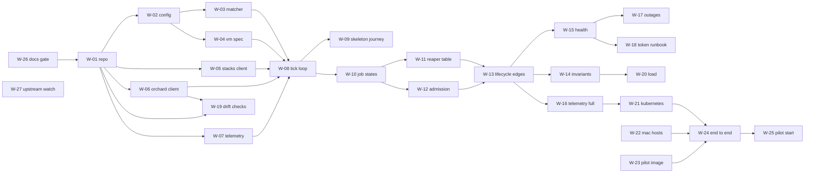

# bk-agent-stack-orchard — Implementation plan

* Status: accepted
* Date: 2026-09-19
* Approved: 2026-09-20
* Owner: Josh Wright
* Related documents:
  * [Product requirements](../product/requirements.md): identifiers such as `PR-005`
  * [System design baseline](../architecture/system-design-baseline.md): identifiers such as
    `QA-01` and `SC-03`
  * [Target design](../architecture/target-design.md)
  * [Test strategy](../quality/test-strategy.md): risks `R-01` to `R-20`, invariants `I-1` to
    `I-8`, and obligations `T-001` to `T-141`
  * [Architecture decision records](../adrs/README.md): ADR-0001 to ADR-0009

## Conventions

The key words "MUST", "MUST NOT", "REQUIRED", "SHALL", "SHALL NOT", "SHOULD", "SHOULD NOT",
"RECOMMENDED", "NOT RECOMMENDED", "MAY", and "OPTIONAL" in this document are to be
interpreted as described in BCP 14 [RFC 2119] [RFC 8174] when, and only when, they appear in
all capitals, as shown here.

This document uses ASD-STE100 Simplified Technical English and the third person.

`W-nn` is a work unit. Each work unit has one observable outcome and its own completion
evidence. A work unit is complete only when its evidence passes, not when its code exists.

## 1. Purpose and scope

This plan gives the order of the work, the boundary of each work unit, and the evidence that ends
it. It does not repeat the design.

In scope: the controller, its two clients, the test harness, the release artifacts, the reference
deployment, the host provisioning, and the pilot image.

Out of scope: the pipelines of the iOS application, a second region, a warm pool, high
availability, and any item in the roadmap of the target design.

One person does this work (OP-01). Because of this, the plan has no parallel work streams for
people. It marks the work that can wait for hardware, so that the person always has work that is
not blocked.

## 2. Increments

The delivery follows the increments of the test strategy, section 2. Each increment ends with
evidence, and each increment leaves the system in a state that a person can demonstrate.

| # | Increment | Observable outcome | Evidence that ends it |
|---|---|---|---|
| 0 | Foundations | Every pull request proves that the documents stay whole, and a weekly job reports a dependency that moved | T-121, T-123, T-124 |
| 1 | Walking skeleton | One job goes from `scheduled` to a deleted VM, against a synthetic Orchard and a fake Stacks server | T-001, T-002, T-003, T-004 (capacity), T-005 (rows 2 and 4), T-006, T-040, T-060, T-120, T-122 |
| 2 | Full lifecycle | The controller obeys the complete Reaper decision table, the admission rules, and a restart | T-004, T-005 (all rows), T-007, T-020, T-021, T-022, T-023, T-025, T-061, T-062 |
| 3 | Operability | An operator can see the state, replace the token, and survive an outage | T-008, T-009, T-024, T-041, T-063, T-064, T-121 |
| 4 | Fleet readiness | A real job builds the iOS application in a real VM on a Mac | T-080, T-100 to T-106, T-140, T-141 |

The skeleton contains Reaper rows 2 and 4 (test strategy, section 2). Until increment 2 is
complete, the controller MUST NOT serve the pilot queue.

## 3. Repository layout

The layout follows the components of the target design, section 4. Each component is one package
with one responsibility, so that the pure functions stay testable without a VM.

```
cmd/bk-agent-stack-orchard/     process entry point, flags, signal handling
internal/config/                configuration types, loading, and validation
internal/profile/               profiles, the match map, and the VM size
internal/match/                 Matcher: job tags to one profile (pure)
internal/admission/             Admission: candidates, capacity, order (pure)
internal/reaper/                Reaper: the decision table (pure) and its executor
internal/vmspec/                the Orchard VM specification builder and the VM name
internal/buildkite/             the Stacks interface, its client, and its errors
internal/orchard/               the Orchard interface, this project's REST client (ADR-0010)
internal/inventory/             worker and VM inventory with freshness
internal/jobstates/             batched job states with observation times
internal/launcher/              reserve, issue tokens, create VMs, notify
internal/stack/                 stack registration and the paused value
internal/controller/            the tick loop that wires the components
internal/telemetry/             OTel meter, tracer, and the slog bridge
internal/health/                /livez and /readyz
test/fakestacks/                the fake Stacks API server
test/integration/               tests against orchard dev --synthetic
test/load/                      the nightly load test
deploy/helm/                    the controller chart
deploy/orchard/                 the Orchard StatefulSet and its bootstrap job
deploy/hosts/                   Ansible for the Mac hosts
images/                         the Packer configuration of the pilot image
```

`internal/buildkite` and `internal/orchard` MUST expose narrow interfaces, and all other packages
MUST depend on the interfaces only (target design, section 4). Because of this, the in-memory
fakes of T-020 can replace both suppliers.

### 3.1 Tool versions and tasks

`mise` pins the tool versions and runs the tasks. One `mise.toml` file gives Go, golangci-lint,
GoReleaser, Packer, and Ansible, so a developer and CI use the same versions. CI runs `mise
install` and then `mise run check`.

The alternatives and the reason for this selection:

| Option | Tool versions | Tasks | Result |
|---|---|---|---|
| `mise` | Yes | Yes | Selected. One file gives the versions and the tasks, and it covers the tools that are not written in Go |
| `make` | No | Yes | A second mechanism must pin the tool versions |
| `task` (go-task) | No | Yes | Same limit as `make`, with a better syntax |
| `just` | No | Yes | Same limit as `make` |
| Go `tool` directives in `go.mod` | Go tools only | No | The golangci-lint documentation states that `go install`, the tools pattern, and `tool` directives "aren't guaranteed to work", because the local Go version builds the tool (2026-09-19). The project also needs Packer and Ansible, which are not Go tools |

The golangci-lint documentation gives `mise` as a local installation method (2026-09-19).

### 3.2 The fake Stacks API server

Buildkite maintains a fake: `FakeAgentServer` in `github.com/buildkite/agent-stack-k8s/v2/api`
(MIT licence, as of 2026-09-19). It is an `httptest` server that uses the real `stacksapi` types.
It records the reserve calls, the reservation expiry values, and the token requests, and it can
give a configured response, status code, or error. Buildkite tests its own controller with it.

W-05 MUST use this fake, and it MUST NOT contain a new fake of the same API. The unit of work
first imports the package. If the module graph of `agent-stack-k8s` (a Kubernetes controller) puts
a cost on the build, W-05 copies `fake_agent_server.go` into `test/fakestacks` with the MIT notice.
The copy is permitted, and the file has approximately 300 lines.

The fake is not a conformance suite. Open item O-1 of the test strategy stays: the fixtures of
T-040 come from recorded responses of a real Buildkite test cluster.

## 4. Work units

### 4.0 Increment 0 — foundations

These units need no Go code, so they start first. Their identifiers follow W-25 because an
identifier never changes after publication. Their position in the order comes from section 5, not
from their number.

| ID | Outcome | Boundary | Depends on | Completion evidence | Requirements |
|---|---|---|---|---|---|
| W-26 | Every pull request proves that the documents stay whole | `.github/workflows/docs.yml`, `scripts/check-docs.sh` | — | T-121, T-123, and T-124 pass in CI | CO-04 |
| W-27 | A weekly job reports an upstream release that the documents must answer | `.github/workflows/upstream.yml` | — | The job opens an issue when Orchard, Tart, the Buildkite agent, `stacksapi`, or a published macOS image moves past the version in the documents | CO-02, CO-05, CO-06 |

### 4.1 Increment 1 — walking skeleton

| ID | Outcome | Boundary | Depends on | Completion evidence | Requirements |
|---|---|---|---|---|---|
| W-01 | The repository builds, lints, and releases a snapshot image, and it holds the commit rules | `go.mod`, `mise.toml`, `.golangci.yaml`, `.goreleaser.yaml`, `.conform.yaml`, CI workflow | W-26 | T-120, T-122, and T-123 pass in CI, through `mise run check` | CO-04, ADR-0005 |
| W-02 | A configuration file becomes validated types, and secrets come from the environment | `internal/config`, `internal/profile` | W-01 | T-002, T-006 | PR-020, PR-021, PR-022 |
| W-03 | Job tags select one profile, or give a mismatch reason | `internal/match` | W-02 | T-001 | PR-003, PR-004 |
| W-04 | A profile and a job become a valid Orchard VM specification | `internal/vmspec` | W-02 | T-003, and I-3 and I-4 hold | PR-030, PR-001 |
| W-05 | The controller talks to the Stacks API, and a fake server models it | `internal/buildkite`, `test/fakestacks` (the Buildkite `FakeAgentServer`, section 3.2) | W-01 | T-040 | PR-004, PR-012, PR-024 |
| W-06 | The controller calls the Orchard REST API with its own client (ADR-0010) | `internal/orchard`: create, list, delete, workers, and events, with its own types | W-01 | The client creates, lists, and deletes a VM against `orchard dev --synthetic`, and T-122 confirms that `go.mod` has no Orchard dependency | PR-001, PR-002 |
| W-07 | The process exports OTel metrics, traces, and logs | `internal/telemetry` | W-01 | T-008; the trace identifier of a job is its UUID | PR-025 |
| W-08 | One tick reserves a job, starts its VM, and deletes the VM when the job ends | `internal/stack`, `internal/inventory`, `internal/admission` (capacity only), `internal/launcher`, `internal/reaper` (rows 2 and 4), `internal/controller`, `cmd/` | W-03, W-04, W-05, W-06, W-07 | T-004 (capacity), T-005 (rows 2 and 4) | PR-001, PR-002, PR-005 |
| W-09 | The skeleton journey passes in CI without a Mac | `test/integration` | W-08 | T-060, and no owned VM remains at the end | PR-001, PR-002, PR-009 |

### 4.2 Increment 2 — full lifecycle

| ID | Outcome | Boundary | Depends on | Completion evidence | Requirements |
|---|---|---|---|---|---|
| W-10 | The controller knows the Buildkite state of each owned VM, with its observation time | `internal/jobstates` | W-05, W-08 | The causal freshness rule and the stale rule of the target design, section 7.1 | PR-002, PR-010 |
| W-11 | The Reaper obeys all thirteen rows and their executor actions | `internal/reaper` | W-10 | T-005 (all rows), T-007, T-025 | PR-002, PR-007, PR-008, PR-012 |
| W-12 | Admission places, orders, and limits candidates correctly | `internal/admission` | W-10 | T-004, T-061, T-062 | PR-004, PR-005, PR-006 |
| W-13 | A cancellation, a paused queue, and a restart change no job result | `internal/controller`, `internal/stack` | W-11, W-12 | T-021, T-022, T-023 | PR-007, PR-010, PR-011 |
| W-14 | Random event sequences hold the invariants | `test/` component suite with in-memory fakes | W-13 | T-020, with I-1, I-2, I-5, I-6, and I-8 | PR-001, PR-005, PR-008 |

### 4.3 Increment 3 — operability

| ID | Outcome | Boundary | Depends on | Completion evidence | Requirements |
|---|---|---|---|---|---|
| W-15 | An operator sees readiness, liveness, and the freshness of each source | `internal/health`, `internal/controller` | W-13 | T-063; `/readyz` fails when a source is older than 30 s or the API returns HTTP 401 | PR-024, PR-023 |
| W-16 | The telemetry proves the quality targets, and the job page shows each step | `internal/telemetry`, `internal/launcher`, `internal/reaper` | W-13 | T-008, T-009; every metric of the target design, section 10.1 exists | PR-009, PR-024, PR-025 |
| W-17 | An outage or a rate limit degrades the controller safely | `internal/controller`, both clients | W-15 | T-024; the controller obeys `Retry-After` | PR-010, QA-03 |
| W-18 | The token replacement procedure works, and a runbook describes it | `docs/runbooks/`, `internal/health` | W-15 | The procedure of the target design, section 9.2 passes against a test cluster | PR-023 |
| W-19 | CI detects dependency and model drift | CI workflows | W-01, W-06 | T-041, T-064, T-121 | CO-02, CO-06 |
| W-20 | The load test measures the target scale | `test/load` | W-14 | T-080 runs nightly and reports | SC-05, CO-01 |

### 4.4 Increment 4 — fleet readiness

| ID | Outcome | Boundary | Depends on | Completion evidence | Requirements |
|---|---|---|---|---|---|
| W-21 | The controller and Orchard run on Kubernetes from a chart | `deploy/helm`, `deploy/orchard` | W-16 | A smoke deployment starts, becomes ready, and exports telemetry | PR-022, OP-04 |
| W-22 | A Mac host runs an Orchard worker with the correct macOS version | `deploy/hosts` | — (hardware) | A worker registers, and a VM of the pilot image starts on it | SC-04, CO-07 |
| W-23 | The pilot image exists in the registry | `images/` | — (can start before the hosts arrive) | The image has macOS 27, Xcode 27, `buildkite-agent` v4, the Tart guest agent, and the artifact hook | PR-026, PR-032 |
| W-24 | Real jobs pass the end-to-end scenarios on one Mac | `test/e2e` pipeline definitions | W-21, W-22, W-23 | T-100 to T-105 | PR-001, PR-008, PR-023, PR-030, PR-032, PR-033 |
| W-25 | The pilot starts with the correct queue, token, and alerts | Buildkite configuration, alert rules | W-24 | T-140, T-141; the alert conditions of the target design, section 10.6 are active | PR-031, PR-033, SE-03 |

## 5. Order and critical path



The critical path is W-26, W-01, W-02, W-04, W-08, W-10, W-11, W-13, W-16, W-21, W-24, W-25.
W-27 is on no path, and it runs on a schedule after it exists.

W-22 and W-23 are not on the software path, and the owner decided on 2026-09-20 that neither one
starts early: the hosts are not necessary for increments 0 to 3, and the pilot image blocks no
software work until W-24. W-23 therefore runs last.

This has one consequence to watch. W-24 needs an image that contains `buildkite-agent` v4 and the
Tart guest agent, so the end-to-end evidence, and with it the only proof that the guest-agent
transport starts an agent (open item O-2), waits for W-23. If that wait becomes a problem, the
smaller step is an image with the agent and the guest agent but no Xcode, which the end-to-end
scenarios other than the iOS build can use.

## 6. Estimates

These are ranges for one person, in working days. They are not commitments. The assumptions are:
familiar Go, no interruption for other work, and no new decision during the increment.

| Increment | Work units | Range | Main uncertainty |
|---|---|---|---|
| 0 | W-26 and W-27 | 1 to 2 days | The checks that the document integrity script must make |
| 1 | W-01 to W-09 | 5 to 8 days | The fidelity of the fake Stacks server (O-1) |
| 2 | W-10 to W-14 | 6 to 10 days | The thirteen decision rows and their property tests |
| 3 | W-15 to W-20 | 4 to 7 days | The outage matrix and the load harness |
| 4 | W-21 to W-25 | 5 to 9 days, and machine time for the image | Hardware, the image build, and the first real VM |

Dates that the plan must respect:

* The Mac hosts ship on 2026-09-22 (SC-04). W-22 cannot start before they arrive.
* The pilot starts approximately one month after 2026-09-14 (SC-03), so about 2026-10-14.
* The pilot exit criteria need two weeks of measurement (QA-04), so the earliest exit is about
  2026-10-28.

Each work unit carries a day estimate and a size in the
[project](https://github.com/users/joshwrightcodes/projects/1). The estimates of an increment sum
inside its range above. The project holds the value for each unit, and this document holds the
range for each increment, so a change to one unit does not need a change to this document.

The sum of the ranges is 21 to 36 working days. The lower range meets the pilot date only if the
image build (W-23) starts before the hosts arrive, and if no increment needs a new decision. The
owner SHOULD expect the pilot entry in the second half of October 2026.

## 7. Verification

Each work unit names its evidence in section 4. These rules apply to all units:

* Development MUST use TDD. Each change of behaviour starts with a failing test (target design,
  section 12).
* A work unit is complete when its evidence passes in CI, not when the code compiles.
* The integration checks between units are T-060 (increment 1), T-020 (increment 2), T-024
  (increment 3), and T-100 (increment 4). A unit that passes alone but fails its integration check
  is not complete.
* The gates of the test strategy, section 8 hold for every merge and every release.

Requirement coverage: PR-001 to PR-012 map to W-03, W-04, W-08 to W-14, and W-16. PR-020 to
PR-026 map to W-02, W-07, W-15, W-16, W-22, and W-23. PR-030 to PR-033 map to W-04, W-23, W-24,
and W-25. No requirement has no unit.

## 8. Risks to the plan, and recovery

| ID | Risk | Effect on the plan | Response |
|---|---|---|---|
| D-1 | The guest-agent transport fails on the first real VM (O-2) | W-24 stops | Set `startupTransport: ssh` on the pilot profile, and restore the VM credentials. ADR-0009 permits this per profile. The transport then needs a new experiment, not a design change |
| D-2 | The fake Stacks server does not model the real API (O-1) | Increment 1 and 2 evidence is weaker than it looks | Record the responses of a Buildkite test cluster early in W-05, and use them as fixtures |
| D-3 | A macOS 27 guest needs a macOS 27 host (O-4), and the hosts arrive with an older version | W-22 and W-24 stop | Test the assumption on the development Mac before 2026-09-22. If it holds, update the hosts before the worker installation |
| D-4 | The hosts arrive later than 2026-09-22 | W-22, W-24, and the pilot move | Increments 1 to 3 and W-23 continue. Only W-22 and W-24 wait |
| D-5 | The image build takes longer than expected, or the host storage holds fewer images than the fleet needs (SC-09) | W-23 and the pilot profile change | Build one profile only for the pilot. Measure the image count for each host, which is evidence E-4 |
| D-6 | An Orchard release changes the VM specification or a role | W-06, W-19, and the deployment change | T-064 detects this at the gate. Hold the pinned version, and open an ADR review |
| D-7 | The demand model is wrong, so the fleet size is wrong (SC-05) | The pilot capacity plan changes, not the software | Pilot telemetry replaces the model. The plan needs no change |

## 9. Irreversible steps and external boundaries

* A published container tag and a published Git tag are not reversible. The plan corrects a bad
  release with a new version, not with a deletion.
* The creation and the revocation of a Buildkite cluster agent token affect the live cluster. Only
  W-18 and W-25 touch tokens, and the token replacement procedure controls the order.
* The deletion of a VM ends a running job. Only the Reaper deletes VMs, and rule 5 of the target
  design, section 7.1 protects a job that an agent acquired.
* The host provisioning changes a physical Mac. W-22 MUST use one host first, and the fleet
  operator MUST record the steps in `deploy/hosts` before the second host.
* No step of this plan sends owner source code to a third party.

## 10. What invalidates this plan

* A change to the Reaper decision table changes W-11 and T-005.
* A change to the transport decision (ADR-0009) changes W-04, W-23, and T-100.
* A new Orchard or Buildkite agent release line changes W-06, W-19, and W-23.
* A change to the queue decision (ADR-0007) changes W-25.
* A change to the licence of this project, or to the Orchard licence, changes ADR-0010, W-06, and
  T-122.
* A pilot measurement that fails QA-01 or QA-02 opens the warm-pool decision (ADR-0003), which
  adds a work unit that this plan does not contain.
