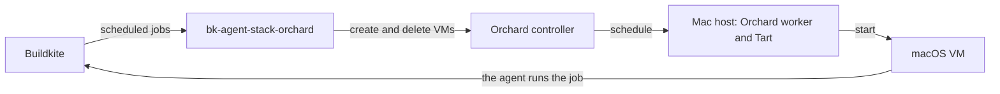

# How it works

This page explains what the controller does with each job, and why. To try it, follow the
[quick start](quickstart.md). To set it up, read [Install the controller](install.md).

## The parts



* **Buildkite** holds the jobs. The controller serves one self-hosted queue of a cluster, with a
  cluster agent token.
* **The controller** is one process. It decides which job gets a VM, and when a VM goes.
* **Orchard** places each VM on a Mac host. Each host runs an Orchard worker and Tart.
* **Each VM** is a fresh clone of a Tart image. It runs one job, then the controller deletes it.

## The life of a job

1. **Scheduled.** A pipeline asks for an agent on the queue. The controller reads the scheduled
   jobs of the queue every second.
2. **Matched.** The controller compares the tags of the job, without `queue`, with the `match` map
   of each profile. The profile with an equal map carries the job. A job that matches no profile
   stays in the queue for another runner, and its job page says why.
3. **Admitted.** The controller checks that a Mac host has a free VM slot for the job. If no slot
   is free, the job stays in the queue, where it is visible and another runner can take it.
4. **Reserved.** The controller reserves the job, so that no other runner takes it, and gets a
   token that opens this job only.
5. **VM created.** The controller asks Orchard for a VM, with the image and size of the profile.
   The job page says "VM requested", then "placed on" the host, then "booting".
6. **Agent started.** In the VM, a startup script names the host after the VM, downloads and checks
   `buildkite-agent` (or uses the one in the image), and starts it with the token of the job.
7. **Job runs.** The agent takes the job and runs it, as any Buildkite agent does.
8. **VM deleted.** When the job ends, the controller deletes the VM. The job page says
   "VM deleted".

On one Mac with the image in its cache, steps 5 to 7 take about 30 to 60 seconds.

## Profiles

A profile is one type of VM: its image, CPU, memory, disk, and the tags of the jobs that it carries.
A job carries its tags in `agents:` in the pipeline:

```yaml
steps:
  - command: xcodebuild test
    agents: {queue: macos, xcode: "27"}
```

This job runs on the profile with `match: {xcode: "27"}`. The match is exact: a job with the tags
`xcode: "27"` and `size: large` does not run on that profile. A profile with `match: {}` carries the
jobs that have only the `queue` tag.

The agent in each VM has the tags `queue`, `agent-stack=orchard`, `profile`, the tags of the job,
and the tags of the image, so the job page shows what the VM stands for.

## Capacity

Apple permits at most two macOS VMs on one Mac at a time, so each Mac host has two VM slots. The
controller counts the free slots of the hosts that can run a profile before it reserves a job. It
never reserves a job that has no slot, because a reserved job is hidden from other runners.

The controller does not add or remove Mac hosts. To run more jobs at once, add hosts to Orchard.

## When a VM does not start

Each phase of a start has a time limit, which a profile can change:

| Phase | Limit | What happens |
|---|---|---|
| Waiting for a host | `unplaced`, 2 min | The VM is deleted, and the job goes back to the queue. |
| Image pull, clone, and VM start | `boot`, 15 min | The job fails, and the VM is deleted. |
| macOS boot and agent start | `acquire`, 5 min | The job fails with the last lines of the startup script. |
| The whole life of a VM | `maxVMLifetime`, 25 h | The VM is deleted, whatever the job does. |

A VM that fails before its agent takes the job fails the job with the reason from Orchard and the
last lines of the startup script. After the agent takes the job, Buildkite decides the result of
the job, and the controller only deletes the VM.

## Restarts and outages

The controller keeps no state of its own. After a restart, it reads the jobs from Buildkite and the
VMs from Orchard, and carries on: it keeps a VM whose job still runs, and deletes a VM whose job
ended while it was down.

If Buildkite or Orchard does not answer, the controller stops starting VMs, and reports that it is
not ready. VMs that run keep running. When the answers come back, it carries on.

An answer about the jobs of the VMs that names none of them counts as no answer, because the
controller cannot tell it from an answer that lost its data. A job counts as unknown to Buildkite
only when two answers in a row leave it out, and only then does the controller delete its VM.

Each call to Buildkite or Orchard has a time limit of 10 seconds. An API that stops answering
therefore cannot stop the controller. While Buildkite does not answer, the controller still deletes
a VM whose name has its prefix but no job, and a VM older than `maxVMLifetime`. While Orchard does
not answer, the controller still keeps the reservations of the jobs whose VMs start. The
controller makes up to 8 calls for VMs at the same time, and it stops them at the first call that
gets no answer. In one tick it reserves at most 24 jobs, which is what it can start in that tick.
When
Buildkite or Orchard asks the controller to wait, it waits up to 30 seconds before it reads the
same data again.

## Isolation

The controller treats every build as untrusted:

* Each VM runs one job, and is deleted after it.
* The VM gets a token for its own job only. The cluster agent token and the Orchard token stay with
  the controller.
* Softnet keeps the VM away from the Mac host, from the other VMs, and from private networks,
  except the ranges that a profile allows.
* The VM has no shared folder with the host.

## What it does not do

* It serves one queue. Run one controller for each queue.
* It runs as one replica. A restart takes a few seconds, and the jobs that run keep running.
* It does not keep warm VMs. Each job waits for its VM to boot.
* It does not scale the Mac hosts.
